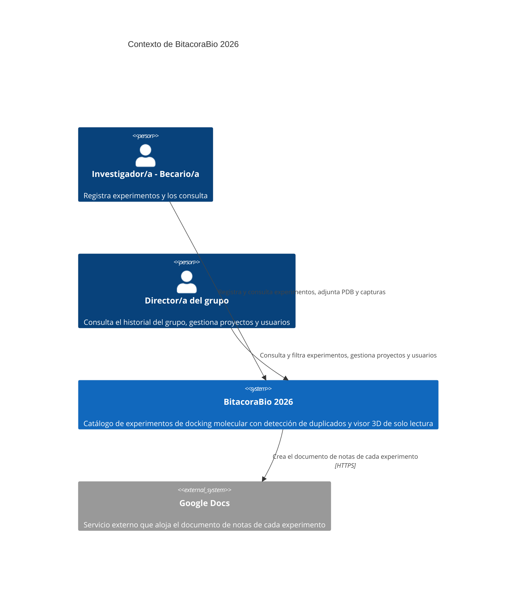
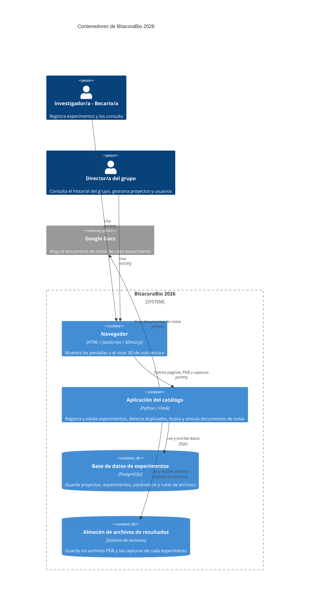

# BitacoraBio 2026 — Documento de Especificación de Arquitectura

**Materia:** Ingeniería del Software 2026 (FIUNER) · **Trabajo práctico:** TP3 — Arquitectura del Sistema
**Integrantes:** Nuñez Juliana, Segovia Lucas

---

## 1. Introducción

### 1.1 Propósito

Este documento describe la arquitectura de BitacoraBio 2026, un sistema de gestión y trazabilidad de experimentos computacionales de docking molecular para grupos de investigación. Registra las decisiones estructurales del sistema, las razones que las motivan (los atributos de calidad del TP2) y lo que cada una sacrifica, y las representa con las vistas de contenedores y de componentes del modelo C4.

### 1.2 Alcance

La arquitectura se define en profundidad para los procesos elegidos en el TP1 (`docs/requirements/srs.md`):

| Proceso (DFD nivel 1) | Casos de uso | Tratamiento |
|---|---|---|
| Proceso 1 · Registrar Experimento | CU-01 | En profundidad |
| Proceso 3 · Detectar Duplicado | CU-00 (incluido por CU-01) | En profundidad |
| Proceso 2 · Consultar y Filtrar Experimentos | CU-02 | En profundidad |
| Proceso 4 · Visualizar Pose 3D | RF-10 | Incluido en la primera versión, sin profundizar: lo resuelve la librería externa 3Dmol.js, que corre en el navegador |
| Proceso 5 · Vincular Documento de Notas | Dependencia de CU-01 (pasos 7-8, E1; RF-05 y RF-09) | Incluido en la primera versión, sin profundizar como proceso propio: se documenta como dependencia del Proceso 1 y aparece como la integración con Google Docs |
| Procesos 6, 7, 8 y 9 (gestionar proyecto, modificar estado, eliminar experimento, registrar usuario) | Sin CU propio | Caja negra |

**Nota.** Los procesos elegidos en el SRS para profundizar son el Proceso 1 (con su interacción con el Proceso 3) y el Proceso 2. Para que la primera versión del sistema tenga las funciones necesarias, la arquitectura incluye además el visor 3D (Proceso 4) y la vinculación con Google Docs (Proceso 5). Se sabe y se entiende que estas funciones no fueron profundizadas en las entregas anteriores; se consideraron necesarias para mantener el flujo y el valor del sistema.

Lo que queda fuera de lo anterior se representa como caja negra: un contenedor sin detalle interno o un sistema externo.

**Fuera del alcance de este TP:** las vistas de clases y de código y los diagramas de despliegue (se trabajan en el TP4).

### 1.3 Audiencia

Docentes de la materia y integrantes del grupo. También un integrante que se sume más adelante, que debería poder entender y corregir el sistema sin ayuda de quienes lo diseñaron (escenario EC-08, sección 4).

### 1.4 Documentos relacionados

| Documento | Ubicación | Qué aporta a este documento |
|---|---|---|
| SRS (TP1) | `docs/requirements/srs.md` | DFD, modelo de dominio, requerimientos funcionales (RF), casos de uso (CU) e historias de usuario (HU) |
| Atributos de calidad (TP2, parte A) | `docs/requirements/quality-scenarios/atributos-calidad.md` | Escenarios de calidad con identificador `EC-xx` |
| Maquetado e interfaz (TP2, parte B) | `docs/ui/` | Pantallas (mockups), perfiles de usuario y evaluación heurística |
| Registro de uso de IA | `docs/uso_ia.md` | Bitácora de uso de inteligencia artificial |

### 1.5 Convenciones

- Los escenarios de calidad se identifican como `EC-01`, `EC-02`, etc. (la numeración está en `atributos-calidad.md`).
- Las decisiones de arquitectura se identifican como `DA-01`, `DA-02`, etc. (sección 9).
- Los requerimientos, casos de uso e historias de usuario conservan los identificadores del SRS (`RF-xx`, `CU-xx`, `HU-xx`).
- Los elementos se nombran igual en todas las vistas, decisiones y tablas de trazabilidad. El idioma de todo el documento es el español.

### 1.6 Siglas

| Sigla | Significado |
|---|---|
| API | Interfaz de programación de aplicaciones: las operaciones que un programa ofrece a otros |
| C4 | Modelo de documentación de arquitectura en cuatro niveles: contexto, contenedores, componentes y código |
| CU | Caso de uso |
| DA | Decisión de arquitectura |
| DFD | Diagrama de flujo de datos |
| EC | Escenario de calidad |
| HTTPS | Protocolo de la web sobre una conexión cifrada |
| HU | Historia de usuario |
| IA | Inteligencia artificial |
| ISO/IEC 25010:2023 | Norma sobre el modelo de calidad del producto de software |
| PDB | Formato de archivo de texto que describe la estructura tridimensional de moléculas; es el archivo de resultado de cada experimento de docking |
| RF | Requerimiento funcional |
| SQL | Lenguaje para consultar y modificar bases de datos relacionales |
| SRS | Especificación de requerimientos de software (*Software Requirements Specification*) |

---

## 2. Restricciones

Las restricciones condicionan qué arquitecturas son viables. Cada una se rastrea después a las decisiones que afecta.

### 2.1 Técnicas

| Id | Restricción | Origen |
|---|---|---|
| RT-01 | El frontend se desarrolla con Flask, que entrega páginas HTML a partir de plantillas | Decisión del grupo |
| RT-02 | El backend se desarrolla en Python | Decisión del grupo |
| RT-03 | El sistema se aloja en un servidor web | Decisión del grupo |
| RT-04 | La base de datos es PostgreSQL | Decisión del grupo |
| RT-05 | Los archivos PDB y las capturas de resultado se guardan como archivos y la base guarda solo su ruta, para que la base no crezca con contenido binario | Decisión del grupo, motivada por el crecimiento del catálogo |
| RT-06 | El documento de notas de cada experimento vive en Google Docs, un servicio externo fuera del control del equipo | SRS (RF-05, RF-09) |
| RT-07 | El visor 3D es una librería externa (3Dmol.js) que corre en el navegador y es de solo lectura | SRS (RF-10) |

### 2.2 De equipo y de tiempo

| Id | Restricción | Origen |
|---|---|---|
| RE-01 | El equipo son dos personas | Grupo |
| RE-02 | El tiempo disponible es un cuatrimestre, con ciclo de vida incremental e iterativo | README del proyecto |
| RE-03 | El grupo desarrolla en Python y Flask: la arquitectura debe apoyarse en lo que el equipo ya usa | Decisión del grupo |
| RE-04 | El alcance se mantiene acotado a lo esencial para demostrar el valor del sistema: una arquitectura con pocas piezas que operar | Grupo |

### 2.3 De alcance funcional

| Id | Restricción | Consecuencia |
|---|---|---|
| RA-01 | **Usuario identificado como precondición.** El sistema asume que el usuario ya está identificado (CU-01 y CU-02 declaran "el usuario está autenticado"). La autenticación y la gestión de usuarios (Proceso 9, sin CU propio) quedan fuera del desarrollo | La identificación sustenta RF-02 (el autor se registra automáticamente) y RF-11 (solo el autor de un experimento puede agregar o modificar sus capturas). Se registra como aspecto transversal descartado en la sección 5, con su motivo: es una función estándar que no demuestra el valor del sistema. Durante las pruebas se asume un usuario ya logueado para verificar las funcionalidades del sistema |
| RA-02 | El sistema es de trazabilidad y consulta, no de cálculo: no ejecuta los ensayos de docking, solo guarda sus metadatos y resultados | No hay procesos pesados de cómputo dentro del sistema |
| RA-03 | La detección de duplicados (CU-00) necesita responder en el momento: el investigador/a decide continuar o cancelar con la lista de coincidencias a la vista | El flujo de registro es sincrónico hasta la confirmación |
| RA-04 | El sistema debe quedar preparado para incorporar otros tipos de ensayo (por ejemplo dinámica molecular) en incrementos futuros | Justifica el escenario EC-07 (sección 4) |

---

## 3. Contexto

El diagrama de contexto toma los actores y las entidades externas del DFD de Nivel 0 del TP1, sin agregar ni quitar ninguno. Muestra el sistema como una sola caja.

**Actores y sistemas externos**

| Elemento | Tipo | Descripción | Flujos del DFD de Nivel 0 que representa |
|---|---|---|---|
| Investigador/a - Becario/a | Persona | Registra experimentos, modifica su estado y los consulta | Alta de experimento (con parámetros, archivo PDB y capturas); modificación de estado; consulta y filtro; confirmaciones y resultados de búsqueda |
| Director/a del grupo | Persona | Consulta el historial del grupo y gestiona proyectos, usuarios y bajas de experimentos | Alta de usuario y rol; alta y baja de proyecto; eliminación de experimento; consulta y filtro; historial |
| Google Docs | Sistema externo | Crea el documento de notas y devuelve su enlace | Metadatos del experimento (salida); enlace a la bitácora creada (entrada) |

En el diagrama el Director/a y el Investigador/a se muestran como dos personas distintas porque el DFD las distingue. La consulta y el filtrado de experimentos (CU-02) es idéntica para ambos.

---

## 4. Drivers arquitectónicos

Los escenarios de calidad del TP2 describen cómo tiene que comportarse el sistema (por ejemplo, qué tan fácil es corregirlo o cuánto tarda una consulta). No todos obligan a organizar el sistema de una forma particular. Los que sí lo hacen se llaman **drivers arquitectónicos**: son los escenarios que condicionan la estructura (qué partes tiene el sistema, cómo se separan y cómo se conectan). Esta sección elige cuáles son los drivers de BitacoraBio 2026 y explica por qué. La sección 5 parte de esta lista.

Los escenarios están en `atributos-calidad.md`, cada uno con un identificador `EC-xx` para poder rastrearlo.

### 4.1 Drivers seleccionados

| Id | Subcaracterística (ISO/IEC 25010:2023) | Atributo del libro (Bass, Clements, Kazman) | Prioridad |
|---|---|---|---|
| `EC-08` | Mantenibilidad: analizabilidad | Modificabilidad y capacidad de prueba | **Principal** |
| `EC-07` | Mantenibilidad: modificabilidad | Modificabilidad | Secundario |
| `EC-03` | Eficiencia de desempeño: capacidad | Desempeño | Secundario |

#### EC-08 — Mantenibilidad: corregir el Detector de Duplicados sin conocer el diseño original

| Campo | Contenido |
|---|---|
| Fuente del estímulo | Un/a nuevo/a integrante del equipo, que no participó del diseño original |
| Estímulo | Debe corregir un error reportado en la lógica de detección de duplicados |
| Entorno | Degradado — sin acceso a quienes diseñaron el sistema originalmente, solo con la documentación disponible |
| Artefacto | Detector de Duplicados |
| Respuesta | El/la integrante localiza el módulo responsable apoyándose únicamente en el SRS y en el código, y aplica la corrección sin afectar otros procesos |
| Medida de respuesta | Identifica el módulo responsable en menos de 30 minutos, y la corrección no introduce regresiones verificables en el resto del sistema |

**Por qué condiciona la estructura.** Para que alguien nuevo encuentre el Detector en menos de 30 minutos, su código tiene que estar en un lugar propio y claro, separado de las pantallas y del acceso a la base. Para corregirlo sin romper nada, tiene que poder probarse solo, sin depender del resto. Eso depende de cómo se divide el sistema en partes y de qué parte puede usar a cuál, no de cómo se escribe una sola parte.
**Se relaciona con:** RF-03, RF-04, CU-00, CU-01, HU-01.B1.1, HU-01.A1, HU-01.E3.

#### EC-07 — Mantenibilidad: agregar una técnica nueva de experimento

| Campo | Contenido |
|---|---|
| Fuente del estímulo | Desarrollador/a del equipo |
| Estímulo | Necesita agregar dinámica molecular como nueva técnica de experimento soportada |
| Entorno | Mantenimiento planificado, con acceso completo a la documentación y al modelo de dominio original |
| Artefacto | Modelo de datos de Experimento y ParametroExperimento |
| Respuesta | La nueva técnica se agrega definiendo sus parámetros como nuevas filas de ParametroExperimento, sin modificar el esquema de las tablas ya existentes (Experimento, Proyecto) |
| Medida de respuesta | La extensión no requiere alterar ni una sola columna de las tablas existentes; se implementa en menos de una jornada de trabajo |

**Por qué condiciona la estructura.** Para sumar una técnica nueva sin cambiar las tablas, los parámetros de cada experimento se guardan como pares nombre-valor (con su unidad, si la tienen) y no como una columna por parámetro. Eso define cómo es la base de datos y cómo la usan todas las partes que leen o escriben parámetros. Responde a la restricción RA-04.
**Se relaciona con:** RF-01, RF-12, modelo de dominio (ParametroExperimento), HU-01.B1.1, HU-02.B2.

#### EC-03 — Eficiencia de desempeño: consulta con gran volumen de datos

| Campo | Detalle |
|---|---|
| Fuente del estímulo | Investigador/a (mismo estímulo que el EC-01, sin concurrencia) |
| Estímulo | Consulta el catálogo filtrando por el mismo criterio simple (proteína) |
| Entorno | Catálogo con 100.000 experimentos registrados (en vez de ~1.000), 1 usuario conectado |
| Artefacto | Módulo de consulta y filtro |
| Respuesta | El sistema devuelve los experimentos que coinciden con el filtro |
| Medida de respuesta | Se completa en 5 segundos o menos |

**Por qué condiciona la estructura.** Con 100.000 experimentos y un archivo PDB por cada uno, el contenido binario llegaría a decenas de GB (orden de magnitud estimado). Guardarlo dentro de la base la haría crecer sin control y complicaría los respaldos y el mantenimiento; por eso la base guarda solo los datos del experimento y la ruta de cada archivo, y los archivos viven aparte. Además, a ese volumen la consulta tiene que resolverse en la base, con índices por los campos de filtro, y devolver los resultados por páginas en lugar de traer todo el catálogo. Esto define dónde vive cada tipo de dato y obliga a tener una parte del sistema que acceda a los archivos.
**Se relaciona con:** RF-07, RF-10, RF-11, HU-02.B1, restricción RT-05.

### 4.2 Escenarios que no se toman como drivers

Un escenario no es un driver si se resuelve dentro de un solo componente o solo en la interfaz, sin afectar la estructura. Para cada uno de los demás se indica el motivo.

| Escenario | Por qué no es un driver |
|---|---|
| `EC-01` Eficiencia: consulta simple con ~1.000 experimentos | Se cumple con una base relacional con índices; no requiere ningún mecanismo estructural |
| `EC-02` Eficiencia: 20 consultas concurrentes | PostgreSQL atiende esa concurrencia con los índices ya previstos; no requiere réplicas, caché ni otra estructura |
| `EC-04`, `EC-05`, `EC-06` Fiabilidad: Google Docs caído y recuperación | Se resuelve dentro de un solo componente (el que vincula el documento), que marca el experimento como "no vinculado" y ofrece el reintento (RF-09). No agrega contenedores ni cambia la estructura |
| `EC-09` Adecuación funcional: acceso a la pose desde un listado grande | Se resuelve en la interfaz (una fila del listado lleva al detalle con el visor); no afecta la estructura |
| `EC-10` Adecuación funcional: varias coincidencias en una sola pantalla | Se resuelve en la interfaz y en un único componente (el detector devuelve la lista completa); la consigna indica que la pertinencia funcional corresponde a los requerimientos y no a decisiones de arquitectura |
| `EC-11` Capacidad de interacción: múltiples coincidencias | Se resuelve en la interfaz, sin afectar la estructura |

### 4.3 Cobertura de los drivers sobre los requerimientos

| Driver | Procesos que condiciona | Requerimientos relacionados |
|---|---|---|
| `EC-08` | Proceso 1 y Proceso 3 (Registrar y Detectar Duplicado) | RF-03, RF-04, RF-08 |
| `EC-07` | Proceso 1 y Proceso 2 (datos de los experimentos) | RF-01, RF-06, RF-12 |
| `EC-03` | Proceso 2 (Consulta y Filtro), Proceso 1 (guardado de los archivos de resultado) y Proceso 4 (lectura del PDB para el visor) | RF-07, RF-10, RF-11 |

Las restricciones de la sección 2 (equipo de dos personas, un cuatrimestre, pocas piezas que operar) descartan de entrada estructuras con muchos procesos independientes. La sección 5 parte de esta lista de drivers.

---

## 5. Estrategia de solución

Esta sección recorre el camino que va de los drivers (sección 4) a la estructura del sistema: primero las tácticas que permiten alcanzar la medida de cada escenario, después el estilo y el patrón que las agrupan, y por último los aspectos transversales. Al final se verifica que cada driver quede cubierto y qué se sacrifica.

### 5.1 Tácticas por driver

Las tácticas son las de la bibliografía de la materia (Bass, Clements y Kazman). Cuando el grupo agrega una decisión que no figura en esas tablas, se aclara.

#### EC-08 — Corregir el Detector de Duplicados sin conocer el diseño original

Atributos del libro: Modificabilidad y Capacidad de prueba.

**Tácticas elegidas**

| Táctica | Grupo | Cómo contribuye a la medida |
|---|---|---|
| Dividir módulos | Modificabilidad: aumentar cohesión | El registro se parte en pasos de una sola responsabilidad (validar, detectar duplicados, guardar, vincular). El Detector es un módulo propio, y por eso se lo ubica rápido |
| Encapsular | Modificabilidad: reducir acoplamiento | El Detector se usa a través de una interfaz estable (recibe los datos del experimento y devuelve las coincidencias). Corregir su interior no afecta a quien lo usa |
| Restringir dependencias | Modificabilidad: reducir acoplamiento | Cada capa usa solo a la inferior, así que un cambio en el Detector no se propaga hacia las pantallas |
| Abstraer fuentes de datos | Capacidad de prueba | El Detector consulta los experimentos a través de un repositorio. En las pruebas se lo reemplaza por uno simulado, y el Detector se prueba sin la base real |
| Limitar la complejidad estructural | Capacidad de prueba | Cada paso es simple y tiene pocas dependencias, por lo que se prueba por separado. Eso permite verificar que una corrección no introduce regresiones |

**Tácticas descartadas**

| Táctica | Motivo |
|---|---|
| Usar un intermediario (por ejemplo una cola entre la aplicación y el Detector) | CU-00 necesita la respuesta en el momento (RA-03), y un intermediario haría más difícil seguir el flujo, lo contrario de lo que pide EC-08 |
| Plug-ins, publicación-suscripción, parametrización (diferir el enlace) | La lógica de duplicados no cambia en tiempo de ejecución ni por configuración: solo agregaría complejidad |
| Interfaces especializadas, grabar y reproducir, aserciones ejecutables | No hacen falta para la medida: alcanza con pruebas que usan un repositorio simulado |

#### EC-07 — Agregar una técnica nueva de experimento

Atributo del libro: Modificabilidad.

**Tácticas elegidas**

| Táctica | Grupo | Cómo contribuye a la medida |
|---|---|---|
| Parametrización (dentro de diferir el enlace) | Modificabilidad | Los parámetros de cada técnica se definen como datos (filas nombre-valor-unidad en ParametroExperimento) y no como columnas ni como código. Una técnica nueva se agrega sin tocar el esquema |
| Encapsular | Modificabilidad: reducir acoplamiento | El acceso a los parámetros queda detrás del repositorio de experimentos. Los demás componentes no dependen de cómo se guardan |

**Tácticas descartadas**

| Táctica | Motivo |
|---|---|
| Plug-ins (un módulo por técnica) | La técnica nueva cambia los datos, no el comportamiento. Un mecanismo de plug-ins sumaría código sin un escenario que lo pida. Si en el futuro una técnica tuviera lógica propia, se reevalúa |
| Dividir módulos por técnica | Mismo motivo: duplicaría código para algo que se resuelve con datos |

#### EC-03 — Consulta con 100.000 experimentos

Atributo del libro: Desempeño.

**Tácticas elegidas**

| Táctica | Grupo | Cómo contribuye a la medida |
|---|---|---|
| Reducir sobrecarga | Desempeño: controlar la demanda | La consulta se resuelve en la base con índices por los campos de filtro (molécula, ligando, proyecto, fecha, autor) y devuelve los resultados por páginas, sin traer todo el catálogo. La base no almacena ni recorre contenido binario: guarda solo la ruta de cada archivo |

**Aclaración.** Guardar los archivos PDB y las capturas fuera de la base es una decisión propia del grupo (RT-05) que no figura como táctica literal en el libro; se apoya en "reducir sobrecarga", porque evita que la base cargue con trabajo y volumen que no le corresponden.

**Tácticas descartadas**

| Táctica | Motivo |
|---|---|
| Aumentar recursos | No cambia la estructura, y con índices no hace falta para un solo usuario |
| Mantener copias de datos o de cómputo (caché, réplicas de lectura) | Suma piezas que operar para un escenario de un solo usuario con 5 segundos de margen |
| Introducir concurrencia | El escenario es de un solo usuario, sin concurrencia |
| Limitar o priorizar eventos, acotar colas, planificar recursos | No hay cola ni recursos compartidos que planificar |
| Acotar tiempos de ejecución | La medida ya es un tiempo máximo y un límite de consulta no cambia la estructura |

### 5.2 Estilos (decisión global)

#### 5.2.1 Estilo base: cliente-servidor

El navegador solicita páginas y archivos, y la aplicación del catálogo responde. Toda la lógica y los datos compartidos viven en el servidor.

| Aspecto | Detalle |
|---|---|
| Por qué | Es lo que ya definen las restricciones técnicas: Flask entrega páginas desde el servidor (RT-01 a RT-03), con pocas piezas que operar (RE-04). Concentra la lógica y los datos en un solo lugar, lo que permite detectar duplicados entre todos los experimentos del grupo |
| Qué mejora | Control centralizado de los datos y de la lógica; simplicidad |
| Qué sacrifica | El servidor es un punto único de falla; la carga se concentra en él |
| Dónde aplica | Todo el sistema. La aplicación se despliega como una sola unidad, pero cliente-servidor es lo que describe la estructura global: un navegador que solicita y un servidor que responde |

**Comprobación de las restricciones del estilo (Tabla 4 de la consigna)**

| Restricción o regla | Cómo se cumple |
|---|---|
| Los clientes no se comunican entre sí | Cada navegador habla solo con la aplicación |
| El servidor no inicia la comunicación con el cliente | La aplicación solo responde a lo que el navegador solicita |
| El cliente no accede directamente a la base de datos | El navegador no tiene conexión con la base ni con el almacén de archivos; todo pasa por la aplicación |
| El cliente inicia siempre la comunicación | Toda interacción empieza con una solicitud del navegador |
| El servidor expone una interfaz definida | Las rutas de la aplicación (HTTPS) son la única entrada |
| La lógica y los datos compartidos viven en el servidor | Reglas, detección de duplicados y datos están en la aplicación y sus almacenes |

#### 5.2.2 Estilo adicional, solo en la zona de registro: tuberías y filtros

El registro de un experimento es una secuencia de pasos, cada uno con una sola responsabilidad. Se organiza como una cadena de filtros: cada uno recibe los datos de la solicitud de registro, los completa o los verifica, y se los pasa al siguiente.

| Filtro | Responsabilidad | Origen en el SRS |
|---|---|---|
| 1. Validar datos | Verifica que los campos obligatorios estén completos y que el formato sea válido | RF-08, CU-01 paso 2 |
| 2. Detectar duplicados | Busca coincidencias de tipo y molécula/ligando. Si hay coincidencias que el investigador/a no confirmó, corta la cadena y devuelve la lista | RF-03, RF-04, CU-00 |
| 3. Guardar experimento | Registra autor y fecha, guarda los datos en la base y los archivos PDB y capturas en el almacén | RF-02, CU-01 pasos 5-6 |
| 4. Vincular documento | Crea el documento de notas en Google Docs y guarda el enlace. Si falla, deja el experimento "no vinculado" | RF-05, RF-09, CU-01 paso 7, E1 |

| Aspecto | Detalle |
|---|---|
| Qué escenario responde | EC-08: el Detector es un paso con nombre propio, fácil de ubicar, y cada filtro se prueba por separado. Se elige por la prueba por etapa que la Tabla 3 asocia al estilo; no por concurrencia ni por volumen de datos |
| Qué mejora | Analizabilidad y capacidad de prueba del registro; agregar un paso nuevo es insertar un filtro |
| Qué sacrifica | Hace falta un formato de datos común entre filtros; hay que definir qué pasa cuando un paso falla; solo cubre el registro, no el resto del sistema |
| Dónde aplica | Solo en el registro de experimentos (CU-01 con CU-00). La búsqueda, el detalle y el resto siguen el estilo base |
| Cómo se conecta con el estilo base | La ruta de registro de la aplicación (zona cliente-servidor) invoca con una llamada interna a un componente de la capa de servicios, el ejecutor de registro, que arma y ejecuta la cadena. Los filtros son componentes de un mismo contenedor, no procesos separados: por eso este estilo se ve en la vista de componentes (sección 7) y no en la de contenedores |

**Comprobación de las restricciones del estilo (Tabla 4 de la consigna)**

| Restricción o regla | Cómo se cumple |
|---|---|
| Un filtro no conoce a los demás ni comparte estado con ellos | Los filtros no se invocan entre sí. Solo reciben y devuelven la solicitud de registro; el orden lo conoce únicamente el ejecutor de registro |
| No hay retornos hacia etapas anteriores | Si hay coincidencias sin confirmar, la cadena se corta y devuelve la lista al usuario. Si el investigador/a decide continuar, vuelve a enviar el registro con esa confirmación y la cadena corre otra vez desde el principio. Nunca se vuelve atrás dentro de una misma ejecución |
| Cada filtro hace una sola transformación | Validar, detectar, guardar y vincular son cuatro filtros distintos |
| La salida de un filtro es la entrada del siguiente, en un formato de datos común | Todos reciben y devuelven el mismo objeto: la solicitud de registro |
| Cómo comprobarlo en el diagrama | Una cadena de flechas en un solo sentido, sin atajos entre filtros (sección 7). La flecha entre dos filtros indica el sentido del flujo de datos, no una llamada directa |

**Qué pasa cuando un paso falla**

| Situación | Qué ocurre | Caso del SRS |
|---|---|---|
| Campo obligatorio vacío o formato inválido | El filtro 1 corta la cadena e indica el campo | E5, E6 |
| Coincidencia detectada | El filtro 2 corta la cadena y devuelve la lista; el usuario decide continuar o cancelar | A1, E3 |
| Se interrumpe la conexión durante el guardado | El filtro 3 revierte lo guardado; no queda un experimento a medias | E2 |
| Google Docs no responde | El filtro 4 captura el error y deja el experimento "no vinculado"; el reintento se hace desde el detalle del experimento | E1, RF-09 |

#### 5.2.3 Estilos descartados

| Estilo | Motivo |
|---|---|
| Orientada a eventos (como base o en la zona de Google Docs) | El flujo principal necesita la respuesta en el momento (RA-03), y seguir el flujo se haría más difícil, lo contrario de EC-08. No hay tareas lentas ni picos de carga que lo justifiquen, y los escenarios de Fiabilidad no se toman como drivers |
| Tuberías y filtros como estilo base | La mayor parte del sistema es consulta, no transformación de datos. Solo encaja en el registro (5.2.2) |
| Entre pares (bases locales por investigador) | El valor del sistema es un catálogo compartido: detectar duplicados exige ver los experimentos de todos |
| Microservicios | Complejidad operativa desproporcionada para un equipo de dos personas (RE-01, RE-04) |

No se tuvieron en cuenta, por saberse inadecuados para este sistema y sus drivers: repositorio, microkernel y SOA.

### 5.3 Patrón (decisión local)

| Contenedor | Patrón | Motivo |
|---|---|---|
| Aplicación del catálogo | Capas | Responde a EC-08 y EC-07 |
| Navegador | Ninguno | Muestra HTML generado por el servidor y el visor externo 3Dmol.js |
| Base de datos de experimentos, Almacén de archivos de resultados | No aplica | Son almacenes de datos |

**Capas dentro de la aplicación del catálogo**

| Capa | Responsabilidad |
|---|---|
| Presentación | Recibe las solicitudes del navegador y arma las respuestas (rutas y plantillas) |
| Servicios | La lógica del sistema: el registro (el ejecutor y la cadena de cuatro filtros) y la consulta (búsqueda, detalle y entrega de archivos) |
| Acceso a datos y servicios externos | Lee y escribe en la base y en el almacén de archivos, y habla con Google Docs |

| Aspecto | Detalle |
|---|---|
| Qué escenario responde | EC-08 (módulos separados y dependencias acotadas) y EC-07 (el acceso a parámetros queda encapsulado en la capa de acceso a datos) |
| Qué mejora | Modificabilidad y capacidad de prueba: un cambio en una capa afecta poco a las demás |
| Qué sacrifica | Indirección y algo de rendimiento (despreciable frente a los márgenes de EC-03) |
| Relación con tuberías y filtros | Los cuatro filtros viven dentro de la capa de servicios |

**Comprobación de las restricciones del patrón (Tabla 6 de la consigna)**

| Restricción o regla | Cómo se cumple |
|---|---|
| Una capa no depende de las superiores | Los servicios no conocen las rutas, y el acceso a datos no conoce a los servicios |
| No se saltean capas sin justificarlo | Las rutas llaman a los servicios, y los servicios llaman al acceso a datos |
| Cada capa tiene una responsabilidad | Ver la tabla de capas |
| Todas las flechas entre capas van hacia abajo | Se verifica en el diagrama de componentes (sección 7) |

**Patrones descartados**

| Patrón | Motivo |
|---|---|
| MVC | No separa la lógica de negocio en una capa propia, que es lo que EC-08 necesita. Flask ya separa rutas y plantillas sin que haga falta declararlo como patrón |
| Hexagonal | Suma interfaces y adaptadores, con riesgo de sobreingeniería para dos personas, y combinarlo con capas dificultaría comprobar las reglas de la Tabla 6 |
| Broker (cola de mensajes con un proceso que la consume) | No responde a ningún driver: CU-00 es síncrono y el reintento de la vinculación lo dispara el usuario. Suma un contenedor que operar |

No se tuvieron en cuenta, por saberse inadecuados para este sistema y sus drivers: CQRS, MVVM, pizarra y serverless.

### 5.4 Aspectos transversales

| Aspecto | Decisión | Motivo |
|---|---|---|
| Autenticación y autorización | **Descartado** | Se asume un usuario identificado como precondición (RA-01); la autenticación no demuestra el valor del sistema. En las pruebas se asume un usuario ya logueado |
| Auditoría | **Adoptado en forma mínima** | Se guarda el autor y la fecha y hora de cada experimento (RF-02). Un registro general de todas las acciones se descarta: ningún driver lo exige |
| Gestión de excepciones | **Adoptado** | Los errores previstos (validación, coincidencias, falla de Google Docs, interrupción al guardar; ver 5.2.2) se tratan de forma común, en un componente propio |
| Interoperabilidad | **Adoptado** | La integración con Google Docs queda encapsulada en un componente propio de la capa de acceso a datos y servicios externos (táctica: adaptar la interfaz), de modo que un cambio en el servicio externo afecta solo a ese componente |
| Instrumentación (monitoreo) | **Descartado** | Ningún driver lo exige |
| Notificaciones | **Descartado** | La aplicación informa el resultado en pantalla (confirmaciones y errores); no avisa fuera de ella |

### 5.5 Cobertura de los drivers y sacrificios

| Driver | Cómo lo cubre la arquitectura | Dónde se ve | Qué sacrifica |
|---|---|---|---|
| `EC-08` | Capas más cadena de filtros: el Detector es un componente propio, usado a través de una interfaz estable y probado con un repositorio simulado | Componentes: Detectar duplicados, Repositorio de experimentos (sección 7) | Indirección entre capas; hay que mantener un formato de datos común entre filtros; la cadena solo cubre el registro |
| `EC-07` | Parámetros guardados como filas nombre-valor-unidad, detrás del repositorio de experimentos | Base de datos de experimentos (tabla ParametroExperimento); componente Repositorio de experimentos | Filtrar por parámetro es más costoso que por columna; el valor se guarda como texto, sin validación de tipo a nivel de esquema |
| `EC-03` | Archivos PDB y capturas fuera de la base; consultas con índices y resultados por páginas | Contenedores Base de datos de experimentos y Almacén de archivos de resultados; componente Acceso a archivos | Hay dos almacenes que mantener consistentes: se guarda primero el experimento y después el archivo, revirtiendo si falla, y se respalda todo junto |

### 5.6 Conflictos entre tácticas

| Conflicto | Cómo se resuelve |
|---|---|
| EC-07 (parámetros clave-valor) contra EC-03 (desempeño): filtrar por parámetro exige unir tablas y es más lento que filtrar por una columna | El filtro del escenario EC-03 usa campos propios del experimento (molécula, ligando, proyecto, fecha, autor), que son columnas con índice. Los parámetros llevan un índice por experimento y por (nombre, valor). Se acepta que filtrar por parámetro sea más lento |
| EC-08 (capas y cadena) contra EC-03 (desempeño): más pasos y llamadas entre componentes | Las llamadas entre componentes del mismo proceso son internas y muy rápidas; el costo es despreciable frente al margen de 5 segundos |
| EC-03 (archivos fuera de la base) contra la consistencia de los datos | Se guarda primero el experimento y después el archivo; si falla alguno, se revierte lo hecho. Los respaldos de la base y del almacén se hacen juntos |

Ningún driver queda sin cubrir.

---

## 6. Vista de contenedores

Es la única vista de contenedores y es global: muestra todo el sistema. Los procesos elegidos se ven detallados en la aplicación del catálogo (la vista de componentes está en la sección 7); los procesos de gestión de proyectos, estado, bajas y usuarios (Procesos 6 a 9) quedan como caja negra dentro de la misma aplicación.

### 6.1 Diagrama

### 6.2 Catálogo de contenedores

| Contenedor | Tecnología | Responsabilidad |
|---|---|---|
| Navegador | HTML, JavaScript, 3Dmol.js | Muestra las pantallas al usuario y el visor 3D de solo lectura |
| Aplicación del catálogo | Python, Flask | Registra y valida experimentos, detecta duplicados, busca y consulta, y vincula el documento de notas |
| Base de datos de experimentos | PostgreSQL | Guarda los proyectos, los experimentos, sus parámetros y la ruta de cada archivo |
| Almacén de archivos de resultados | Sistema de archivos | Guarda los archivos PDB y las capturas de cada experimento |

Sistema externo: **Google Docs**, que aloja el documento de notas de cada experimento.

### 6.3 Catálogo de relaciones

| Origen | Destino | Qué se comunica | Tipo | Protocolo |
|---|---|---|---|---|
| Investigador/a - Becario/a | Navegador | Uso de las pantallas | Persona hacia contenedor | HTTPS |
| Director/a del grupo | Navegador | Uso de las pantallas | Persona hacia contenedor | HTTPS |
| Navegador | Aplicación del catálogo | Solicitudes de páginas, de archivos PDB y de capturas, y envío del formulario de registro | Síncrona | HTTPS |
| Aplicación del catálogo | Base de datos de experimentos | Lectura y escritura de proyectos, experimentos y parámetros | Acceso a datos | SQL |
| Aplicación del catálogo | Almacén de archivos de resultados | Lectura y escritura de archivos PDB y capturas | Acceso a datos | Sistema de archivos |
| Aplicación del catálogo | Google Docs | Creación del documento de notas y recepción de su enlace | Integración con un sistema externo | HTTPS |

### 6.4 Comprobación de las reglas de la vista

| Regla | Cómo se cumple |
|---|---|
| Título y sistema descripto | El diagrama se titula "Contenedores de BitacoraBio 2026" y el límite del sistema encierra los contenedores |
| Dentro del límite solo hay contenedores; personas y sistemas externos van fuera | Las dos personas y Google Docs están fuera del límite |
| Cada contenedor indica nombre, tecnología y responsabilidad | Ver el diagrama y el catálogo |
| Almacenes de datos como contenedores | La base de datos y el almacén de archivos son contenedores de datos |
| Un contenedor no contiene otros; no hay componentes dentro | Se cumple; los componentes están en la sección 7 |
| No hay elementos aislados | Todo elemento tiene al menos una relación |
| Hasta unos diez elementos | Hay siete: dos personas, cuatro contenedores y un sistema externo |
| Relaciones con verbo, desde quien inicia, con protocolo al cruzar un proceso | Todas las flechas siguen esa regla y no se dibujan respuestas |
| La estructura respeta el estilo base (cliente-servidor) | No hay flechas entre navegadores ni del navegador hacia la base o el almacén; ninguna flecha sale de la base o del almacén hacia el navegador |
| Nombres por rol, sin tecnología y sin nombres genéricos | Navegador, Aplicación del catálogo, Base de datos de experimentos, Almacén de archivos de resultados |

**Dónde se ven los estilos y los drivers en esta vista**

- **Cliente-servidor (estilo base):** se ve en la separación entre el Navegador y la Aplicación del catálogo, que es el único punto de entrada a los datos.
- **Tuberías y filtros (zona de registro):** no aparece acá, porque los filtros son componentes de la aplicación; se ve en la sección 7.
- **EC-03:** se ve en la existencia del Almacén de archivos de resultados como contenedor separado de la base de datos.
- **EC-07:** se ve en la Base de datos de experimentos, que guarda los parámetros como pares nombre-valor.
- **EC-08:** se ve en la sección 7, en los componentes de la aplicación.

*Nota sobre el diagrama:* la sintaxis C4 de Mermaid es experimental y tiene limitaciones de disposición. Se prioriza la claridad del contenido por sobre el formato visual.

---

## 7. Vista de componentes

Se hace una sola vista de componentes: la de la **Aplicación del catálogo**, que es el único contenedor con lógica de los procesos elegidos. No se hace vista de componentes del Navegador (muestra HTML generado por el servidor y usa una librería externa), de la Base de datos ni del Almacén de archivos (son almacenes de datos).

### 7.1 Diagrama

```mermaid
C4Component
    title Componentes de la Aplicación del catálogo
    Container(nav, "Navegador", "HTML / JavaScript / 3Dmol.js", "Muestra las pantallas y el visor 3D")
    Container_Boundary(app, "Aplicación del catálogo") {
        Component(rreg, "Rutas de registro", "Flask", "Capa de presentación: recibe el formulario de registro y el pedido de reintento de vinculación")
        Component(rcon, "Rutas de consulta", "Flask", "Capa de presentación: recibe filtros y pedidos de detalle, PDB y capturas")
        Component(exc, "Gestión de excepciones", "Python", "Aspecto transversal: traduce los errores previstos en respuestas al usuario")
        Component(reg, "Ejecutor de registro", "Python", "Capa de servicios: arma y ejecuta la cadena de registro")
        Component(val, "Validar datos", "Python", "Filtro 1: verifica obligatoriedad y formato")
        Component(dup, "Detectar duplicados", "Python", "Filtro 2: busca coincidencias y corta la cadena si no fueron confirmadas")
        Component(gua, "Guardar experimento", "Python", "Filtro 3: registra autor y fecha y guarda datos y archivos")
        Component(vin, "Vincular documento", "Python", "Filtro 4: crea el documento de notas y guarda el enlace")
        Component(con, "Servicio de consulta", "Python", "Capa de servicios: busca, filtra, arma el detalle y entrega los archivos")
        Component(rep, "Repositorio de experimentos", "Python", "Capa de acceso a datos: consultas y escrituras en la base")
        Component(arc, "Acceso a archivos", "Python", "Capa de acceso a datos: lee y escribe PDB y capturas")
        Component(gdc, "Cliente de Google Docs", "Python", "Capa de acceso a servicios externos: crea documentos de notas")
    }
    ContainerDb(bd, "Base de datos de experimentos", "PostgreSQL", "Proyectos, experimentos, parámetros y rutas de archivos")
    ContainerDb(arch, "Almacén de archivos de resultados", "Sistema de archivos", "Archivos PDB y capturas")
    System_Ext(gdocs, "Google Docs", "Documento de notas de cada experimento")
    Rel(nav, rreg, "Envía el formulario de registro", "HTTPS")
    Rel(nav, rcon, "Solicita páginas, PDB y capturas", "HTTPS")
    Rel(rreg, reg, "Invoca")
    Rel(rreg, exc, "Delega el manejo de errores")
    Rel(rcon, con, "Invoca")
    Rel(rcon, exc, "Delega el manejo de errores")
    Rel(reg, val, "Ejecuta")
    Rel(val, dup, "Entrega la solicitud")
    Rel(dup, gua, "Entrega la solicitud")
    Rel(gua, vin, "Entrega la solicitud")
    Rel(dup, rep, "Consulta coincidencias")
    Rel(gua, rep, "Guarda el experimento")
    Rel(gua, arc, "Guarda PDB y capturas")
    Rel(vin, rep, "Guarda el enlace y el estado")
    Rel(vin, gdc, "Solicita el documento")
    Rel(con, rep, "Consulta experimentos")
    Rel(con, arc, "Obtiene PDB y capturas")
    Rel(rep, bd, "Lee y escribe", "SQL")
    Rel(arc, arch, "Lee y escribe archivos", "Sistema de archivos")
    Rel(gdc, gdocs, "Crea el documento", "HTTPS")
    UpdateLayoutConfig($c4ShapeInRow="3", $c4BoundaryInRow="1")
```

### 7.2 Catálogo de componentes

| Componente | Capa | Tecnología | Responsabilidad | Se rastrea a |
|---|---|---|---|---|
| Rutas de registro | Presentación | Flask | Recibe el formulario de registro y el pedido de reintentar la vinculación, invoca al ejecutor de registro y arma la respuesta (errores, coincidencias o confirmación) | CU-01; HU-01.B1.1, B1.2, A1, E3, E1 |
| Rutas de consulta | Presentación | Flask | Recibe los filtros y los pedidos de detalle, PDB y capturas, y arma las páginas | CU-02; HU-02.B1, B2, A1; RF-10, RF-11 |
| Ejecutor de registro | Servicios | Python | Arma y ejecuta la cadena de registro (los cuatro filtros) y, para el reintento de vinculación, una cadena de un solo filtro: Vincular documento | CU-01; RF-09; EC-08 |
| Validar datos | Servicios (filtro 1) | Python | Verifica que los campos obligatorios estén completos y que el formato sea válido | RF-08; CU-01 paso 2 |
| Detectar duplicados | Servicios (filtro 2) | Python | Busca experimentos del mismo tipo y molécula/ligando, excluye los inválidos y los ya declarados en "Similar a", y corta la cadena si hay coincidencias sin confirmar | RF-03, RF-04; CU-00; HU-01.A1, E3; EC-08 |
| Guardar experimento | Servicios (filtro 3) | Python | Registra autor y fecha, guarda los datos en la base y los archivos PDB y capturas en el almacén, y revierte si algo falla | RF-01, RF-02, RF-11; CU-01 pasos 5-6; HU-01.B1.1 |
| Vincular documento | Servicios (filtro 4) | Python | Pide el documento de notas y guarda el enlace; si falla, deja el experimento "no vinculado" | RF-05, RF-09; CU-01 paso 7, E1; HU-01.B1.2, E1 |
| Servicio de consulta | Servicios | Python | Busca y filtra experimentos, arma el detalle (con unidades y estados) y entrega los archivos PDB y las capturas | RF-06, RF-07, RF-10, RF-11, RF-12; CU-02 |
| Repositorio de experimentos | Acceso a datos | Python | Consulta y escribe proyectos, experimentos y parámetros (nombre, valor, unidad) en la base | RF-01, RF-03, RF-06, RF-07; EC-07, EC-03 |
| Acceso a archivos | Acceso a datos | Python | Lee y escribe los archivos PDB y las capturas en el almacén | RF-10, RF-11; EC-03 |
| Cliente de Google Docs | Acceso a servicios externos | Python | Crea el documento de notas en Google Docs y devuelve su enlace | RF-05, RF-09; aspecto de interoperabilidad (5.4) |
| Gestión de excepciones | Transversal | Python | Define los errores previstos (validación, coincidencias, falla de Google Docs, interrupción al guardar) y los traduce en respuestas al usuario | CU-01 E1 a E6; aspecto transversal (5.4) |

### 7.3 Catálogo de relaciones

| Origen | Destino | Qué se comunica | Tipo | Protocolo |
|---|---|---|---|---|
| Navegador | Rutas de registro | Formulario de registro y pedido de reintento de vinculación | Síncrona, entre contenedores | HTTPS |
| Navegador | Rutas de consulta | Solicitudes de páginas, PDB y capturas | Síncrona, entre contenedores | HTTPS |
| Rutas de registro | Ejecutor de registro | Datos del formulario | Llamada interna | — |
| Rutas de registro | Gestión de excepciones | Errores previstos para traducir en respuesta | Llamada interna | — |
| Rutas de consulta | Servicio de consulta | Filtros y pedidos de detalle o de archivos | Llamada interna | — |
| Rutas de consulta | Gestión de excepciones | Errores previstos para traducir en respuesta | Llamada interna | — |
| Ejecutor de registro | Validar datos | Inicio de la cadena con la solicitud de registro | Llamada interna | — |
| Validar datos | Detectar duplicados | Solicitud de registro validada | Flujo de datos de la cadena | — |
| Detectar duplicados | Guardar experimento | Solicitud de registro sin coincidencias, o confirmada | Flujo de datos de la cadena | — |
| Guardar experimento | Vincular documento | Solicitud de registro con el experimento ya guardado | Flujo de datos de la cadena | — |
| Detectar duplicados | Repositorio de experimentos | Consulta de coincidencias | Llamada interna | — |
| Guardar experimento | Repositorio de experimentos | Datos y parámetros del experimento | Llamada interna | — |
| Guardar experimento | Acceso a archivos | Archivo PDB y capturas | Llamada interna | — |
| Vincular documento | Repositorio de experimentos | Enlace y estado de vinculación | Llamada interna | — |
| Vincular documento | Cliente de Google Docs | Pedido de creación del documento | Llamada interna | — |
| Servicio de consulta | Repositorio de experimentos | Consultas de experimentos | Llamada interna | — |
| Servicio de consulta | Acceso a archivos | Pedido de PDB y capturas | Llamada interna | — |
| Repositorio de experimentos | Base de datos de experimentos | Lectura y escritura de datos | Acceso a datos, entre contenedores | SQL |
| Acceso a archivos | Almacén de archivos de resultados | Lectura y escritura de archivos | Acceso a datos, entre contenedores | Sistema de archivos |
| Cliente de Google Docs | Google Docs | Creación del documento y recepción del enlace | Integración externa, entre contenedores | HTTPS |

### 7.4 Comprobación de las reglas de la vista

| Regla | Cómo se cumple |
|---|---|
| Una vista por cada contenedor que implementa los procesos elegidos | Solo la Aplicación del catálogo implementa lógica; los demás son almacenes de datos o el cliente |
| Los componentes van dentro del límite de ese contenedor y lo externo va fuera, sin sus componentes | Navegador, base, almacén y Google Docs están fuera del límite y se dibujan como contenedores o sistema externo |
| Un componente pertenece a un solo contenedor y no contiene otros | Se cumple |
| Un componente es una agrupación coherente de funcionalidad, no una clase | Cada uno agrupa una responsabilidad (por ejemplo, "Validar datos"); no se modelan clases ni métodos |
| Nombre y responsabilidad de cada componente | Ver el catálogo |
| Respeta las restricciones del patrón de capas (Tabla 6) | Las flechas entre capas van solo hacia abajo: las rutas llaman a los servicios, y los servicios llaman al acceso a datos. Ningún servicio llama a una ruta y el acceso a datos no conoce a los servicios. Las rutas no llaman directamente al acceso a datos: lo hacen a través de los servicios |
| Respeta las restricciones de tuberías y filtros (Tabla 4) en el registro | Los cuatro filtros forman una cadena en un solo sentido, sin atajos ni retornos; ninguno invoca a otro |
| Aspectos transversales como componentes propios | Gestión de excepciones e interoperabilidad (Cliente de Google Docs). Autenticación y autorización se descartaron (5.4) |
| Ningún componente huérfano | Cada componente se rastrea a un requerimiento, caso de uso o escenario (columna "Se rastrea a") |
| Comunicación entre componentes: verbo, sin protocolo | Las relaciones internas llevan verbo y no protocolo; solo las que cruzan un contenedor indican protocolo |

**Dónde se ven los drivers en esta vista**

- **EC-08:** el Detector es el componente "Detectar duplicados", propio y ubicable en la capa de servicios. Se usa a través del ejecutor y consulta los datos por el "Repositorio de experimentos", que en las pruebas se reemplaza por uno simulado.
- **EC-07:** los parámetros nombre-valor-unidad se leen y escriben solo a través del "Repositorio de experimentos".
- **EC-03:** el "Acceso a archivos" es un componente separado del "Repositorio de experimentos", porque la base guarda solo la ruta y los archivos viven en el almacén.

*Nota sobre el diagrama:* la sintaxis C4 de Mermaid es experimental y tiene limitaciones de disposición. Se prioriza la claridad del contenido por sobre el formato visual.

