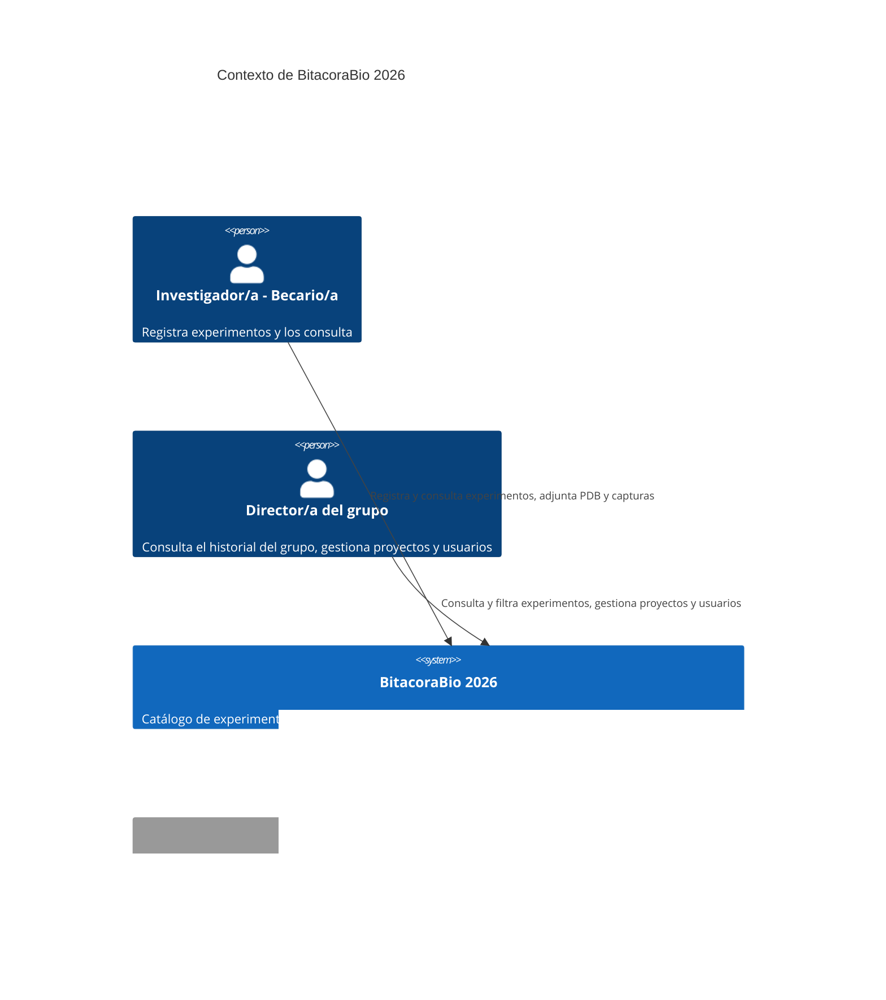
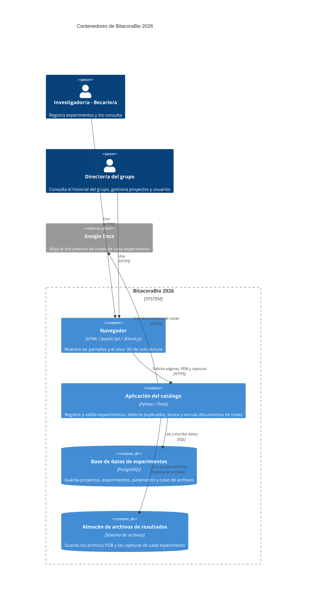
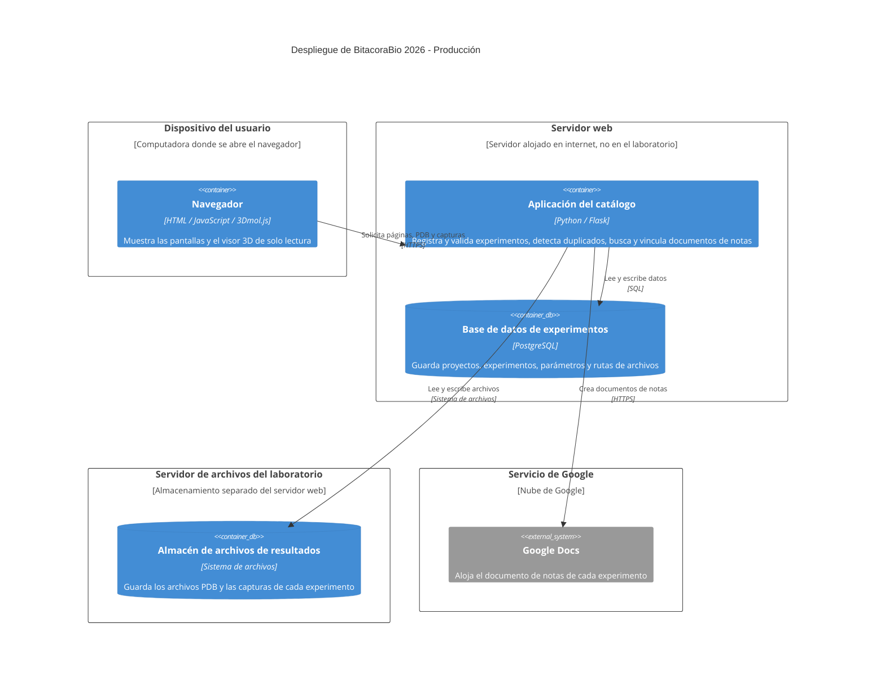

# BitacoraBio 2026 — Documento de Especificación de Arquitectura

**Materia:** Ingeniería del Software 2026 (FIUNER) · **Trabajo práctico:** TP3 — Arquitectura del Sistema
**Integrantes:** Nuñez Juliana, Segovia Lucas

---

## 1. Introducción

### 1.1 Propósito

Este documento describe la arquitectura de BitacoraBio 2026, un sistema de gestión y trazabilidad de experimentos computacionales de docking molecular para grupos de investigación, pensado desde su estructura para incorporar otros tipos de ensayo sin rehacerla (escenario EC-07, sección 4). Registra las decisiones estructurales del sistema, las razones que las motivan (los atributos de calidad del TP2) y lo que cada una sacrifica, y las representa con las vistas de contenedores, de componentes y de despliegue del modelo C4.

### 1.2 Alcance

La arquitectura se define en profundidad para los procesos elegidos en el TP1 (`docs/requirements/srs.md`):

| Proceso (DFD nivel 1) | Casos de uso | Tratamiento |
|---|---|---|
| Proceso 1 · Registrar Experimento | CU-01 | En profundidad |
| Proceso 3 · Detectar Duplicado | CU-00 (incluido por CU-01) | En profundidad |
| Proceso 2 · Consultar y Filtrar Experimentos | CU-02 | En profundidad |
| Proceso 4 · Visualizar Pose 3D | RF-10 | Incluido en la primera versión, sin profundizar: lo resuelve la librería externa 3Dmol.js, que corre en el navegador |
| Proceso 5 · Vincular Documento de Notas | Dependencia de CU-01 (pasos 7-8, E1; RF-05 y RF-09) | Incluido en la primera versión, sin profundizar como proceso propio: se documenta como dependencia del Proceso 1 y aparece como la integración con Google Docs |
| Procesos 6, 7, 8 y 9 (gestionar proyecto, modificar estado, eliminar experimento, registrar usuario) | Sin CU propio | Caja negra |

**Nota.** Los procesos elegidos en el SRS para profundizar son el Proceso 1 (con su interacción con el Proceso 3) y el Proceso 2. Para que la primera versión del sistema tenga las funciones necesarias, la arquitectura incluye además el visor 3D (Proceso 4) y la vinculación con Google Docs (Proceso 5). Se sabe y se entiende que estas funciones no fueron profundizadas en las entregas anteriores; se consideraron necesarias para mantener el flujo y el valor del sistema.

Lo que queda fuera de lo anterior se representa como caja negra: un contenedor sin detalle interno o un sistema externo.

**Fuera del alcance de este TP:** las vistas de clases y de código (se trabajan en el TP4). El despliegue se documenta solo para el entorno de producción (sección 8).

### 1.3 Audiencia

Docentes de la materia y integrantes del grupo. También un integrante que se sume más adelante, que debería poder entender el sistema y agregarle un tipo de ensayo nuevo siguiendo la documentación (escenario EC-07, sección 4).

### 1.4 Documentos relacionados

| Documento | Ubicación | Qué aporta a este documento |
|---|---|---|
| SRS (TP1) | `docs/requirements/srs.md` | DFD, modelo de dominio, requerimientos funcionales (RF), casos de uso (CU) e historias de usuario (HU) |
| Atributos de calidad (TP2, parte A) | `docs/requirements/quality-scenarios/atributos-calidad.md` | Escenarios de calidad con identificador `EC-xx` |
| Maquetado e interfaz (TP2, parte B) | `docs/ui/` | Pantallas (mockups), perfiles de usuario y evaluación heurística |
| Registro de uso de IA | `docs/uso_ia.md` | Bitácora de uso de inteligencia artificial |

### 1.5 Convenciones

- Los escenarios de calidad se identifican como `EC-01`, `EC-02`, etc. (la tabla con todos los escenarios está en la sección 4.1).
- Las decisiones de arquitectura se identifican como `DA-01`, `DA-02`, etc. (sección 10).
- Los requerimientos, casos de uso e historias de usuario conservan los identificadores del SRS (`RF-xx`, `CU-xx`, `HU-xx`).
- Los elementos se nombran igual en todas las vistas, decisiones y tablas de trazabilidad. El idioma de todo el documento es el español.

### 1.6 Siglas

| Sigla | Significado |
|---|---|
| API | Interfaz de programación de aplicaciones: las operaciones que un programa ofrece a otros |
| C4 | Modelo de documentación de arquitectura en cuatro niveles: contexto, contenedores, componentes y código |
| CQRS | Separación de responsabilidades entre comandos (escrituras) y consultas (lecturas) |
| CU | Caso de uso |
| DA | Decisión de arquitectura |
| DFD | Diagrama de flujo de datos |
| EC | Escenario de calidad |
| GB, KB | Gigabyte y kilobyte: unidades de tamaño de archivos |
| HTML | Lenguaje con el que se escriben las páginas web |
| HTTPS | Protocolo de la web sobre una conexión cifrada |
| HU | Historia de usuario |
| IA | Inteligencia artificial |
| JSON | Formato de texto para intercambiar datos estructurados |
| ISO/IEC 25010:2023 | Norma sobre el modelo de calidad del producto de software |
| MVC | Modelo-Vista-Controlador |
| MVVM | Modelo-Vista-Modelo de Vista |
| PDB | Formato de archivo de texto que describe la estructura tridimensional de moléculas; es el archivo de resultado de cada experimento de docking |
| RF | Requerimiento funcional |
| SOA | Arquitectura orientada a servicios |
| SQL | Lenguaje para consultar y modificar bases de datos relacionales |
| SRS | Especificación de requerimientos de software (*Software Requirements Specification*) |
| TP | Trabajo práctico |
| FIUNER | Facultad de Ingeniería de la Universidad Nacional de Entre Ríos |

---

## 2. Restricciones

Las restricciones condicionan qué arquitecturas son viables. Cada una se rastrea después a las decisiones que afecta.

### 2.1 Técnicas

| Id | Restricción | Origen |
|---|---|---|
| RT-01 | El frontend se desarrolla con Flask, que entrega páginas HTML a partir de plantillas | Decisión del grupo |
| RT-02 | El backend se desarrolla en Python | Decisión del grupo |
| RT-03 | El sistema se aloja en un servidor web | Decisión del grupo |
| RT-04 | La base de datos es PostgreSQL | Decisión del grupo |
| RT-05 | Los archivos PDB y las capturas de resultado se guardan como archivos y la base guarda solo su ruta, para que la base no crezca con contenido binario | Decisión del grupo, motivada por el crecimiento del catálogo |
| RT-06 | El documento de notas de cada experimento vive en Google Docs, un servicio externo fuera del control del equipo | SRS (RF-05, RF-09) |
| RT-07 | El visor 3D es una librería externa (3Dmol.js) que corre en el navegador y es de solo lectura | SRS (RF-10) |
| RT-08 | Los archivos PDB y las capturas se guardan en el servidor de archivos del laboratorio, fuera del servidor de la aplicación: el volumen de todos los grupos que usen el sistema (estimado por el grupo en terabytes) no entra en el servidor donde corre la aplicación. La base guarda solo la ruta de cada archivo (RT-05) | Decisión del grupo, motivada por el volumen de archivos |

### 2.2 De equipo y de tiempo

| Id | Restricción | Origen |
|---|---|---|
| RE-01 | El equipo son dos personas | Grupo |
| RE-02 | El tiempo disponible es un cuatrimestre, con ciclo de vida incremental e iterativo | README del proyecto |
| RE-03 | El grupo desarrolla en Python y Flask: la arquitectura debe apoyarse en lo que el equipo ya usa | Decisión del grupo |
| RE-04 | El alcance se mantiene acotado a lo esencial para demostrar el valor del sistema: una arquitectura con pocas piezas que operar | Grupo |

### 2.3 De alcance funcional

| Id | Restricción | Consecuencia |
|---|---|---|
| RA-01 | **Usuario identificado como precondición.** El sistema asume que el usuario ya está identificado (CU-01 y CU-02 declaran "el usuario está autenticado"). La autenticación y la gestión de usuarios (Proceso 9, sin CU propio) quedan fuera del desarrollo | La identificación sustenta RF-02 (el autor se registra automáticamente) y RF-11 (solo el autor de un experimento puede agregar o modificar sus capturas). Se registra como aspecto transversal descartado en la sección 5, con su motivo: es una función estándar que no demuestra el valor del sistema. Durante las pruebas se asume un usuario ya logueado para verificar las funcionalidades del sistema |
| RA-02 | El sistema es de trazabilidad y consulta, no de cálculo: no ejecuta los ensayos de docking, solo guarda sus metadatos y resultados | No hay procesos pesados de cómputo dentro del sistema |
| RA-03 | La detección de duplicados (CU-00) necesita responder en el momento: el investigador/a decide continuar o cancelar con la lista de coincidencias a la vista | El flujo de registro es sincrónico hasta la confirmación |
| RA-04 | El sistema debe quedar preparado para incorporar otros tipos de ensayo (por ejemplo dinámica molecular) en incrementos futuros | Justifica el escenario EC-07, el driver principal (sección 4) |

---

## 3. Contexto

El diagrama de contexto toma los actores y las entidades externas del DFD de Nivel 0 del TP1, sin agregar ni quitar ninguno. Muestra el sistema como una sola caja.

**Actores y sistemas externos**

| Elemento | Tipo | Descripción | Flujos del DFD de Nivel 0 que representa |
|---|---|---|---|
| Investigador/a - Becario/a | Persona | Registra experimentos, modifica su estado y los consulta | Alta de experimento (con parámetros, archivo PDB y capturas); modificación de estado; consulta y filtro; confirmaciones y resultados de búsqueda |
| Director/a del grupo | Persona | Consulta el historial del grupo y gestiona proyectos, usuarios y bajas de experimentos | Alta de usuario y rol; alta y baja de proyecto; eliminación de experimento; consulta y filtro; historial |
| Google Docs | Sistema externo | Crea el documento de notas y devuelve su enlace | Metadatos del experimento (salida); enlace a la bitácora creada (entrada) |

En el diagrama el Director/a y el Investigador/a se muestran como dos personas distintas porque el DFD las distingue. La consulta y el filtrado de experimentos (CU-02) es idéntica para ambos.

---

## 4. Drivers arquitectónicos

Los escenarios de calidad del TP2 describen cómo tiene que comportarse el sistema (por ejemplo, qué tan fácil es corregirlo o cuánto tarda una consulta). No todos obligan a organizar el sistema de una forma particular. Los que sí lo hacen se llaman **drivers arquitectónicos**: son los escenarios que condicionan la estructura (qué partes tiene el sistema, cómo se separan y cómo se conectan). Esta sección elige cuáles son los drivers de BitacoraBio 2026 y explica por qué. La sección 5 parte de esta lista.

Los escenarios están descriptos en `atributos-calidad.md`. Como ese archivo no los numera, la sección 4.1 les asigna un identificador `EC-xx` para poder rastrearlos.

### 4.1 Escenarios del TP2 con identificador

Los once escenarios de `atributos-calidad.md` reciben un identificador. La subcaracterística es la de ISO/IEC 25010:2023 asignada en el TP2.

| ID | Atributo (subcaracterística) | Escenario del TP2 | Medida | ¿Driver? |
|---|---|---|---|---|
| `EC-01` | Eficiencia de desempeño (comportamiento temporal) | Eficiencia, escenario 1: consulta con un filtro, ~1.000 experimentos | ≤ 2 s | No |
| `EC-02` | Eficiencia de desempeño (capacidad) | Eficiencia, escenario 2: 20 consultas concurrentes | ≤ 5 s cada una, 0 % de fallas | No |
| `EC-03` | Eficiencia de desempeño (capacidad) | Eficiencia, escenario 3: catálogo de 100.000 experimentos | ≤ 5 s | **Sí** |
| `EC-04` | Fiabilidad (disponibilidad) | Fiabilidad, escenario 1: Google Docs disponible | 100 % vinculados al primer intento | No |
| `EC-05` | Fiabilidad (tolerancia a fallos) | Fiabilidad, escenario 2: Google Docs caído | 0 % de pérdida del registro | No (lo cubre DA-06) |
| `EC-06` | Fiabilidad (capacidad de recuperación) | Fiabilidad, escenario 3: reintento de la vinculación | ≥ 95 % de reintentos exitosos | No (lo cubre DA-06) |
| `EC-07` | Mantenibilidad (modificabilidad) | Mantenibilidad, escenario 1: agregar una técnica nueva | 0 columnas existentes modificadas; < 1 jornada | **Sí (principal)** |
| `EC-08` | Mantenibilidad (analizabilidad) | Mantenibilidad, escenario 2: un integrante nuevo corrige el Detector de Duplicados | Módulo ubicado en < 30 min; sin regresiones verificables | No |
| `EC-09` | Adecuación funcional (pertinencia funcional) | Adecuación funcional, escenario 1: llegar a la pose desde un listado grande | 1 acción por fila, con 20, 100 y 500 resultados | No |
| `EC-10` | Adecuación funcional (pertinencia funcional) | Adecuación funcional, escenario 2: coincidencias en una sola pantalla | 1 pantalla, con 1, 5 y 10 coincidencias | No |
| `EC-11` | Capacidad de interacción (operabilidad) | Capacidad de interacción, escenario 1: varias coincidencias sin perder lo cargado | 0 campos que recargar | No |

### 4.2 Drivers seleccionados

| Id | Subcaracterística (ISO/IEC 25010:2023) | Atributo del libro (Bass, Clements, Kazman) | Prioridad |
|---|---|---|---|
| `EC-07` | Mantenibilidad: modificabilidad | Modificabilidad | **Principal** |
| `EC-03` | Eficiencia de desempeño: capacidad | Desempeño | Secundario |

EC-07 es el driver principal porque responde a RA-04, el riesgo principal del proyecto: que el sistema deje de servir cuando entre un tipo de ensayo distinto del docking. Los demás escenarios de la sección 4.1 se justifican en 4.3.

#### EC-07 — Mantenibilidad: agregar una técnica nueva de experimento

| Campo | Contenido |
|---|---|
| Fuente del estímulo | Desarrollador/a del equipo |
| Estímulo | Necesita agregar dinámica molecular como nueva técnica de experimento soportada |
| Entorno | Mantenimiento planificado, con acceso completo a la documentación y al modelo de dominio original |
| Artefacto | Modelo de datos de Experimento y ParametroExperimento |
| Respuesta | La nueva técnica se agrega definiendo sus parámetros como nuevas filas de ParametroExperimento, sin modificar el esquema de las tablas ya existentes (Experimento, Proyecto) |
| Medida de respuesta | La extensión no requiere alterar ni una sola columna de las tablas existentes; se implementa en menos de una jornada de trabajo |

**Por qué condiciona la estructura.** Es el driver principal porque responde a RA-04, el riesgo principal del proyecto: que entre un tipo de ensayo distinto del docking. Condiciona la estructura en dos lugares:

- **Los datos.** Para sumar una técnica sin cambiar las tablas, los datos propios de cada técnica se guardan como pares nombre-valor (con su unidad, si la tienen) y no como columnas. En docking eso incluye la molécula/proteína y el ligando: una técnica sin ligando, o con otras entidades clave, no obliga a agregar ni a dejar vacía ninguna columna. Eso define cómo es la base de datos y cómo la usan todas las partes que leen o escriben parámetros (`DA-03`).
- **El comportamiento del registro y del detalle.** Lo que cambia entre técnicas no son solo los datos: también qué parámetros se piden y cuáles son obligatorios (formulario y validación), qué se considera un duplicado y cómo se muestra el detalle con sus unidades. Si esas reglas estuvieran escritas para docking dentro de los pasos del registro, cada técnica nueva obligaría a modificar varios componentes. Por eso la estructura necesita un punto de extensión por técnica (`DA-02`).

La medida del TP2 se refiere al esquema de la base. La arquitectura agrega una medida propia para el punto de extensión: agregar la técnica no modifica ningún componente existente del núcleo del registro, solo suma un componente nuevo. Esa medida no figura en el TP2 y se verifica en `DA-02`.
**Se relaciona con:** RA-04, RF-01, RF-03, RF-04, RF-08, RF-12, modelo de dominio (ParametroExperimento), HU-01.B1.1, HU-01.A1, HU-02.B2.

#### EC-03 — Eficiencia de desempeño: consulta con gran volumen de datos

| Campo | Detalle |
|---|---|
| Fuente del estímulo | Investigador/a (mismo estímulo que el EC-01, sin concurrencia) |
| Estímulo | Consulta el catálogo filtrando por el mismo criterio simple (proteína) |
| Entorno | Catálogo con 100.000 experimentos registrados (en vez de ~1.000), 1 usuario conectado |
| Artefacto | Módulo de consulta y filtro |
| Respuesta | El sistema devuelve los experimentos que coinciden con el filtro |
| Medida de respuesta | Se completa en 5 segundos o menos |

**Por qué condiciona la estructura.** Con 100.000 experimentos y un archivo PDB por cada uno, el contenido binario llegaría a decenas de GB (orden de magnitud estimado). Guardarlo dentro de la base la haría crecer sin control y complicaría los respaldos y el mantenimiento; por eso la base guarda solo los datos del experimento y la ruta de cada archivo, y los archivos viven aparte. Además, a ese volumen la consulta tiene que resolverse en la base, con índices por las columnas de filtro y, para filtrar por un parámetro como la proteína, con un índice sobre el nombre y el valor de los parámetros. El listado tiene que ser liviano: solo las columnas que se muestran y los parámetros de resumen de cada experimento, sin archivos ni el resto de los parámetros, en lugar de traer cada experimento completo. No se pagina: `EC-09` pide llegar a la pose desde el listado sin paginar. Esto define dónde vive cada tipo de dato y obliga a tener una parte del sistema que acceda a los archivos.
**Se relaciona con:** RF-07, RF-10, RF-11, HU-02.B1, restricción RT-05.

### 4.3 Escenarios que no se toman como drivers

Un escenario no es un driver si se resuelve dentro de un solo componente o solo en la interfaz, sin afectar la estructura. Para cada uno de los demás se indica el motivo.

| Escenario | Por qué no es un driver |
|---|---|
| `EC-01` Eficiencia: consulta simple con ~1.000 experimentos | Se cumple con una base relacional con índices; no requiere ningún mecanismo estructural |
| `EC-02` Eficiencia: 20 consultas concurrentes | PostgreSQL atiende esa concurrencia con los índices ya previstos; no requiere réplicas, caché ni otra estructura |
| `EC-04`, `EC-05`, `EC-06` Fiabilidad: Google Docs caído y recuperación | Se resuelve dentro de un solo componente (el que vincula el documento), que marca el experimento como "no vinculado" y ofrece el reintento (RF-09). No agrega contenedores ni cambia la estructura |
| `EC-08` Mantenibilidad: corregir el Detector de Duplicados sin conocer el diseño | Se resuelve dentro de un solo componente, que ya queda separado de las rutas y del acceso a datos por las capas (`DA-01`). No exige una estructura propia: el microkernel del registro (`DA-02`) no se elige por este escenario |
| `EC-09` Adecuación funcional: acceso a la pose desde un listado grande | Se resuelve en la interfaz (una fila del listado lleva al detalle con el visor); no afecta la estructura |
| `EC-10` Adecuación funcional: varias coincidencias en una sola pantalla | Se resuelve en la interfaz y en un único componente (el detector devuelve la lista completa); la consigna indica que la pertinencia funcional corresponde a los requerimientos y no a decisiones de arquitectura |
| `EC-11` Capacidad de interacción: múltiples coincidencias | Se resuelve en la interfaz, sin afectar la estructura |

### 4.4 Cobertura de los drivers sobre los requerimientos

| Driver | Procesos que condiciona | Requerimientos relacionados |
|---|---|---|
| `EC-07` | Proceso 1, Proceso 3 y Proceso 2 (los datos de los experimentos, y el formulario, la validación, la detección de duplicados y el detalle, que dependen del tipo de ensayo) | RF-01, RF-03, RF-04, RF-06, RF-08, RF-12 |
| `EC-03` | Proceso 2 (Consulta y Filtro), Proceso 1 (guardado de los archivos de resultado) y Proceso 4 (lectura del PDB para el visor) | RF-07, RF-10, RF-11 |

Las restricciones de la sección 2 (equipo de dos personas, un cuatrimestre, pocas piezas que operar) descartan de entrada estructuras con muchos procesos independientes. La sección 5 parte de esta lista de drivers.

---

## 5. Estrategia de solución

Esta sección recorre el camino que va de los drivers (sección 4) a la estructura del sistema: primero las tácticas que permiten alcanzar la medida de cada escenario, después el estilo y el patrón que las agrupan, y por último los aspectos transversales. Al final se verifica que cada driver quede cubierto y qué se sacrifica.

### 5.1 Tácticas por driver

Las tácticas son las de la bibliografía de la materia (Bass, Clements y Kazman). Cuando el grupo agrega una decisión que no figura en esas tablas, se aclara.

#### EC-07 — Agregar una técnica nueva de experimento

Atributo del libro: Modificabilidad.

**Tácticas elegidas**

| Táctica | Grupo | Cómo contribuye a la medida |
|---|---|---|
| Plug-ins (dentro de diferir el enlace) | Modificabilidad: diferir el enlace | Lo propio de cada técnica (parámetros obligatorios y su formato, validaciones, criterio de coincidencia, unidades en el detalle) vive en un plug-in. El núcleo del registro no conoce las técnicas concretas: una técnica nueva es un plug-in nuevo que se registra, sin modificar el núcleo |
| Parametrización (dentro de diferir el enlace) | Modificabilidad: diferir el enlace | Los parámetros de cada técnica se definen como datos (filas nombre-valor-unidad en ParametroExperimento) y no como columnas ni como código. Una técnica nueva se agrega sin tocar el esquema |
| Usar un intermediario | Modificabilidad: reducir acoplamiento | El Registro de técnicas es el único que sabe qué plug-ins existen. Los pasos del registro y el Servicio de consulta reciben la técnica del experimento en lugar de nombrarla |
| Restringir dependencias | Modificabilidad: reducir acoplamiento | Los plug-ins solo dependen de la interfaz de técnica que define el núcleo: no usan el repositorio, los archivos ni Google Docs, ni se usan entre sí |
| Encapsular | Modificabilidad: reducir acoplamiento | El acceso a los parámetros queda detrás del repositorio de experimentos. Los demás componentes no dependen de cómo se guardan |

**Tácticas descartadas**

| Táctica | Motivo |
|---|---|
| Dividir módulos por técnica (un registro completo por cada técnica) | Duplicaría guardar el experimento y vincular el documento, que no cambian con la técnica. Se separa solo lo que cambia |
| Publicación-suscripción | Las técnicas no reaccionan a eventos: el núcleo las usa en puntos fijos del registro |
| Definir las técnicas solo como datos, sin código | Alcanzaría si todas las técnicas se definieran por parámetros con formato simple y comparación por igualdad. Todavía no se sabe qué reglas pedirá dinámica molecular (por ejemplo, validaciones entre parámetros); un plug-in las puede expresar sin tocar el núcleo. Se reevalúa si, al implementar la segunda técnica, ningún plug-in necesita código propio |

#### EC-03 — Consulta con 100.000 experimentos

Atributo del libro: Desempeño.

**Tácticas elegidas**

| Táctica | Grupo | Cómo contribuye a la medida |
|---|---|---|
| Reducir sobrecarga | Desempeño: controlar la demanda | La consulta se resuelve en la base con índices: por las columnas de filtro (proyecto, fecha, autor, tipo) y, en ParametroExperimento, por experimento y por (nombre, valor), para el filtro por proteína y la búsqueda de duplicados. Devuelve un listado liviano (las columnas que se muestran y los parámetros de resumen, sin archivos ni el resto de los parámetros), sin paginar por `EC-09`. La base no almacena ni recorre contenido binario: guarda solo la ruta de cada archivo |

**Aclaración.** Guardar los archivos PDB y las capturas fuera de la base es una decisión propia del grupo (RT-05) que no figura como táctica literal en el libro; se apoya en "reducir sobrecarga", porque evita que la base cargue con trabajo y volumen que no le corresponden.

**Tácticas descartadas**

| Táctica | Motivo |
|---|---|
| Aumentar recursos | No cambia la estructura, y con índices no hace falta para un solo usuario |
| Mantener copias de datos o de cómputo (caché, réplicas de lectura) | Suma piezas que operar para un escenario de un solo usuario con 5 segundos de margen |
| Introducir concurrencia | El escenario es de un solo usuario, sin concurrencia |
| Limitar o priorizar eventos, acotar colas, planificar recursos | No hay cola ni recursos compartidos que planificar |
| Acotar tiempos de ejecución | La medida ya es un tiempo máximo y un límite de consulta no cambia la estructura |

### 5.2 Estilos (decisión global)

#### 5.2.1 Estilo base: cliente-servidor

El navegador solicita páginas y archivos, y la aplicación del catálogo responde. Toda la lógica y los datos compartidos viven en el servidor.

| Aspecto | Detalle |
|---|---|
| Por qué | Es lo que ya definen las restricciones técnicas: Flask entrega páginas desde el servidor (RT-01 a RT-03), con pocas piezas que operar (RE-04). Concentra la lógica y los datos en un solo lugar, lo que permite detectar duplicados entre todos los experimentos del grupo |
| Qué mejora | Control centralizado de los datos y de la lógica; simplicidad |
| Qué sacrifica | El servidor es un punto único de falla; la carga se concentra en él |
| Dónde aplica | Todo el sistema. La aplicación se despliega como una sola unidad, pero cliente-servidor es lo que describe la estructura global: un navegador que solicita y un servidor que responde |

**Comprobación de las restricciones del estilo (Tabla 4 de la consigna)**

| Restricción o regla | Cómo se cumple |
|---|---|
| Los clientes no se comunican entre sí | Cada navegador habla solo con la aplicación |
| El servidor no inicia la comunicación con el cliente | La aplicación solo responde a lo que el navegador solicita |
| El cliente no accede directamente a la base de datos | El navegador no tiene conexión con la base ni con el almacén de archivos; todo pasa por la aplicación |
| El cliente inicia siempre la comunicación | Toda interacción empieza con una solicitud del navegador |
| El servidor expone una interfaz definida | Las rutas de la aplicación (HTTPS) son la única entrada |
| La lógica y los datos compartidos viven en el servidor | Reglas, detección de duplicados y datos están en la aplicación y sus almacenes |

#### 5.2.2 Estilo adicional, solo en la zona de registro: microkernel

El registro de un experimento tiene una parte que no cambia con el tipo de ensayo (el orden de los pasos, guardar el experimento y sus archivos, vincular el documento de notas) y una parte que sí cambia (qué parámetros se piden y cuáles son obligatorios, qué se considera un duplicado, cómo se muestra el detalle). El microkernel separa las dos: un **núcleo** con lo común y un **plug-in por técnica de ensayo** con lo propio de cada una.

| Parte | Componentes | Responsabilidad |
|---|---|---|
| Núcleo de registro | Ejecutor de registro, Registro de técnicas y los cuatro pasos comunes: Validar datos, Detectar duplicados, Guardar experimento y Vincular documento | Ordena el registro y decide cuándo cortarlo; guarda el experimento y sus archivos; vincula el documento; define la interfaz de técnica y ofrece el mecanismo para registrar plug-ins |
| Plug-in de técnica | Técnica Docking (primera versión). Técnica Dinámica molecular: futura, no se construye en este TP | Declara lo propio de una técnica a través de la interfaz de técnica |

**Qué ofrece un plug-in (interfaz de técnica)**

| Qué entrega el plug-in | Quién lo usa | Origen en el SRS |
|---|---|---|
| Definición de parámetros: nombre, unidad, si es obligatorio y formato válido | Rutas de registro (arma el formulario), Validar datos (obligatoriedad y formato) y Servicio de consulta (unidad y orden en el detalle) | RF-01, RF-08, RF-12 |
| Validaciones propias de la técnica (por ejemplo, reglas entre parámetros) | Validar datos | RF-08 |
| Clave de coincidencia: qué parámetros de un experimento nuevo definen que otro ya registrado es un duplicado (en docking, la molécula/proteína y el ligando). El tipo de ensayo se compara siempre | Detectar duplicados | RF-03, RF-04, CU-00 |
| Parámetros de resumen: cuáles se muestran junto a cada experimento en el listado (en docking, la molécula/proteína y el ligando) | Servicio de consulta | CU-02 paso 3 |

**Cómo funciona en este sistema**

| Pregunta | Respuesta |
|---|---|
| ¿Cómo se agrega una técnica nueva? | Se escribe un plug-in que cumple la interfaz de técnica y se lo registra en el Registro de técnicas al arrancar la aplicación. El núcleo no se modifica; los parámetros de la técnica se guardan como filas de ParametroExperimento (`DA-03`) |
| ¿Quién conoce qué técnicas existen? | Solo el Registro de técnicas. Los pasos no nombran ninguna técnica: usan la que el Ejecutor de registro agrega a la solicitud |
| ¿Qué viaja por el registro? | Un único objeto en memoria, la **solicitud de registro**: lleva los datos del formulario, el archivo PDB, las capturas y la técnica elegida, y cada paso le agrega su resultado (por ejemplo, el experimento ya guardado o el enlace del documento) |
| ¿Quién hace avanzar el registro? | El **ejecutor de registro**: crea la solicitud, le pide al Registro de técnicas la técnica del experimento y corre los cuatro pasos en orden. Los pasos no se llaman entre sí |
| ¿Los plug-ins acceden a la base, a los archivos o a Google Docs? | No. Solo declaran definiciones y reglas sobre los datos que el núcleo les pasa. Quien consulta la base es el núcleo, a través del Repositorio de experimentos |
| ¿Es síncrono? ¿Se guarda algo entre pasos? | Es síncrono: todo ocurre durante la misma solicitud HTTP, sin trabajo diferido. Validar datos y Detectar duplicados no escriben nada; solo Guardar experimento escribe (en la base y en el almacén de archivos) |
| ¿Cómo corta el registro un paso? | Avisa con un error previsto (por ejemplo, "faltan datos" o "hay coincidencias sin confirmar") que el ejecutor no sigue propagando a los pasos siguientes; las rutas lo traducen en la respuesta al usuario (ver "Qué pasa cuando un paso falla") |
| ¿Por qué no una cola ni procesos separados? | Porque el flujo necesita la respuesta en el momento (CU-00, RA-03) y ningún escenario pide trabajo diferido (ver 5.2.3) |

| Aspecto | Detalle |
|---|---|
| Qué escenario responde | EC-07: una técnica nueva es un plug-in nuevo. Se elige porque permite agregar funciones sin cambiar el núcleo, no por concurrencia ni por volumen de datos |
| Qué mejora | Modificabilidad: sumar una técnica no toca el núcleo ni las tablas existentes |
| Qué sacrifica | Hay que definir y mantener la interfaz de técnica, y se diseña a partir de un solo ejemplo (docking): una técnica que necesite algo que la interfaz no prevé obliga a ampliarla, y eso toca el núcleo y los plug-ins existentes. Más indirección en la validación, la detección de duplicados y el detalle. El núcleo no puede contener reglas de una técnica concreta |
| Dónde aplica | En el registro de experimentos (CU-01 con CU-00) y en el armado del detalle (CU-02), solo para las unidades y el orden de los parámetros. La búsqueda, el listado y el resto siguen el estilo base |
| Cómo se conecta con el estilo base | La ruta de registro de la aplicación (zona cliente-servidor) invoca con una llamada interna a un componente de la capa de servicios, el ejecutor de registro. El núcleo y los plug-ins son componentes de un mismo contenedor, no procesos separados: por eso este estilo se ve en la vista de componentes (sección 7) y no en la de contenedores |

**Comprobación de las restricciones del estilo (Tabla 4 de la consigna)**

| Restricción o regla | Cómo se cumple |
|---|---|
| El núcleo funciona, con lo mínimo, sin plug-ins | **Variante declarada.** El núcleo ordena los pasos, guarda el experimento y vincula el documento sin conocer ninguna técnica, y no contiene reglas de una técnica concreta (los parámetros, las validaciones y la clave de coincidencia del docking están en Técnica Docking). Pero no puede validar ni buscar duplicados sin al menos un plug-in: sin Técnica Docking no hay técnica que elegir y no se puede registrar. Se acepta porque lo que valida y compara el registro ya depende del tipo de ensayo (RF-01, RF-03); Técnica Docking forma parte de la primera versión |
| Los plug-ins no se comunican entre sí ni modifican el núcleo | Ningún plug-in conoce a otro, y agregar uno no modifica el núcleo (se verifica en `DA-02`) |
| Los plug-ins se conectan solo al núcleo | El núcleo los usa mediante la interfaz de técnica; los plug-ins no acceden a la base, a los archivos ni a Google Docs |
| El núcleo ofrece puntos de extensión y un contrato común | El Registro de técnicas (punto de extensión) y la interfaz de técnica (contrato común) |
| Cómo comprobarlo en el diagrama | Las flechas hacia los plug-ins salen solo del Registro de técnicas; ningún plug-in tiene flechas hacia otro plug-in ni hacia el acceso a datos (sección 7) |

**Qué pasa cuando un paso falla**

| Situación | Qué ocurre | Caso del SRS |
|---|---|---|
| Campo obligatorio vacío o formato inválido | Validar datos corta el registro e indica el campo | E5, E6 |
| Coincidencia detectada | Detectar duplicados corta el registro y devuelve la lista; el usuario decide continuar o cancelar. Si continúa, vuelve a enviar el registro con la confirmación y el ejecutor corre los pasos otra vez desde el principio | A1, E3 |
| Se interrumpe la conexión durante el guardado | Guardar experimento revierte lo guardado; no queda un experimento a medias | E2 |
| Google Docs no responde | Vincular documento captura el error y deja el experimento "no vinculado"; el reintento se hace desde el detalle del experimento | E1, RF-09 |

#### 5.2.3 Estilos descartados

| Estilo | Motivo |
|---|---|
| Orientada a eventos (como base o en la zona de Google Docs) | El flujo principal necesita la respuesta en el momento (RA-03), y seguir el flujo se haría más difícil. No hay tareas lentas ni picos de carga que lo justifiquen, y los escenarios de Fiabilidad no se toman como drivers |
| Tuberías y filtros (como base o en el registro) | Como base: la mayor parte del sistema es consulta, no transformación de datos. En el registro: ordenaría los pasos y ayudaría a probarlos por separado, pero no da un lugar donde agregar lo propio de cada técnica, que es lo que pide EC-07 |
| Entre pares (bases locales por investigador) | El valor del sistema es un catálogo compartido: detectar duplicados exige ver los experimentos de todos |
| Microservicios | Complejidad operativa desproporcionada para un equipo de dos personas (RE-01, RE-04) |

No se tuvieron en cuenta, por saberse inadecuados para este sistema y sus drivers: repositorio y SOA.

### 5.3 Patrón (decisión local)

| Contenedor | Patrón | Motivo |
|---|---|---|
| Aplicación del catálogo | Capas | Responde a EC-07: las reglas de cada técnica quedan en la capa de servicios y el acceso a parámetros, en la de acceso a datos |
| Navegador | Ninguno | Muestra HTML generado por el servidor y el visor externo 3Dmol.js |
| Base de datos de experimentos, Almacén de archivos de resultados | No aplica | Son almacenes de datos |

**Capas dentro de la aplicación del catálogo**

| Capa | Qué contiene | Qué hace | Qué puede usar | Qué no debe hacer |
|---|---|---|---|---|
| Presentación | Rutas de registro, Rutas de consulta y las plantillas HTML (que no se dibujan como componente porque no tienen lógica propia) | Recibe la solicitud HTTP del navegador, toma los datos del formulario o los filtros, llama a un servicio y arma la respuesta: una página, un archivo o un mensaje de error | La capa de servicios y Gestión de excepciones | Aplicar reglas del sistema, escribir SQL, abrir archivos o llamar a Google Docs |
| Servicios | Núcleo de registro (Ejecutor de registro, Registro de técnicas y los cuatro pasos), plug-ins de técnica, Gestión de capturas y Servicio de consulta | Es la lógica del sistema: valida, decide qué es una coincidencia, controla que solo el autor modifique las capturas, ordena los pasos del registro y arma el detalle de un experimento | La capa de acceso a datos y servicios externos | Conocer las rutas o las plantillas, escribir SQL o conocer la ubicación física de los archivos |
| Acceso a datos y servicios externos | Repositorio de experimentos, Acceso a archivos y Cliente de Google Docs | Traduce los pedidos de los servicios a consultas SQL, a lectura y escritura de archivos y a llamadas a Google Docs | La base de datos, el almacén de archivos y Google Docs | Decidir reglas (por ejemplo, qué es un duplicado) o usar a los servicios o a las rutas |

Gestión de excepciones no pertenece a ninguna capa: es un aspecto transversal (5.4) que usan las rutas para traducir los errores en respuestas y que Vincular documento usa para señalar la falla de Google Docs.

**Cómo atraviesa las capas un registro.** El navegador envía el formulario a *Rutas de registro* (presentación); estas se lo pasan al *Ejecutor de registro* (servicios), que obtiene del *Registro de técnicas* la técnica del experimento y corre los cuatro pasos; los pasos usan las definiciones de la técnica y piden datos o los guardan a través del *Repositorio de experimentos* y de *Acceso a archivos* (acceso a datos), que son los únicos que tocan la base y el almacén. La respuesta vuelve por el mismo camino.

| Aspecto | Detalle |
|---|---|
| Qué escenario responde | EC-07 (las reglas de cada técnica viven en la capa de servicios y el acceso a parámetros queda encapsulado en la capa de acceso a datos) |
| Qué mejora | Modificabilidad: un cambio en una capa afecta poco a las demás |
| Qué sacrifica | Indirección y algo de rendimiento (despreciable frente a los márgenes de EC-03) |
| Relación con el microkernel | El núcleo y los plug-ins viven dentro de la capa de servicios |

**Comprobación de las restricciones del patrón (Tabla 6 de la consigna).** Se adopta la variante de capas estrictas: cada capa usa solo a la inmediatamente inferior.

| Restricción o regla | Cómo se cumple |
|---|---|
| Una capa no depende de las superiores | Los servicios no conocen las rutas, y el acceso a datos no conoce a los servicios |
| No se saltean capas sin justificarlo | Las rutas llaman a los servicios, y los servicios llaman al acceso a datos |
| Cada capa tiene una responsabilidad | Ver la tabla de capas |
| Todas las flechas entre capas van hacia abajo | Se verifica en el diagrama de componentes (sección 7) |

**Patrones descartados**

| Patrón | Motivo |
|---|---|
| MVC | No separa la lógica de negocio en una capa propia, que es donde viven las reglas de cada técnica (EC-07). Flask ya separa rutas y plantillas sin que haga falta declararlo como patrón |
| Hexagonal | Suma interfaces y adaptadores, con riesgo de sobreingeniería para dos personas, y combinarlo con capas dificultaría comprobar las reglas de la Tabla 6 |
| Broker (cola de mensajes con un proceso que la consume) | No responde a ningún driver: CU-00 es síncrono y el reintento de la vinculación lo dispara el usuario. Suma un contenedor que operar |

No se tuvieron en cuenta, por saberse inadecuados para este sistema y sus drivers: CQRS, MVVM, pizarra y serverless.

### 5.4 Aspectos transversales

| Aspecto | Decisión | Motivo |
|---|---|---|
| Autenticación y autorización | **Descartado** | Se asume un usuario identificado como precondición (RA-01); la autenticación no demuestra el valor del sistema. En las pruebas se asume un usuario ya logueado |
| Auditoría | **Descartado como componente propio** | El autor y la fecha y hora de cada experimento son datos del experimento (RF-02) y los guarda Guardar experimento. Un registro general de todas las acciones se descarta: ningún driver lo exige |
| Gestión de excepciones | **Adoptado** | Los errores previstos (validación, coincidencias, falla de Google Docs, interrupción al guardar; ver 5.2.2) se tratan de forma común, en un componente propio |
| Interoperabilidad | **Adoptado** | La integración con Google Docs queda encapsulada en un componente propio de la capa de acceso a datos y servicios externos (táctica: adaptar la interfaz), de modo que un cambio en el servicio externo afecta solo a ese componente |
| Instrumentación (monitoreo) | **Descartado** | Ningún driver lo exige |
| Notificaciones | **Descartado** | La aplicación informa el resultado en pantalla (confirmaciones y errores); no avisa fuera de ella |

### 5.5 Cobertura de los drivers y sacrificios

| Driver | Cómo lo cubre la arquitectura | Dónde se ve | Qué sacrifica |
|---|---|---|---|
| `EC-07` | Microkernel en el registro: un núcleo y un plug-in por técnica, sobre capas; los parámetros se guardan como filas nombre-valor-unidad detrás del repositorio de experimentos | Componentes Ejecutor de registro, Registro de técnicas y Técnica Docking; base de datos de experimentos (tabla ParametroExperimento) y componente Repositorio de experimentos (sección 7) | La interfaz de técnica se diseña con un solo ejemplo (docking) y puede tener que ampliarse con la segunda técnica; más indirección en validación, detección de duplicados y detalle; filtrar por parámetro (la proteína, la molécula, el ligando) es más costoso que por columna y se mide en EC-03; el valor se guarda como texto, sin validación de tipo a nivel de esquema |
| `EC-03` | Archivos PDB y capturas fuera de la base; consultas con índices y listados livianos | Contenedores Base de datos de experimentos y Almacén de archivos de resultados; componente Acceso a archivos; nodos Servidor web y Servidor de archivos del laboratorio (sección 8) | Hay dos almacenes, en máquinas distintas, que mantener consistentes: se guarda primero el experimento y después el archivo, revirtiendo si falla, y los respaldos se coordinan para poder restaurar ambos al mismo momento |

### 5.6 Conflictos entre tácticas

| Conflicto | Cómo se resuelve |
|---|---|
| EC-07 (parámetros clave-valor, incluidos molécula y ligando) contra EC-03 (desempeño): filtrar por un parámetro exige unir tablas y es más lento que filtrar por una columna | Los filtros de RF-07 (proyecto, fecha, autor) son columnas del experimento con índice. El filtro por proteína del escenario EC-03 y la búsqueda de duplicados consultan ParametroExperimento con un índice por experimento y por (nombre, valor): es una consulta indexada sobre un orden de un millón de filas (100.000 experimentos por unos 10 parámetros; estimación del grupo, no medida). Se acepta el costo y se verifica con la medida de EC-03 (`DA-05`). Si no se cumple, el plan B es guardar en el experimento una clave de coincidencia derivada de esos parámetros |
| EC-07 (microkernel y capas) contra EC-03 (desempeño): más indirección y llamadas entre componentes | Las llamadas entre componentes del mismo proceso son internas y muy rápidas. El listado no ejecuta lógica de los plug-ins: le pide al Registro de técnicas solo los nombres de los parámetros de resumen de cada técnica (una búsqueda en memoria); los plug-ins se usan al registrar y al armar el detalle. El costo es despreciable frente al margen de 5 segundos |
| EC-03 (volumen) contra EC-09 (llegar a la pose sin paginar): paginar acotaría el listado, pero obligaría a recorrer páginas para llegar a una pose | No se pagina. El filtro del escenario EC-03 es simple y devuelve pocas filas, y el listado trae solo columnas livianas y los parámetros de resumen (nunca archivos ni el resto de los parámetros), así que sin paginar alcanza con los índices. Si un filtro llegara a devolver demasiado, se reevalúa (plan B) |
| EC-03 (archivos fuera de la base) contra la consistencia de los datos | Se guarda primero el experimento y después el archivo; si falla alguno, se revierte lo hecho. Los respaldos de la base y del almacén se coordinan para poder restaurar ambos al mismo momento |

Ningún driver queda sin cubrir.

---

## 6. Vista de contenedores

Es la única vista de contenedores y es global: muestra todo el sistema. Los procesos elegidos se ven detallados en la aplicación del catálogo (la vista de componentes está en la sección 7); los procesos de gestión de proyectos, estado, bajas y usuarios (Procesos 6 a 9) quedan como caja negra dentro de la misma aplicación.

### 6.1 Diagrama

### 6.2 Catálogo de contenedores

| Contenedor | Tecnología | Responsabilidad |
|---|---|---|
| Navegador | HTML, JavaScript, 3Dmol.js | Muestra las pantallas al usuario y el visor 3D de solo lectura |
| Aplicación del catálogo | Python, Flask | Registra y valida experimentos, detecta duplicados, busca y consulta, y vincula el documento de notas |
| Base de datos de experimentos | PostgreSQL | Guarda los proyectos, los experimentos, sus parámetros y la ruta de cada archivo |
| Almacén de archivos de resultados | Sistema de archivos | Guarda los archivos PDB y las capturas de cada experimento |

Sistema externo: **Google Docs**, que aloja el documento de notas de cada experimento.

### 6.3 Catálogo de relaciones

| Origen | Destino | Qué se comunica | Tipo | Protocolo |
|---|---|---|---|---|
| Investigador/a - Becario/a | Navegador | Uso de las pantallas | Persona hacia contenedor | HTTPS |
| Director/a del grupo | Navegador | Uso de las pantallas | Persona hacia contenedor | HTTPS |
| Navegador | Aplicación del catálogo | Solicitudes de páginas, de archivos PDB y de capturas, y envío del formulario de registro | Síncrona | HTTPS |
| Aplicación del catálogo | Base de datos de experimentos | Lectura y escritura de proyectos, experimentos y parámetros | Acceso a datos | SQL |
| Aplicación del catálogo | Almacén de archivos de resultados | Lectura y escritura de archivos PDB y capturas | Acceso a datos | Sistema de archivos |
| Aplicación del catálogo | Google Docs | Creación del documento de notas y recepción de su enlace | Integración con un sistema externo | HTTPS |

### 6.4 Relación con la estrategia de solución

- **Cliente-servidor (estilo base):** se ve en la separación entre el Navegador y la Aplicación del catálogo, que es el único punto de entrada a los datos.
- **Microkernel (zona de registro):** no aparece acá, porque el núcleo y los plug-ins son componentes de la aplicación; se ve en la sección 7.
- **EC-03:** se ve en la existencia del Almacén de archivos de resultados como contenedor separado de la base de datos (decisión DA-04, sección 10).
- **EC-07:** se ve en la Base de datos de experimentos, que guarda los parámetros como pares nombre-valor, y en la sección 7, donde el núcleo del registro y los plug-ins de técnica son componentes de la aplicación.

*Nota sobre el diagrama:* la sintaxis C4 de Mermaid es experimental y tiene limitaciones de disposición. Se prioriza la claridad del contenido por sobre el formato visual.

---

## 7. Vista de componentes

Se hace una sola vista de componentes: la de la **Aplicación del catálogo**, que es el único contenedor con lógica de los procesos elegidos. No se hace vista de componentes del Navegador (muestra HTML generado por el servidor y usa una librería externa), de la Base de datos ni del Almacén de archivos (son almacenes de datos).

### 7.1 Diagrama

```mermaid
C4Component
    title Componentes de la Aplicación del catálogo
    Boundary(cli, "Navegador", "Cliente") {
        Container(nav, "Navegador", "HTML / JavaScript / 3Dmol.js", "Muestra las pantallas y el visor 3D")
    }
    Container_Boundary(app, "Aplicación del catálogo") {
        Component(rreg, "Rutas de registro", "Flask", "Capa de presentación: arma el formulario con los campos de la técnica elegida, recibe el formulario de registro, el reintento de vinculación y las capturas de un experimento ya registrado")
        Component(rcon, "Rutas de consulta", "Flask", "Capa de presentación: recibe filtros y pedidos de detalle, PDB y capturas")
        Component(exc, "Gestión de excepciones", "Python", "Aspecto transversal: traduce los errores previstos en respuestas al usuario")
        Component(reg, "Ejecutor de registro", "Python", "Núcleo, capa de servicios: ordena y ejecuta los pasos del registro")
        Component(rtec, "Registro de técnicas", "Python", "Núcleo: conoce los plug-ins de técnica y entrega el de cada experimento")
        Component(val, "Validar datos", "Python", "Paso 1 del núcleo: verifica obligatoriedad y formato")
        Component(dup, "Detectar duplicados", "Python", "Paso 2 del núcleo: busca coincidencias y corta el registro si no fueron confirmadas")
        Component(gua, "Guardar experimento", "Python", "Paso 3 del núcleo: registra autor y fecha y guarda datos y archivos")
        Component(vin, "Vincular documento", "Python", "Paso 4 del núcleo: crea el documento de notas y guarda el enlace")
        Component(tdoc, "Técnica Docking", "Python", "Plug-in: parámetros, validaciones, clave de coincidencia y resumen del docking")
        Component(tmd, "Técnica Dinámica molecular (futura)", "Python", "Plug-in a incorporar en un incremento futuro (EC-07); no se construye en este TP")
        Component(gcap, "Gestión de capturas", "Python", "Capa de servicios: agrega o reemplaza capturas si quien lo pide es el autor")
        Component(con, "Servicio de consulta", "Python", "Capa de servicios: busca, filtra, arma el detalle y entrega los archivos")
        Component(rep, "Repositorio de experimentos", "Python", "Capa de acceso a datos: consultas y escrituras en la base")
        Component(arc, "Acceso a archivos", "Python", "Capa de acceso a datos: lee y escribe PDB y capturas")
        Component(gdc, "Cliente de Google Docs", "Python", "Capa de acceso a servicios externos: crea documentos de notas")
    }
    Boundary(cbd, "Base de datos de experimentos", "Contenedor de datos") {
        ContainerDb(bd, "Base de datos de experimentos", "PostgreSQL", "Proyectos, experimentos, parámetros y rutas de archivos")
    }
    Boundary(car, "Almacén de archivos de resultados", "Contenedor de datos") {
        ContainerDb(arch, "Almacén de archivos de resultados", "Sistema de archivos", "Archivos PDB y capturas")
    }
    Boundary(ext, "Google Docs", "Sistema externo") {
        System_Ext(gdocs, "Google Docs", "Documento de notas de cada experimento")
    }
    Rel(nav, rreg, "Envía el registro y las capturas", "HTTPS")
    Rel(nav, rcon, "Solicita páginas, PDB y capturas", "HTTPS")
    Rel(rreg, reg, "Invoca")
    Rel(rreg, gcap, "Invoca")
    Rel(rreg, rtec, "Pide las técnicas y sus campos para armar el formulario")
    Rel(rreg, exc, "Delega el manejo de errores")
    Rel(rcon, con, "Invoca")
    Rel(rcon, exc, "Delega el manejo de errores")
    Rel(reg, rtec, "Obtiene la técnica y la agrega a la solicitud")
    Rel(reg, val, "Ejecuta el paso 1")
    Rel(reg, dup, "Ejecuta el paso 2")
    Rel(reg, gua, "Ejecuta el paso 3")
    Rel(reg, vin, "Ejecuta el paso 4")
    Rel(rtec, tdoc, "Registra y entrega")
    Rel(rtec, tmd, "Registraría y entregaría")
    Rel(dup, rep, "Consulta coincidencias")
    Rel(gua, rep, "Guarda el experimento")
    Rel(gua, arc, "Guarda PDB y capturas")
    Rel(vin, rep, "Guarda el enlace y el estado")
    Rel(vin, gdc, "Solicita el documento")
    Rel(vin, exc, "Señala la falla de Google Docs")
    Rel(gcap, rep, "Verifica autoría y guarda rutas")
    Rel(gcap, arc, "Guarda o reemplaza capturas")
    Rel(con, rep, "Consulta experimentos")
    Rel(con, arc, "Obtiene PDB y capturas")
    Rel(con, rtec, "Pide parámetros de resumen, unidades y orden")
    Rel(rep, bd, "Lee y escribe", "SQL")
    Rel(arc, arch, "Lee y escribe archivos", "Sistema de archivos")
    Rel(gdc, gdocs, "Crea el documento", "HTTPS")
    UpdateLayoutConfig($c4ShapeInRow="3", $c4BoundaryInRow="2")
```

### 7.2 Catálogo de componentes

| Componente | Capa | Tecnología | Responsabilidad | Se rastrea a |
|---|---|---|---|---|
| Rutas de registro | Presentación | Flask | Arma el formulario con los campos de la técnica elegida; recibe el formulario de registro, el pedido de reintentar la vinculación y las capturas que se agregan a un experimento ya registrado; invoca al ejecutor de registro o a la gestión de capturas y arma la respuesta (errores, coincidencias o confirmación) | CU-01; RF-11; HU-01.B1.1, B1.2, A1, E3, E1 |
| Rutas de consulta | Presentación | Flask | Recibe los filtros y los pedidos de detalle, PDB y capturas, y arma las páginas | CU-02; HU-02.B1, B2, A1; RF-10, RF-11 |
| Ejecutor de registro | Servicios (núcleo) | Python | Ordena el registro: pide al Registro de técnicas la técnica del experimento, la agrega a la solicitud de registro y ejecuta los cuatro pasos. Para el reintento de vinculación ejecuta solo Vincular documento | CU-01; RF-09; EC-07 |
| Registro de técnicas | Servicios (núcleo) | Python | Conoce los plug-ins de técnica (se registran al arrancar la aplicación), entrega el de un tipo de ensayo, lista las técnicas disponibles para el formulario y define la interfaz de técnica | RA-04; RF-01, RF-12; EC-07 |
| Validar datos | Servicios (núcleo, paso 1) | Python | Verifica los campos comunes y los parámetros que la técnica del experimento define como obligatorios o con un formato | RF-01, RF-08; CU-01 paso 2; EC-07 |
| Detectar duplicados | Servicios (núcleo, paso 2) | Python | Busca experimentos que coincidan según la clave de coincidencia de la técnica (en docking, mismo tipo y mismos parámetros molécula/proteína y ligando), excluye los inválidos y los ya declarados en "Similar a", y corta el registro si hay coincidencias sin confirmar | RF-03, RF-04; CU-00; HU-01.A1, E3; EC-07 |
| Guardar experimento | Servicios (núcleo, paso 3) | Python | Registra autor y fecha, guarda los datos en la base y los archivos PDB y capturas en el almacén, y revierte si algo falla | RF-01, RF-02, RF-11; CU-01 pasos 5-6; HU-01.B1.1 |
| Vincular documento | Servicios (núcleo, paso 4) | Python | Pide el documento de notas y guarda el enlace; si falla, señala el error a Gestión de excepciones y deja el experimento "no vinculado" | RF-05, RF-09; CU-01 paso 7, E1; HU-01.B1.2, E1 |
| Técnica Docking | Servicios (plug-in) | Python | Define los parámetros del docking (nombre, unidad, obligatorio, formato), sus validaciones propias (por ejemplo, la notación de molécula y ligando, E6), su clave de coincidencia (los parámetros molécula/proteína y ligando) y sus parámetros de resumen para el listado | RF-01, RF-03, RF-08, RF-12; EC-07 |
| Técnica Dinámica molecular (futura) | Servicios (plug-in) | Python | No se construye en este TP: es el caso que ejercita el escenario EC-07 | RA-04; EC-07 |
| Gestión de capturas | Servicios | Python | Agrega o reemplaza las capturas de un experimento ya registrado, solo si el usuario actual es su autor (el usuario identificado es la precondición RA-01) | RF-11; EC-03 |
| Servicio de consulta | Servicios | Python | Busca y filtra experimentos, arma el listado (con los parámetros de resumen de cada técnica), arma el detalle (con las unidades y el orden de los parámetros que define la técnica, y los estados) y entrega los archivos PDB y las capturas | RF-06, RF-07, RF-10, RF-11, RF-12; CU-02; EC-07 |
| Repositorio de experimentos | Acceso a datos | Python | Consulta y escribe proyectos, experimentos y parámetros (nombre, valor, unidad) en la base; busca por columnas y por parámetros (filtro por proteína, coincidencias de duplicados) | RF-01, RF-03, RF-06, RF-07; EC-07, EC-03 |
| Acceso a archivos | Acceso a datos | Python | Lee y escribe los archivos PDB y las capturas en el almacén | RF-10, RF-11; EC-03 |
| Cliente de Google Docs | Acceso a servicios externos | Python | Crea el documento de notas en Google Docs y devuelve su enlace | RF-05, RF-09; aspecto de interoperabilidad (5.4) |
| Gestión de excepciones | Transversal | Python | Define los errores previstos (validación, coincidencias, falla de Google Docs, interrupción al guardar) y los traduce en respuestas al usuario | CU-01 E1 a E6; aspecto transversal (5.4) |

### 7.3 Catálogo de relaciones

| Origen | Destino | Qué se comunica | Tipo | Protocolo |
|---|---|---|---|---|
| Navegador | Rutas de registro | Formulario de registro, pedido de reintento de vinculación y capturas | Síncrona, entre contenedores | HTTPS |
| Navegador | Rutas de consulta | Solicitudes de páginas, PDB y capturas | Síncrona, entre contenedores | HTTPS |
| Rutas de registro | Ejecutor de registro | Datos del formulario | Llamada interna | — |
| Rutas de registro | Gestión de capturas | Capturas a agregar y usuario actual | Llamada interna | — |
| Rutas de registro | Gestión de excepciones | Errores previstos para traducir en respuesta | Llamada interna | — |
| Rutas de consulta | Servicio de consulta | Filtros y pedidos de detalle o de archivos | Llamada interna | — |
| Rutas de consulta | Gestión de excepciones | Errores previstos para traducir en respuesta | Llamada interna | — |
| Rutas de registro | Registro de técnicas | Pedido de las técnicas disponibles y de sus campos, para armar el formulario | Llamada interna | — |
| Ejecutor de registro | Registro de técnicas | Pedido de la técnica del experimento, que se agrega a la solicitud de registro | Llamada interna | — |
| Ejecutor de registro | Validar datos | Solicitud de registro (paso 1) | Llamada interna | — |
| Ejecutor de registro | Detectar duplicados | Solicitud de registro (paso 2) | Llamada interna | — |
| Ejecutor de registro | Guardar experimento | Solicitud de registro (paso 3) | Llamada interna | — |
| Ejecutor de registro | Vincular documento | Solicitud de registro (paso 4) | Llamada interna | — |
| Registro de técnicas | Técnica Docking | Registro del plug-in y entrega a quien lo pide | Llamada interna | — |
| Registro de técnicas | Técnica Dinámica molecular (futura) | Ídem, cuando se incorpore | Llamada interna | — |
| Servicio de consulta | Registro de técnicas | Pedido de los parámetros de resumen para el listado y de unidades y orden para el detalle | Llamada interna | — |
| Detectar duplicados | Repositorio de experimentos | Consulta de coincidencias | Llamada interna | — |
| Guardar experimento | Repositorio de experimentos | Datos y parámetros del experimento | Llamada interna | — |
| Guardar experimento | Acceso a archivos | Archivo PDB y capturas | Llamada interna | — |
| Vincular documento | Repositorio de experimentos | Enlace y estado de vinculación | Llamada interna | — |
| Vincular documento | Cliente de Google Docs | Pedido de creación del documento | Llamada interna | — |
| Vincular documento | Gestión de excepciones | Falla de Google Docs | Llamada interna | — |
| Gestión de capturas | Repositorio de experimentos | Verificación de autoría y rutas de las capturas | Llamada interna | — |
| Gestión de capturas | Acceso a archivos | Capturas a guardar o reemplazar | Llamada interna | — |
| Servicio de consulta | Repositorio de experimentos | Consultas de experimentos | Llamada interna | — |
| Servicio de consulta | Acceso a archivos | Pedido de PDB y capturas | Llamada interna | — |
| Repositorio de experimentos | Base de datos de experimentos | Lectura y escritura de datos | Acceso a datos, entre contenedores | SQL |
| Acceso a archivos | Almacén de archivos de resultados | Lectura y escritura de archivos | Acceso a datos, entre contenedores | Sistema de archivos |
| Cliente de Google Docs | Google Docs | Creación del documento y recepción del enlace | Integración externa, entre contenedores | HTTPS |

Notas sobre el diagrama:

- Las plantillas de página no se dibujan: son parte de la capa de presentación, pero son HTML sin lógica propia.
- Validar datos y Detectar duplicados informan el corte del registro a quien los ejecuta, y las rutas lo traducen con Gestión de excepciones; Vincular documento captura su propia falla y la señala directamente.
- Los pasos usan el plug-in que trae la solicitud de registro. Esa llamada no se dibuja porque depende de la técnica elegida y no de un plug-in en particular; por eso las flechas hacia los plug-ins salen solo del Registro de técnicas.
- Autenticación y autorización se descartaron (5.4).

### 7.4 Relación con la estrategia de solución

- **EC-07:** lo propio de cada técnica vive en un plug-in (hoy "Técnica Docking") que el "Registro de técnicas" entrega al núcleo: el formulario, la validación, la detección de duplicados y el detalle no nombran ninguna técnica. Los parámetros nombre-valor-unidad (en docking, también la molécula/proteína y el ligando) se leen, se escriben y se buscan solo a través del "Repositorio de experimentos". Agregar dinámica molecular es sumar un plug-in y registrarlo.
- **EC-03:** el "Acceso a archivos" es un componente separado del "Repositorio de experimentos", porque la base guarda solo la ruta y los archivos viven en el almacén.

*Nota sobre el diagrama:* la sintaxis C4 de Mermaid es experimental y tiene limitaciones de disposición. Se prioriza la claridad del contenido por sobre el formato visual.

---

## 8. Vista de despliegue

Es la única vista de despliegue y corresponde al **entorno de producción**. Muestra en qué infraestructura se ejecuta cada contenedor de la sección 6. No crea contenedores nuevos y cada relación es una de la sección 6, con el mismo protocolo. No se fija un sistema operativo: ningún escenario ni restricción lo exige.

**Cómo leer el diagrama.** Los nodos son los lugares donde se ejecutan las piezas del sistema. Hay un solo servidor web, alojado en internet (no en la computadora de nadie), donde corren la aplicación y la base de datos; es como el servidor de una página pública (por ejemplo NCBI): quien la consulta no pone nada de eso en su computadora. El "Dispositivo del usuario" aparece solo porque el navegador también es un contenedor y tiene que estar en algún lado: ahí se muestra la página, y no forma parte del servidor, aunque lo usen muchas personas. Los archivos PDB y las capturas se guardan aparte, en el servidor de archivos del laboratorio (`RT-08`).

### 8.1 Diagrama

### 8.2 Catálogo de nodos

| Nodo | Tipo o tecnología | Contenedores que ejecuta | Instancias | Escenario o decisión que lo justifica |
|---|---|---|---|---|
| Dispositivo del usuario | Computadora donde se abre el navegador | Navegador | Una por usuario | Es el cliente: solo muestra las pantallas. No ejecuta la aplicación ni guarda datos del sistema |
| Servidor web | Servidor alojado en internet, no en el laboratorio | Aplicación del catálogo, Base de datos de experimentos | 1 | `RT-03`, `RE-01` y `RE-04` (pocas piezas que operar); `EC-02` y `EC-03` se cumplen con índices, sin más infraestructura (5.1). Decisión `DA-07` |
| Servidor de archivos del laboratorio | Almacenamiento separado del servidor web | Almacén de archivos de resultados | 1 | `RT-08` y `EC-03`: 100.000 PDB de unos 250 KB son del orden de 25 GB solo de PDB, y con las capturas y varios grupos el volumen llega a terabytes (estimación del grupo): no entra en el servidor de la aplicación. La capacidad la provee el laboratorio. Decisiones `DA-04` y `DA-07` |
| Servicio de Google | Servicio externo en la nube de Google | Google Docs (sistema externo) | — | `RT-06`: el documento de notas vive en un servicio fuera del control del equipo. Decisión `DA-06` |

El **servidor web** es la máquina donde se ejecuta la aplicación y a la que se conectan los navegadores; no es el dispositivo del usuario. La base de datos solo acepta conexiones de la propia máquina: la Aplicación del catálogo es el único acceso a los datos, como exige el estilo cliente-servidor (Tabla 4). El navegador tampoco accede al servidor de archivos: cada PDB y cada captura se la entrega la aplicación.

### 8.3 Contraste con los escenarios y sacrificios

Se parte del despliegue más simple y se lo contrasta con los escenarios de la sección 4.1:

| Escenario | ¿Lo cumple este despliegue? | Cómo |
|---|---|---|
| `EC-03` (100.000 experimentos, 5 s) | Sí | Índices y listados livianos (`DA-05`); los archivos no pasan por la base (`DA-04`) ni ocupan el disco del servidor web (`RT-08`). El listado no lee archivos, así que no depende del servidor de archivos |
| `EC-02` (20 consultas concurrentes, 5 s) | Sí | Una base relacional con índices atiende esa concurrencia; no hace falta réplica ni balanceador |
| `EC-07` | No depende de la infraestructura | Se ve en los componentes (núcleo y plug-ins) y en el modelo de datos |
| `EC-04`, `EC-05`, `EC-06` (Google Docs) | No dependen de la infraestructura | Los resuelve un componente (`DA-06`) |

Sacrificios asumidos (registrados en `DA-07`):

- **El Servidor web es un punto único de falla** para la aplicación y la base: si cae, no se puede registrar ni consultar. Los datos no se pierden mientras haya respaldo de la base; la recuperación es restaurar y volver a levantar el servidor.
- **Hay una dependencia de red y de otra máquina.** Si el servidor de archivos del laboratorio no responde, se puede listar y ver los datos de los experimentos, pero no abrir PDB ni capturas, y un registro nuevo falla al guardar el archivo (se revierte, sin dejar un experimento a medias).
- Leer un PDB o una captura implica un viaje por la red entre la aplicación y el servidor de archivos. Se mide en la verificación de `DA-07`.
- La base y los archivos están en máquinas distintas: los respaldos tienen que coordinarse para poder restaurar ambos al mismo momento.
- Si la medida de `EC-03` no se cumple con la carga real, el paso siguiente es pasar la base de datos a un nodo propio.

---

## 9. Historias de usuario sobre las vistas

Cada historia se recorre sobre la vista de contenedores (sección 6) y la de componentes (sección 7), para comprobar que la estructura la soporta de punta a punta.

| Historia de usuario | Criterio de aceptación | Contenedores | Componentes |
|---|---|---|---|
| `HU-01.B1.1` Registrar experimento | *Given* un proyecto existente, campos válidos y sin coincidencias; *When* confirma; *Then* se registran autor y fecha y se guarda el experimento | Navegador → Aplicación del catálogo → Base de datos de experimentos y Almacén de archivos de resultados | Rutas de registro → Ejecutor de registro (obtiene la técnica del Registro de técnicas) → Validar datos → Detectar duplicados → Guardar experimento → Repositorio de experimentos y Acceso a archivos. Los pasos usan el plug-in de la técnica (Técnica Docking) |
| `HU-01.B1.1` (criterio de exclusión) | *Given* un experimento previo con la misma molécula/ligando pero inválido; *Then* no se reporta como coincidencia | Aplicación del catálogo → Base de datos de experimentos | Detectar duplicados → Repositorio de experimentos (excluye el estado inválido y los declarados "Similar a") |
| `HU-01.B1.2` Vincular documento | *Given* un experimento recién guardado; *When* se crea el documento; *Then* se asocia el enlace y se muestra el resumen | Aplicación del catálogo → Google Docs y Base de datos de experimentos | Guardar experimento → Vincular documento → Cliente de Google Docs → (Google Docs); Vincular documento → Repositorio de experimentos |
| `HU-01.A1` Continuar pese a coincidencia | *Given* una coincidencia mostrada; *When* elige continuar; *Then* se registra como experimento nuevo | Navegador → Aplicación del catálogo (dos solicitudes) → Base de datos de experimentos y Almacén de archivos de resultados | 1.ª solicitud: Rutas de registro → Ejecutor de registro → Validar datos → Detectar duplicados; el registro se corta y Rutas de registro pide a Gestión de excepciones la respuesta con la lista de coincidencias. 2.ª solicitud, con la confirmación: los cuatro pasos hasta Vincular documento |
| `HU-01.E3` Cancelar por coincidencia | *Given* una coincidencia mostrada; *When* cancela; *Then* no se guarda nada ni se crea documento | Navegador → Aplicación del catálogo | El registro se cortó en Detectar duplicados: Guardar experimento y Vincular documento nunca se ejecutan. Para ver el existente: Rutas de consulta → Servicio de consulta |
| `HU-01.E1` Falla al crear el documento | *Given* un experimento guardado y una falla de Google Docs; *Then* queda guardado, "no vinculado", con aviso | Aplicación del catálogo → Google Docs (falla) → Base de datos de experimentos | Vincular documento → Cliente de Google Docs (falla); Vincular documento → Gestión de excepciones; Vincular documento → Repositorio de experimentos (estado "no vinculado") |
| `HU-01.E1` (reintento) | *Given* un experimento "no vinculado"; *When* dispara el reintento; *Then* se crea el documento sin recargar datos | Navegador → Aplicación del catálogo → Google Docs y Base de datos de experimentos | Rutas de registro → Ejecutor de registro (ejecuta solo el paso Vincular documento) → Vincular documento → Cliente de Google Docs y Repositorio de experimentos |
| `HU-02.B1` Filtrar experimentos | *Given* experimentos cargados; *When* filtra por autor; *Then* ve solo los de ese autor | Navegador → Aplicación del catálogo → Base de datos de experimentos | Rutas de consulta → Servicio de consulta → Repositorio de experimentos |
| `HU-02.B2` Ver detalle | *Given* un experimento seleccionado; *Then* se muestran sus campos, parámetros con unidad, estados, capturas y enlace | Navegador → Aplicación del catálogo → Base de datos de experimentos y Almacén de archivos de resultados | Rutas de consulta → Servicio de consulta → Repositorio de experimentos y Acceso a archivos. El visor 3D pide el PDB a Rutas de consulta |
| `HU-02.A1` Sin resultados | *Given* un filtro sin coincidencias; *Then* se muestra "sin resultados" | Navegador → Aplicación del catálogo → Base de datos de experimentos | Rutas de consulta → Servicio de consulta → Repositorio de experimentos |
| RF-11 Adjuntar capturas (todavía sin historia de usuario en el SRS) | El autor agrega capturas a un experimento ya registrado; otro usuario no puede modificarlas | Navegador → Aplicación del catálogo → Base de datos de experimentos y Almacén de archivos de resultados | Rutas de registro → Gestión de capturas → Repositorio de experimentos (verifica autoría) y Acceso a archivos |
| `EC-07` Agregar una técnica nueva (escenario principal, no es una historia de usuario) | *Given* un experimento de dinámica molecular; *When* se registra; *Then* el formulario pide sus parámetros, se validan, se buscan duplicados con su clave de coincidencia y el detalle los muestra con unidad, sin modificar el núcleo ni las tablas existentes | Navegador → Aplicación del catálogo → Base de datos de experimentos y Almacén de archivos de resultados | Rutas de registro → Registro de técnicas (entrega Técnica Dinámica molecular) → Ejecutor de registro → los cuatro pasos con el plug-in de la técnica → Repositorio de experimentos (filas de ParametroExperimento). Para el detalle: Rutas de consulta → Servicio de consulta → Registro de técnicas |

---

## 10. Decisiones de arquitectura

### DA-01 — Cliente-servidor como estilo base, con capas en la Aplicación del catálogo

- **Escenario que la motiva:** `EC-07` y `EC-03` (los dos drivers) y las restricciones del proyecto (RT-01 a RT-04, RE-01, RE-04).
- **Contexto:** hay que elegir cómo se organiza el sistema entero. El equipo es de dos personas, tiene un cuatrimestre y domina Python y SQL; la interfaz se arma con plantillas de Flask; los datos van en PostgreSQL.
- **Decisión:**
  - Tácticas: restringir dependencias y encapsular (Modificabilidad).
  - Estilo: cliente-servidor como base, para todo el sistema.
  - Patrón: capas (presentación, servicios, acceso a datos y servicios externos) en la Aplicación del catálogo.
- **Alternativas consideradas:**
  - Orientada a eventos como base — descartada: el flujo principal necesita respuesta inmediata (`RA-03`) y la ejecución es más difícil de seguir.
  - Microservicios — descartada: complejidad operativa desproporcionada para dos personas.
  - Tuberías y filtros como estilo base — descartada: la mayor parte del sistema es consulta, no transformación.
  - MVC como único patrón — descartada: no separa una capa de lógica propia, que es donde viven las reglas de cada técnica (`EC-07`).
  - Hexagonal — descartada: sobreingeniería para este tamaño y dificulta comprobar la Tabla 6.
- **Consecuencias:**
  - A favor: pocas piezas que operar; las reglas de cada técnica quedan en la capa de servicios, separadas de las rutas y del SQL.
  - En contra: el servidor es punto único de falla; algo de indirección entre capas.
- **Elementos afectados:** contenedores Navegador, Aplicación del catálogo y Base de datos de experimentos; capas de la aplicación.
- **Cómo se verifica:** las medidas de los dos drivers se verifican en `DA-02` a `DA-05`. Además, revisar en cada pull request que los servicios no importen a las rutas y que el acceso a datos no importe a los servicios, que es lo que exigen las capas (Tabla 6).

### DA-02 — Microkernel en la zona de registro: un núcleo y un plug-in por técnica de ensayo

- **Escenario que la motiva:** `EC-07` (principal): agregar dinámica molecular sin modificar el esquema ni los componentes existentes del registro.
- **Contexto:** `DA-03` resuelve los datos de los parámetros, pero lo que cambia entre técnicas no son solo datos: también qué parámetros son obligatorios y con qué formato (formulario y validación), qué se considera un duplicado (hoy, mismo tipo y molécula/ligando, RF-03) y cómo se muestra el detalle con unidades (RF-12). Si esas reglas quedan escritas para docking dentro de los pasos del registro, una técnica nueva obliga a tocar el formulario, la validación, el Detector y el detalle.
- **Decisión:**
  - Tácticas: plug-ins (diferir el enlace), usar un intermediario, restringir dependencias y encapsular (Modificabilidad).
  - Estilo: microkernel, solo en la zona de registro, dentro de la Aplicación del catálogo. El resto sigue en capas.
  - Patrón: ninguno adicional.
  - Variante respecto de la Tabla 4 de la consigna: el núcleo no funciona sin al menos un plug-in (Técnica Docking es obligatorio), porque no puede validar ni buscar duplicados sin saber qué técnica es. Se justifica en 5.2.2.
  - El **núcleo** (Ejecutor de registro, Registro de técnicas y los cuatro pasos: Validar datos, Detectar duplicados, Guardar experimento y Vincular documento) no contiene reglas de ninguna técnica. Cada **plug-in** (hoy, Técnica Docking) entrega por una interfaz de técnica la definición de sus parámetros (nombre, unidad, obligatorio, formato), sus validaciones propias, su clave de coincidencia y sus parámetros de resumen para el listado. Los plug-ins se registran al arrancar, no se conocen entre sí y no acceden a la base, a los archivos ni a Google Docs. El ejecutor pide la técnica al Registro de técnicas, la agrega a la solicitud de registro y corre los pasos; las rutas de registro y el Servicio de consulta también la piden para armar el formulario y el detalle.
- **Alternativas consideradas:**
  - Técnicas definidas solo como datos, sin código — descartada por ahora: la definición de parámetros sí es dato (`DA-03`), pero todavía no se sabe qué reglas pedirá dinámica molecular; un plug-in las expresa sin tocar el núcleo. Se reevalúa si, al implementar la segunda técnica, ningún plug-in necesita código propio.
  - Condicionales por técnica dentro de cada paso (si el tipo es X, hacer Y) — descartada: cada técnica nueva modifica Validar datos, Detectar duplicados, el Servicio de consulta y el formulario.
  - Un registro completo por técnica — descartada: duplicaría guardar y vincular, que no cambian con la técnica.
  - Tuberías y filtros en el registro — descartada: ordena los pasos pero no da un lugar donde enchufar lo propio de cada técnica.
  - Hexagonal — descartada: más interfaces y adaptadores para todo el sistema, cuando solo cambia un punto.
- **Consecuencias:**
  - A favor: una técnica nueva es un plug-in más sus filas de parámetros; no se modifica el núcleo ni la base; la validación, la detección de duplicados y el detalle siguen siendo únicos para todas las técnicas.
  - En contra: hay una interfaz de técnica que mantener y se diseña a partir de un solo ejemplo (docking): si dinámica molecular necesita algo que no prevé, hay que ampliarla y eso toca el núcleo y los plug-ins existentes. Más indirección: la clave de coincidencia ya no está escrita en el Detector. Una regla que dependa de dos técnicas a la vez no encaja, porque los plug-ins no se comunican entre sí.
- **Elementos afectados:** componentes Ejecutor de registro, Registro de técnicas, Validar datos, Detectar duplicados, Servicio de consulta, Rutas de registro y Técnica Docking.
- **Cómo se verifica:** implementar dinámica molecular como plug-in (por ejemplo, con paso de tiempo y duración) y comprobar que (a) ninguna columna existente cambia (medida de `EC-07` del TP2); (b) ningún componente del núcleo se modifica: solo se agrega un módulo y se lo registra (medida propia de esta decisión); (c) el formulario, la validación, la detección de duplicados y el detalle funcionan con la técnica nueva; (d) se hace en menos de una jornada. Si falla (b), se amplía la interfaz de técnica y se repite la prueba también con docking.

### DA-03 — Parámetros del experimento como pares nombre-valor, con unidad

- **Escenario que la motiva:** `EC-07` (principal): agregar una técnica nueva sin modificar el esquema de las tablas existentes.
- **Contexto:** el riesgo principal del proyecto es el cambio de requerimientos (RA-04): sumar dinámica molecular u otras técnicas. RF-12 pide mostrar la unidad de cada parámetro. Esta decisión cubre los datos; lo que cambia en el comportamiento (formulario, validación, duplicados y detalle) lo cubre `DA-02`.
- **Decisión:**
  - Tácticas: parametrización y encapsular (Modificabilidad).
  - Estilo y patrón: no cambian. La decisión se ve en el modelo de datos y en el componente Repositorio de experimentos.
  - Los parámetros son filas de `ParametroExperimento` con nombre, valor y unidad (la unidad puede estar vacía). Todo dato propio de una técnica es un parámetro, incluidos en docking la molécula/proteína, el ligando, el software usado y el sitio activo. Son columnas del experimento solo los datos que valen para cualquier técnica: proyecto, autor, fecha y hora, tipo de ensayo, estados de validez y de análisis, los atributos que el modelo de dominio del SRS asigna a Experimento (objetivo, hardware, tiempo de procesamiento) y las referencias a archivos y al documento de notas.
- **Alternativas consideradas:**
  - Molécula y ligando como columnas del experimento — descartada: son datos del docking; una técnica sin ligando dejaría la columna vacía y una con otras entidades clave pediría columnas nuevas, contra el espíritu de `EC-07` y contra el modelo de dominio del SRS. Se acepta a cambio un filtro y una búsqueda de duplicados más lentos (ver `DA-05`).
  - Columnas fijas por técnica — descartada: obliga a migrar el esquema con cada técnica nueva.
  - Una tabla por técnica (herencia) — descartada: cada técnica nueva exige migración.
  - Una columna JSON en el experimento — descartada: complica filtrar por parámetro y mostrar su unidad, y el escenario del TP2 habla de filas.
- **Consecuencias:**
  - A favor: sumar una técnica es cargar filas; no se toca ninguna columna existente.
  - En contra: sin tipado fuerte en la base; filtrar por parámetro exige uniones y es más lento, y eso alcanza al filtro por proteína de `EC-03` y a la búsqueda de duplicados (ver `DA-05`).
- **Elementos afectados:** componentes Repositorio de experimentos, Guardar experimento y Servicio de consulta; contenedor Base de datos de experimentos.
- **Cómo se verifica:** agregar dinámica molecular cargando solo filas de `ParametroExperimento` (por ejemplo paso de tiempo y duración) y comprobar, con el historial de migraciones, que ninguna columna existente cambió (medida de `EC-07`); cronometrar que se hace en menos de una jornada.

### DA-04 — Archivos PDB y capturas fuera de la base, en un Almacén de archivos de resultados

- **Escenario que la motiva:** `EC-03`: el filtro responde en 5 segundos o menos con 100.000 experimentos.
- **Contexto:** un PDB pesa del orden de 250 KB (el del mockup, 245 KB). Con 100.000 experimentos son unos 25 GB solo de PDB, sin contar las capturas ni los demás grupos que usen el sistema, que el grupo estima en terabytes. Ese volumen no entra en el servidor donde corre la aplicación: los archivos viven en el servidor de archivos del laboratorio (RT-08) y la base guarda solo la ruta (RT-05).
- **Decisión:**
  - Tácticas: reducir sobrecarga (Desempeño; con la aclaración de la sección 5.1: guardar fuera de la base es decisión propia del grupo).
  - Estilo y patrón: no cambian.
  - Los archivos van en el Almacén de archivos de resultados, que está en el servidor de archivos del laboratorio, en carpetas separadas para PDB y capturas. La base guarda solo la ruta. El nombre del archivo es el identificador, nunca el original. El navegador no accede al almacén: la aplicación entrega cada archivo. Los respaldos de la base y del almacén se coordinan para poder restaurar ambos al mismo momento. Las capturas solo las agrega o reemplaza su autor (RF-11), lo verifica Gestión de capturas.
- **Alternativas consideradas:**
  - Guardar los archivos dentro de PostgreSQL — descartada: la base crecería decenas de GB y se respaldaría con más dificultad.
  - Guardar los archivos en un disco del servidor de la aplicación — descartada: el volumen de todos los grupos no entra y la capacidad del catálogo quedaría atada al disco de ese servidor (RT-08).
  - Un servicio de almacenamiento en la nube — descartada: agrega una dependencia externa y costo.
  - Un contenedor aparte para las capturas — descartada: ningún escenario lo justifica; basta con otra carpeta.
- **Consecuencias:**
  - A favor: la base crece solo con metadatos y las consultas no leen archivos.
  - En contra: la coherencia entre base y archivos depende del orden de escritura (primero el experimento, después el archivo, revirtiendo si falla) y de coordinar los respaldos; además, la aplicación depende de la red y de un servidor que administra el laboratorio.
- **Elementos afectados:** contenedor Almacén de archivos de resultados; componentes Acceso a archivos, Guardar experimento, Gestión de capturas y Servicio de consulta.
- **Cómo se verifica:** cargar 100.000 experimentos de prueba con PDB de unos 250 KB y comprobar que la base crece solo con metadatos y rutas, que el tamaño de los archivos queda en el servidor de archivos y que una consulta no lee archivos (`EC-03`).

### DA-05 — Consultas con índices y listados livianos, sin paginar

- **Escenario que la motiva:** `EC-03`, con el límite que impone `EC-09`.
- **Contexto:** los listados consultan por proyecto, fecha y autor (columnas del experimento), y el filtro por proteína de `EC-03` y el Detector consultan por parámetros (molécula/proteína y ligando, que son filas de ParametroExperimento, `DA-03`) sobre un catálogo que crece. `EC-09` pide llegar a la pose de cualquier fila sin paginar.
- **Decisión:**
  - Tácticas: reducir sobrecarga (Desempeño: índices sobre las columnas de filtro (proyecto, fecha, autor, tipo) y, en ParametroExperimento, sobre el experimento y sobre (nombre, valor), que usan el filtro por proteína y el Detector; listados que traen las columnas que se muestran y solo los parámetros de resumen, sin archivos ni el resto de los parámetros).
  - Estilo y patrón: no cambian.
  - No se pagina.
- **Alternativas consideradas:**
  - Paginación — descartada por `EC-09`; se reevalúa si algún filtro devuelve demasiado.
  - Clave de coincidencia derivada, guardada en el experimento — descartada por ahora: es un dato redundante que hay que mantener sincronizado con los parámetros. Es el plan B si el filtro por parámetro o el Detector no cumplen la medida.
  - Caché de resultados — descartada: agrega invalidación y no hace falta con índices.
  - Más recursos del servidor — descartada por ahora; queda como plan B si la medida no se cumple.
- **Consecuencias:**
  - A favor: sin componentes ni contenedores nuevos; los mismos índices sobre los parámetros aceleran el filtro por proteína y el Detector.
  - En contra: los índices ocupan espacio y enlentecen las escrituras (despreciable a este volumen); filtrar por parámetro (la proteína, la molécula, el ligando; `DA-03`) es más lento que por columna y es justamente lo que mide `EC-03`: se acepta si la medida se cumple.
- **Elementos afectados:** componentes Repositorio de experimentos y Servicio de consulta; contenedor Base de datos de experimentos.
- **Cómo se verifica:** con los 100.000 experimentos de prueba, repetir 20 veces el filtro por proteína (un parámetro) y comprobar que cada una tarda 5 segundos o menos (`EC-03`), y que el plan de la consulta usa el índice sobre (nombre, valor). Repetir la búsqueda de duplicados (dos parámetros: molécula/proteína y ligando) con el mismo volumen y comprobar que también usa el índice. Comprobar que un listado de 500 filas trae solo las columnas que se muestran y los parámetros de resumen. Para el límite de `EC-09`, comprobar con listados de 20, 100 y 500 resultados que ver la pose cuesta una sola acción.

### DA-06 — Google Docs sin cola: captura de la falla y reintento manual

- **Escenario que la motiva:** `EC-05` y `EC-06` (no son drivers, pero la falta de cola hay que justificarla).
- **Contexto:** Google Docs está fuera del control del grupo. RF-05, RF-09 y la historia `HU-01.E1` ya definen que el experimento queda guardado "no vinculado" y que el reintento lo dispara el investigador/a. Dos personas y un cuatrimestre.
- **Decisión:**
  - Tácticas: detección de excepciones, manejo de excepciones, degradación controlada y reintento manual iniciado por el usuario (Disponibilidad); acotar tiempos de ejecución, con un tiempo máximo de espera en la llamada (Desempeño); adaptar la interfaz, porque el Cliente de Google Docs oculta la API (Interoperabilidad).
  - Estilo y patrón: ninguno adicional.
  - Vincular documento, último paso del registro, captura la falla, deja el experimento "no vinculado" y la pantalla lo avisa. La misma lógica corre desde el reintento.
- **Alternativas consideradas:**
  - Cola con proceso de trabajo y reintento automático — descartada: ningún escenario exige reintentar sin intervención y suma un contenedor que operar.
  - Estilo orientado a eventos solo en esa zona — descartada: solo se justificaría si Fiabilidad fuera driver; cambiaría `HU-01.B1.2`.
  - Llamar a Google Docs dentro de la misma transacción del guardado — descartada: una falla externa revertiría el registro y violaría `EC-05`.
- **Consecuencias:**
  - A favor: simple de construir y explicar; el guardado nunca se revierte por Google Docs.
  - En contra: el reintento depende de que alguien lo dispare; si Google Docs está caído, quien registra espera hasta el tiempo máximo.
- **Elementos afectados:** componentes Vincular documento, Cliente de Google Docs y Gestión de excepciones.
- **Cómo se verifica:** simular que Google Docs no responde y comprobar que el experimento queda guardado y "no vinculado", sin pérdida de datos (`EC-05`); restablecer el servicio y repetir 20 reintentos, de los que 19 o más deben resolverse bien (`EC-06`).

### DA-07 — Despliegue en un servidor web, con los archivos en el servidor del laboratorio

- **Escenario que la motiva:** `EC-03` (capacidad con 100.000 experimentos) y, sin ser driver, `EC-02` (20 consultas concurrentes); además las restricciones `RT-03`, `RT-08`, `RE-01` y `RE-04`.
- **Contexto:** hay que decidir en qué infraestructura corre cada contenedor. El equipo son dos personas y el sistema lo usa un grupo de investigación. La restricción `RT-03` pide alojarlo en un servidor web. Los archivos de todos los grupos suman un volumen que no entra en ese servidor (`RT-08`).
- **Decisión:**
  - Tácticas: ninguna nueva de infraestructura. Se descartan aumentar recursos, mantener copias y réplicas (sección 5.1), porque con índices alcanza para el volumen del escenario.
  - Estilo y patrón: no cambian.
  - El Servidor web ejecuta la Aplicación del catálogo y la Base de datos de experimentos; la base solo acepta conexiones de la propia máquina. El Almacén de archivos de resultados está en el Servidor de archivos del laboratorio, al que accede únicamente la aplicación. Cada usuario ejecuta el Navegador en su computadora. Google Docs es un servicio externo.
- **Alternativas consideradas:**
  - Los archivos en un disco del Servidor web — descartada por `RT-08`: el volumen no entra y ataría la capacidad del catálogo a ese servidor.
  - Un servidor de base de datos aparte — descartada: suma una máquina que operar y una red entre la aplicación y la base, sin que un escenario lo exija.
  - Varias instancias de la aplicación con un balanceador — descartada: `EC-02` se cumple con índices y no hay escenario de disponibilidad que sea driver.
  - Servicio de almacenamiento en la nube para los archivos — descartada por lo mismo que en `DA-04`: agrega una dependencia externa y costo.
- **Consecuencias:**
  - A favor: la aplicación y la base están en una sola máquina, sin red entre ellas; la capacidad de archivos la provee el laboratorio.
  - En contra: el Servidor web es punto único de falla; si el servidor de archivos no responde no se abren PDB ni capturas y no se pueden registrar experimentos nuevos; leer un archivo cruza la red; los respaldos de dos máquinas hay que coordinarlos. Si no se cumple la medida de `EC-03`, el paso siguiente es pasar la base a un nodo propio.
- **Elementos afectados:** nodos Servidor web, Servidor de archivos del laboratorio y Servicio de Google; contenedores Aplicación del catálogo, Base de datos de experimentos y Almacén de archivos de resultados.
- **Cómo se verifica:** con los 100.000 experimentos de prueba y los archivos en el servidor de archivos, medir el filtro por proteína (5 segundos o menos) y 20 consultas simultáneas (cada una en 5 segundos o menos, sin fallas), y medir el tiempo de abrir el detalle con su PDB. Probar que, con el servidor de archivos desconectado, el listado y los datos siguen disponibles y un registro nuevo se revierte sin dejar un experimento a medias. Probar la recuperación: restaurar la base y los archivos al mismo momento en un entorno limpio.

---

## 11. Trazabilidad

**Escenario → táctica → estilo o patrón → decisión → elemento C4**

| Escenario (TP2) | Atributo | Tácticas | Estilo o patrón | Decisión | Elemento C4 |
|---|---|---|---|---|---|
| `EC-07` | Modificabilidad | Plug-ins; parametrización; usar un intermediario; restringir dependencias; encapsular | Cliente-servidor + capas; microkernel en el registro | `DA-01`, `DA-02`, `DA-03` | Componentes Ejecutor de registro, Registro de técnicas, Técnica Docking, Validar datos, Detectar duplicados, Servicio de consulta, Rutas de registro y Repositorio de experimentos; contenedor Base de datos de experimentos |
| `EC-03` | Desempeño | Reducir sobrecarga | Cliente-servidor | `DA-04`, `DA-05`, `DA-07` | Contenedor Almacén de archivos de resultados; nodos Servidor web y Servidor de archivos del laboratorio; componentes Acceso a archivos, Gestión de capturas, Servicio de consulta, Repositorio de experimentos |
| `EC-05`, `EC-06` (no drivers) | Disponibilidad | Detección de excepciones; manejo de excepciones; degradación controlada; reintento; acotar tiempos de ejecución; adaptar la interfaz | Ninguno adicional | `DA-06` | Componentes Vincular documento, Cliente de Google Docs, Gestión de excepciones |

**Historia de usuario → elementos:** ver la sección 9.

**Responsabilidad → elemento:** la columna "Se rastrea a" de los catálogos de las secciones 6 y 7, y el catálogo de nodos de la sección 8, vinculan cada contenedor y cada componente con sus requerimientos, escenarios o decisiones. Todo driver llega a al menos un contenedor, componente o nodo de despliegue.

---

## 12. Glosario y bibliografía

Las siglas usadas están en la sección 1.6 (Anexo D de la consigna).

| Término | Significado |
|---|---|
| Driver arquitectónico | Escenario de calidad que condiciona la estructura del sistema (sección 4) |
| Táctica | Decisión de diseño que ayuda a alcanzar la medida de un escenario de calidad |
| Estilo | Forma de organizar el sistema entero y las reglas con que se comunican sus partes |
| Patrón | Forma de organizar un contenedor por dentro |
| Contenedor | Aplicación o almacén de datos que se ejecuta por separado (vista de contenedores) |
| Componente | Agrupación coherente de funcionalidad dentro de un contenedor (vista de componentes) |
| Paginar | Mostrar los resultados de una consulta en tandas (por ejemplo, de a 50 por pantalla) y obligar a pasar de página para ver el resto |
| Índice (de base de datos) | Estructura que la base arma sobre una o más columnas para encontrar filas sin recorrer toda la tabla, como el índice de un libro |
| Nodo de despliegue | Infraestructura donde se ejecutan los contenedores: un servidor, la computadora del usuario (donde corre el navegador) o un servicio externo |
| Entorno de producción | El entorno real en el que el sistema funcionaría para sus usuarios |
| Microkernel | Estilo con un núcleo mínimo y plug-ins que agregan lo específico; el núcleo ofrece el mecanismo para registrarlos y es el único que se comunica con ellos |
| Núcleo de registro | Parte del registro que no cambia con el tipo de ensayo: Ejecutor de registro, Registro de técnicas y los cuatro pasos |
| Plug-in de técnica | Componente que declara lo propio de un tipo de ensayo (parámetros, validaciones, clave de coincidencia y parámetros de resumen) y se registra en el núcleo sin modificarlo |
| Interfaz de técnica | Lo que el núcleo exige a todo plug-in de técnica (sección 5.2.2) |
| Registro de técnicas | Componente del núcleo que conoce los plug-ins y entrega el de cada tipo de ensayo |
| Paso | Cada una de las cuatro etapas del registro: validar datos, detectar duplicados, guardar experimento y vincular documento |
| Solicitud de registro | Objeto único que recorre los pasos del registro y que cada paso completa |
| Ejecutor de registro | Componente del núcleo que conoce el orden de los pasos del registro y los ejecuta |
| "No vinculado" | Estado de un experimento guardado cuyo documento de notas no pudo crearse todavía |

**Bibliografía**

- Bass, L., Clements, P. y Kazman, R. *Software Architecture in Practice*. Addison-Wesley. Catálogo de tácticas por atributo de calidad.
- ISO/IEC 25010:2023. *Systems and software Quality Requirements and Evaluation (SQuaRE) — Product quality model*.
- Brown, S. El modelo C4 para visualizar la arquitectura de software.
- Material teórico de la materia sobre arquitectura de software y consigna del TP3.
