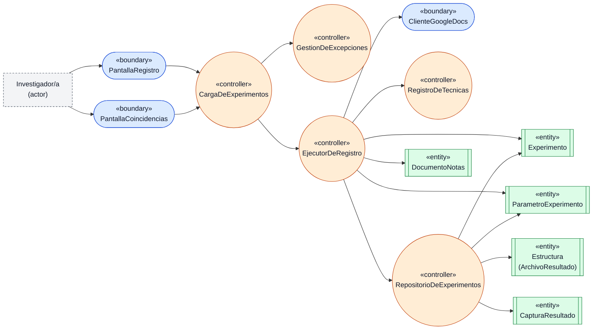
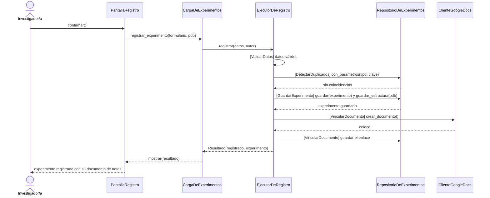
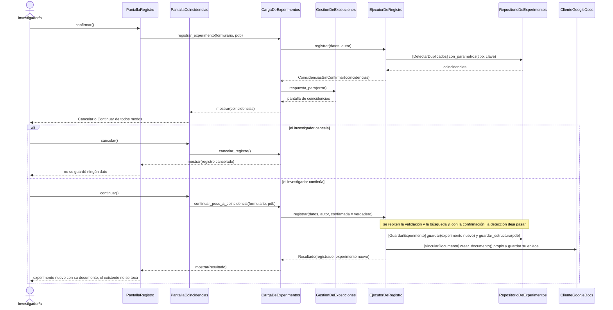
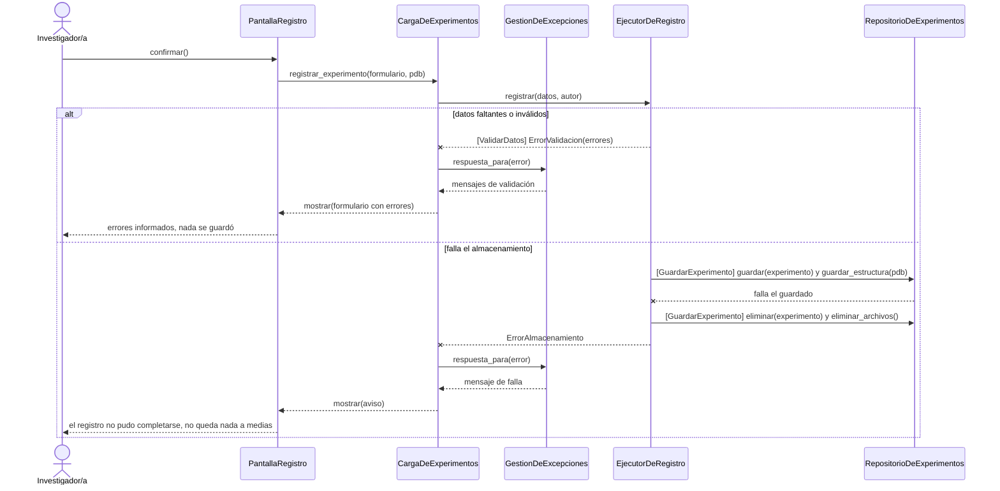

# BitacoraBio 2026 — Diseño detallado, implementación y pruebas (HU-01.A1)

**Materia:** Ingeniería del Software 2026 (FIUNER) · **Trabajo práctico:** TP4 — Diseño detallado, implementación y testing unitario
**Integrantes:** Nuñez Juliana, Segovia Lucas

> **Versión unificada.** Parte de dos borradores del grupo (el de Juliana y el de Lucas). De cada uno se conservó lo que estaba mejor resuelto; las decisiones del grupo están marcadas en 5.1 y las diferencias con el TP3, en 8.2.

---

## 1. Introducción

### 1.1 Propósito

Este documento baja a diseño detallado, código y pruebas una historia de usuario (HU) del sistema, partiendo de la arquitectura del TP3 (`docs/architecture/arquitectura.md`). Se trabaja **una sola HU de punta a punta**: análisis en tres dimensiones, diagrama de robustez, diagramas de secuencia, modelo de clases, implementación con interfaz gráfica mínima y pruebas unitarias con reporte de cobertura.

### 1.2 HU elegida

**HU-01.A1 · Continuar registro pese a coincidencia detectada** (deriva de CU-01, slice A1).

> Como investigador/a, quiero poder registrar igual mi experimento aunque el sistema encuentre uno similar ya cargado, para dejar constancia de una repetición intencional (por ejemplo, replicar un resultado o validar con otro software).

Criterio de aceptación:

- *Given* una coincidencia detectada por CU-00 y mostrada al investigador/a, *When* elige continuar de todos modos, *Then* el sistema registra el experimento como uno nuevo (autor, fecha, documento de notas propio), sin sobrescribir ni vincular el experimento existente.

**Alcance.** HU-01.A1 se trabaja con **HU-01.B1.1 (registrar experimento) incluida por completo como base**: A1 solo existe como una variante del registro, de modo que el diseño cubre el camino sin coincidencias de B1.1 (con sus tres criterios), el corte por coincidencia (punto de partida de A1 y de E3) y la continuación de A1. Criterios de B1.1 que se incluyen:

1. Proyecto existente, campos obligatorios válidos y sin coincidencias: se registran autor y fecha/hora y se guarda el experimento.
2. Un experimento previo con la misma molécula/ligando pero "inválido" no se reporta como coincidencia.
3. Con los campos opcionales vacíos, el experimento se guarda sin exigirlos.

**Google Docs, simulado.** La conexión real con Google Docs no se construye en este TP. Pero el criterio de A1 pide un *documento de notas propio*, así que el paso 4 del núcleo (*Vincular documento*) **sí se diseña y se ejecuta**, usando una interfaz `ClienteGoogleDocs` con una implementación simulada (`ClienteGoogleDocsSimulado`: no se conecta a ningún servicio, devuelve un enlace ficticio y recuerda lo creado). Con eso el criterio de A1 se cumple completo. Quedan **fuera de alcance**: la conexión real, el reintento cuando falla el vínculo (`HU-01.E1`) y el resto de `HU-01.B1.2`.

### 1.3 Por qué esta HU

| Condición de la consigna | Cómo se cumple |
|---|---|
| Asociada a un escenario de calidad | `EC-07` (principal del TP3): el registro es donde cada técnica aporta lo propio, y A1 usa la clave de coincidencia que define cada técnica. También se relaciona con `EC-11` (varias coincidencias sin perder lo cargado) |
| Atraviesa la estructura | Recorre las cuatro capas: Carga de experimentos (presentación) → Ejecutor de registro (servicios) → Registro de técnicas, los cuatro pasos y Técnica Docking (dominio) → Repositorio de experimentos, Acceso a capturas y estructuras y Cliente de Google Docs (acceso a datos y servicios externos) |
| Una decisión de arquitectura la afecta | `DA-02` (microkernel en el registro), `DA-03` (parámetros nombre-valor-unidad) y `DA-01` (capas) citan sus componentes |

Además de cumplir la consigna, A1 es relevante para el proyecto: la detección de duplicados es la razón de ser de BitacoraBio (evitar que el laboratorio repita un ensayo sin saberlo) y A1 es la salida cuando la repetición es **intencional**. Es la HU donde se juntan la regla central del negocio (qué es una coincidencia), el microkernel (la clave de coincidencia la define la técnica) y una decisión de flujo difícil de resolver bien: cortar el registro, pedir una confirmación y retomarlo sin pedir de nuevo los datos.

### 1.4 Siglas

HU: historia de usuario · CU: caso de uso · EC: escenario de calidad · DA: decisión de arquitectura · RF: requerimiento funcional · GRASP: patrones generales para asignar responsabilidades · CP: caso de prueba · PDB: formato de archivo de estructura molecular · C4: modelo de documentación de arquitectura en cuatro niveles.

---

## 2. Relación con la arquitectura

### 2.1 Tabla de coherencia

| Dimensión | Contenido |
|---|---|
| Funcionalidad | `HU-01.A1`, que incluye `HU-01.B1.1` como base. Slice de `CU-01` (con `CU-00`). Caminos: registro sin coincidencias (B1.1); corte por coincidencia con pedido de confirmación; continuar de todos modos (A1); rechazo por datos inválidos; falla al guardar archivos (se revierte). Realiza `RF-01`, `RF-02`, `RF-03`, `RF-04` y `RF-08` |
| Estructura | Contenedor *Aplicación del catálogo* (Python/Flask). Estilo: cliente-servidor como base y microkernel en el registro. Patrón: capas relajadas (presentación, servicios, dominio, acceso a datos y servicios externos). Componentes: **Carga de experimentos** (presentación; en el TP3 se llama *Rutas de registro*); **Ejecutor de registro** (servicios); **Registro de técnicas, Validar datos, Detectar duplicados, Guardar experimento, Vincular documento y Técnica Docking** (dominio); **Repositorio de experimentos, Acceso a capturas y estructuras** (en el TP3, *Acceso a archivos*) **y Cliente de Google Docs** (acceso a datos y servicios externos); **Gestión de excepciones** (transversal). Componente principal: *Detectar duplicados* |
| Calidad | `EC-07`: agregar una técnica nueva sin modificar el núcleo ni columnas existentes. Tácticas: diferir el enlace (plug-ins) y parametrización (parámetros nombre-valor-unidad). Respaldo: `DA-02` y `DA-03` (con `DA-01`). También `EC-11` (varias coincidencias sin recargar lo cargado), que se resuelve reenviando los mismos datos con la confirmación |
| Dominio | `Experimento`, `ParametroExperimento`, `ArchivoResultado` y `DocumentoNotas` (se crean); `CapturaResultado` (si vienen, se guardan); `Proyecto` (se consulta su existencia) y `Usuario` (solo el autor). Ver 3.2 |
| Verificación | `CP-11`: se agrega una técnica de prueba (dinámica molecular) solo con registrarla; el registro, la detección con su clave y el guardado funcionan sin tocar el núcleo ni la entidad `Experimento` (medida de `DA-02` y de `EC-07`). `CP-05` y `CP-05b` para el criterio de A1 |

### 2.2 Estilo y patrones que rigen y cómo se respetan

| Restricción del TP3 | Cómo se respeta en el diseño |
|---|---|
| Capas: una capa no depende de las superiores; las flechas van hacia abajo | La carga de experimentos llama al servicio; el servicio, al dominio; el dominio, a las interfaces del acceso a datos. Ningún módulo importa uno de una capa superior |
| La capa de servicios no tiene lógica | `EjecutorDeRegistro.registrar` solo pide la técnica, crea la solicitud y ejecuta los pasos en orden. No tiene ningún `if` sobre reglas |
| Microkernel: los plug-ins no se comunican entre sí ni modifican el núcleo | `TecnicaDocking` solo implementa la interfaz `Tecnica`; no conoce otros plug-ins ni los pasos |
| Microkernel: lo propio de la técnica está en el plug-in | Parámetros, validaciones propias y clave de coincidencia están en `TecnicaDocking`; los pasos las piden a través de la solicitud y no nombran ninguna técnica |
| Los pasos no se llaman entre sí | Los ejecuta `EjecutorDeRegistro`; cada uno recibe y completa la `SolicitudRegistro` |

---

## 3. Diseño de la HU

### 3.1 Enunciado y criterios

Ver 1.2. Los criterios de aceptación de B1.1 y de A1 son la fuente de los casos de prueba (sección 7). Tres caminos:

| Camino | Criterios | Resultado |
|---|---|---|
| **A.** Sin coincidencia (incluye el previo inválido y los opcionales vacíos) | B1.1 c1, c2, c3 | Se guarda el experimento y se crea su documento de notas |
| **B.** Con coincidencia, sin confirmar | La parte "mostrada" de A1 | El registro se corta y se muestra la lista de coincidencias |
| **C.** Con coincidencia, confirmada | A1 | Se guarda como experimento nuevo, con su propio documento de notas |

Además: **D** (datos faltantes o inválidos) y **E** (falla al guardar los archivos), que son rechazos de B1.1. Los caminos A y B se muestran en la **secuencia 1**, el C (con la cancelación) en la **secuencia 2** y los rechazos D y E en la **secuencia 3** (3.5).

### 3.2 Entidades del modelo de dominio que intervienen

Se marcaron los sustantivos de los criterios (proyecto, campos obligatorios, molécula/ligando, coincidencia, experimento previo, estado de validez, autor, fecha/hora, campos opcionales, capturas, documento de notas) y se buscaron en el modelo de dominio del TP1.

| Entidad del modelo (TP1) | ¿Interviene? | Qué usa la HU de ella | La HU la... | ¿Se dibuja? |
|---|---|---|---|---|
| `Experimento` | Sí | Tipo, autor, fecha de carga, estado de validez, campos opcionales, parámetros, "Similar a", rutas y enlace al documento | **Crea** (el nuevo) y **consulta** (los previos) | Sí |
| `ParametroExperimento` | Sí | Nombre, valor y unidad. La molécula/proteína y el ligando son parámetros (`DA-03`) y forman la clave de coincidencia del docking | Crea (los del nuevo) y consulta (los de los previos) | Sí |
| `ArchivoResultado` (la *estructura* PDB) | Sí | El PDB es obligatorio; se guarda en el almacén y el experimento conserva su ruta (`DA-04`) | Crea | Sí (robustez); en el código es la ruta guardada en `Experimento` |
| `CapturaResultado` | Sí, de forma mínima | Las capturas son opcionales; si vienen se guardan igual que el PDB | Crea | Sí (robustez); en el código, rutas en `Experimento` |
| `DocumentoNotas` | Sí, simulado | El documento de notas propio de cada experimento (criterio de A1). Se guarda su enlace | Crea | Sí (robustez); en el código, el enlace en `Experimento` |
| `Proyecto` | Referencia | Solo su identificador: `ValidarDatos` comprueba que existe | Consulta la existencia; no lo modifica | No: no hay comportamiento que mostrar |
| `Usuario` | Referencia | Solo la identidad del autor (relación "registra"). La autenticación está fuera del desarrollo (RA-01): el sistema recibe el identificador del usuario identificado y lo guarda como autor | No lo consulta ni lo modifica | No: viaja como `autor` dentro de la solicitud, igual que el identificador de `Proyecto` |

**Por qué `Usuario` y `Proyecto` no aparecen como entidades en los diagramas.** Ninguna regla de esta HU necesita sus datos, solo sus identificadores. Dibujarlos como entidades sugeriría una interacción que no existe. `ArchivoResultado`, `CapturaResultado` y `DocumentoNotas` sí se dibujan en la robustez porque se crean, pero en el diagrama de clases no son clases propias: no tienen comportamiento en esta HU y el `Experimento` conserva solo su ruta o su enlace.

**Cambios y decisiones sobre el modelo.**

| Cambio o decisión | Motivo |
|---|---|
| `Experimento` tiene los atributos `tipo` y `fecha_de_carga` (cambio al modelo del TP1; verificar que esté aplicado en `srs.md`) | `RF-02` y `RF-03` hablan de la fecha de carga y de comparar "el mismo tipo"; el modelo no los mostraba. El autor ya está en la relación `Usuario "registra" Experimento` |
| Molécula/proteína, ligando y software **no** son atributos de `Experimento`: son parámetros de la técnica | Es lo que dice `DA-03` y lo que permite que `EC-07` cumpla "0 columnas modificadas" |
| **"Similar a" se conserva en el dominio** (`Experimento.similar_a`, lista de identificadores) | Está en el formulario del TP1/TP2. Sirve para marcar réplicas: **un experimento declarado en "Similar a" no se cuenta como coincidencia**. No se vincula nada al continuar (A1 pide "sin vincular el existente"): el campo lo declara el usuario antes |

### 3.3 Análisis tridimensional

| Dimensión | Elemento | Detalle |
|---|---|---|
| Funcionalidad | B1.1 c1 | Con proyecto existente, campos válidos y sin coincidencias, registrar autor y fecha/hora y guardar el experimento (secuencia 1) |
| Funcionalidad | B1.1 c2 | Un experimento previo inválido no se reporta como coincidencia |
| Funcionalidad | B1.1 c3 | Los campos opcionales vacíos no impiden guardar |
| Funcionalidad | A1 (parte "mostrada") | Con coincidencia y sin confirmación, no guardar nada y mostrar los experimentos coincidentes (secuencia 2) |
| Funcionalidad | A1 | Con coincidencia y confirmación, guardar como nuevo, con su propio documento de notas, sin tocar el existente (secuencia 2) |
| Funcionalidad | Rechazos | Datos faltantes o inválidos: informar y no guardar. Falla al guardar archivos: revertir y no dejar un experimento a medias (secuencia 3) |
| Estructura | Frontera | `PantallaRegistro` (formulario), `PantallaCoincidencias` (tabla con "Continuar" y "Cancelar") y `ClienteGoogleDocs` (interfaz hacia el servicio externo, simulado) |
| Estructura | Control | Los cinco controllers de la robustez: `CargaDeExperimentos`, `GestionDeExcepciones`, `EjecutorDeRegistro` (coordina el proceso; cada paso conserva su responsabilidad), `RegistroDeTecnicas` (con el plug-in Docking) y `RepositorioDeExperimentos` (experimentos, estructuras y capturas) |
| Estructura | Dominio | `Experimento`, `ParametroExperimento`, las estructuras (PDB), las capturas y el documento de notas |
| Calidad | `EC-07` | La clave de coincidencia, las validaciones y los parámetros los define el plug-in: una técnica nueva no cambia el núcleo ni la entidad |
| Calidad | `EC-11` | Al continuar de todos modos no hay que volver a cargar ningún dato: se reenvía lo mismo con la confirmación |

### 3.4 Diagrama de robustez

Leyenda: borde punteado = actor; rectángulo redondeado azul = boundary; círculo naranja = controller; rectángulo con barras verde = entity.



**Reglas de conexión.** El actor solo toca las pantallas; las pantallas solo tocan a `CargaDeExperimentos`; ninguna frontera toca una entidad; los controllers se coordinan entre sí y manipulan las entidades; el único acceso a un sistema externo (Google Docs) pasa por una frontera, `ClienteGoogleDocs`, a la que llega solo `EjecutorDeRegistro`. Como es una frontera, no se conecta con `DocumentoNotas`: esa entidad la maneja el ejecutor. El repositorio se dibuja como controller, igual que en el ejemplo resuelto de la cátedra. Las entidades salen de la tabla 3.2. `SolicitudRegistro` no se dibuja: es el objeto de datos que viaja entre los pasos (TP3, 5.2.2), no una frontera, un controlador ni una entidad del TP1; por eso no es participante de las secuencias y se ve en el diagrama de clases.

**Criterio de este diagrama: pocos controllers, cada uno con una responsabilidad principal.** El profesor indicó que con 8 controllers ya eran demasiados, y la referencia pide evitar controllers que concentren demasiado y también uno por cada paso. Quedan cinco, que representan las **responsabilidades principales** de la HU. Algunos **agrupan** responsabilidades que el diseño detallado delega en clases especializadas: agrupar en la robustez evita un controller por paso, pero **no elimina la separación de responsabilidades** del modelo de clases. Los cinco controllers no son uno por capa: el TP3 tiene cuatro capas más una responsabilidad transversal, y el reparto es otro (presentación → `CargaDeExperimentos`; servicios y los pasos del dominio → `EjecutorDeRegistro`; microkernel de técnicas → `RegistroDeTecnicas`; acceso a datos → `RepositorioDeExperimentos`; transversal → `GestionDeExcepciones`). `GestionDeExcepciones` se mantiene por indicación del profesor.

| Controller | Responsabilidad principal | Clases del diseño detallado que lo componen | Capa del TP3 | Criterio GRASP |
|---|---|---|---|---|
| `CargaDeExperimentos` | Recibir el formulario y armar la respuesta | `CargaDeExperimentos` | Presentación | Controlador de entrada: traduce entre el usuario y el servicio, sin reglas |
| `GestionDeExcepciones` | Traducir los errores previstos en respuestas | `GestionDeExcepciones` | Transversal | Aspecto transversal (TP3, 5.4) |
| `EjecutorDeRegistro` | **Coordinar el proceso completo de registro** | `EjecutorDeRegistro` **coordina**: pide la técnica, crea la solicitud y ejecuta los pasos en orden. Cada paso **conserva su responsabilidad** y es una clase aparte: `ValidarDatos`, `DetectarDuplicados`, `GuardarExperimento` y `VincularDocumento` (todos son `PasoDeRegistro`) | Servicios (el coordinador) y dominio (los pasos) | Controlador: el flujo de "registrar un experimento" tiene un solo punto de coordinación. Alta cohesión: cada paso hace una sola cosa |
| `RegistroDeTecnicas` | Entregar la técnica del tipo elegido | `RegistroDeTecnicas`, que administra al plug-in `TecnicaDocking` (el plug-in no es controller ni participante propio) | Dominio (microkernel) | Variaciones protegidas (`EC-07`) |
| `RepositorioDeExperimentos` | Guardar y recuperar lo que produce el registro | Dos interfaces separadas: `RepositorioExperimentos` (`existe_proyecto`, `existe_experimento`, `con_parametros`, `guardar`, `actualizar_rutas`, `eliminar`) y `AccesoACapturasYEstructuras` (`guardar_estructura`, `guardar_captura`, `eliminar_archivos`) | Acceso a datos | Bajo acoplamiento: los pasos no saben cómo se guarda. Alta cohesión: solo guarda y recupera |

**Cómo se delega dentro de un controller agrupado.** En las secuencias, `EjecutorDeRegistro` figura como el participante que representa al proceso, y el mensaje que corresponde a un paso lleva su etiqueta entre corchetes (por ejemplo `[GuardarExperimento]`). Los mensajes hacia `RepositorioDeExperimentos` agrupan las operaciones de las interfaces que lo componen. No se agregan participantes nuevos, y las llamadas internas de cada paso (técnica, consultas, detalle de archivos) no se dibujan: están en el modelo de clases.

**Qué pasó con los controllers de la versión anterior.** `ValidarDatos`, `DetectarDuplicados`, `GuardarExperimento` y `VincularDocumento` dejaron de ser participantes independientes, y también `TecnicaDocking`, `RepositorioExperimentos` y `AccesoACapturasYEstructuras`. `ClienteGoogleDocs` se reclasifica como boundary porque es la interfaz hacia un sistema externo.

**Riesgo a tener en cuenta.** La referencia dice que "lo que no aparece en la secuencia no aparece en las clases". Las clases de los pasos, la técnica y las dos interfaces de acceso aparecen en las secuencias **solo como etiquetas de los mensajes** (los pasos) o no aparecen (la técnica y el detalle de las interfaces), no como participantes. Está registrado como diferencia en la validación del modelo de clases (sección 4) y queda a confirmar con el docente.

**Dónde vive cada regla de negocio.**

| Regla | Dónde vive | Por qué |
|---|---|---|
| Qué parámetros son obligatorios y su formato | `TecnicaDocking` los declara; `ValidarDatos` los aplica | Cambian con la técnica (`EC-07`) y aplicarlos es igual para todas. La pantalla no decide: solo muestra los errores |
| Qué identifica una coincidencia (en docking: mismo tipo, molécula/proteína y ligando) | `TecnicaDocking.clave_de_coincidencia(parametros)` | Es lo que cambia con un tipo de ensayo nuevo, y por eso el Detector no se toca |
| Buscar los candidatos con ese tipo y esa clave | `RepositorioExperimentos.con_parametros` | Solo trae datos; no decide reglas |
| No cuentan como coincidencia los inválidos ni los declarados en "Similar a" | `DetectarDuplicados` (usa el estado y `similar_a` de cada candidato, sin delegar en la entidad) | Es la regla del paso 2 (`RF-03`) y depende de la solicitud en curso |
| Con coincidencias sin confirmar, el registro se corta; confirmadas, sigue | `DetectarDuplicados` | Es la regla del paso (`RF-04`). El ejecutor no decide nada |
| Siempre se crea un experimento nuevo; nunca se toca el existente | `GuardarExperimento` | No recibe ni modifica los experimentos de las coincidencias |
| Autor y fecha de carga se asignan solos | `GuardarExperimento` | Es el paso que construye el experimento (`RF-02`) |
| Cada experimento tiene su propio documento de notas | `VincularDocumento` | Crea un documento por experimento y nunca reutiliza el de otro |
| Si falla el guardado de archivos se revierte el experimento | `GuardarExperimento` | Cierra la consistencia entre los dos almacenes (TP3, 5.6) |
| Qué pasos correr y en qué orden | `EjecutorDeRegistro` | Es una regla de servicio, no del negocio |

**Elemento → componente del TP3 → capa.**

| Elemento | Componente del TP3 | Capa |
|---|---|---|
| `PantallaRegistro`, `PantallaCoincidencias` | Rutas de registro (plantillas HTML) | Presentación |
| `CargaDeExperimentos` | Rutas de registro (renombrado, ver 8.2) | Presentación |
| `GestionDeExcepciones` | Gestión de excepciones | Transversal |
| `EjecutorDeRegistro` | Ejecutor de registro, Validar datos, Detectar duplicados, Guardar experimento y Vincular documento (pasos 1 a 4) | Servicios y dominio (núcleo) |
| `RegistroDeTecnicas` | Registro de técnicas y Técnica Docking | Dominio (microkernel) |
| `RepositorioDeExperimentos` | Repositorio de experimentos y Acceso a archivos (renombrado, ver 8.2) | Acceso a datos |
| `ClienteGoogleDocs` (boundary) | Cliente de Google Docs (simulado) | Acceso a datos y servicios externos |
| `Experimento`, `ParametroExperimento`, estructuras, capturas, `DocumentoNotas` | Entidades del modelo de dominio (no son un componente del TP3) | Dominio |

### 3.5 Diagramas de secuencia

Se dibujan **tres secuencias cortas**, una por situación: (1) registro sin coincidencias, (2) registro con coincidencias, con la cancelación y la continuación (HU-01.A1) y (3) excepciones. Los participantes son los elementos del diagrama de robustez más el actor, y el actor solo interactúa con las pantallas. Los diagramas muestran **los mensajes clave entre participantes**, no el detalle interno de cada paso. Los errores previstos (`CoincidenciasSinConfirmar`, `ErrorValidacion`, `ErrorAlmacenamiento`) son excepciones que cortan el registro: los pasos siguientes no se ejecutan.

**Convención.** `EjecutorDeRegistro` coordina el proceso y cada paso hace su trabajo. Los pasos no son participantes: un mensaje que sale de `EjecutorDeRegistro` o de un paso se marca con la etiqueta del paso entre corchetes (por ejemplo `[GuardarExperimento]`) para que se vea qué paso es responsable, sin agregar participantes. Los mensajes hacia `RepositorioDeExperimentos` agrupan operaciones del mismo momento (por ejemplo, guardar el experimento y su estructura).

**Qué se omite en los diagramas** (existe en el código y en el modelo de clases, sección 4):
- La creación de `SolicitudRegistro` (el objeto de datos que viaja entre los pasos, ver 3.4).
- El pedido de la técnica a `RegistroDeTecnicas` y las operaciones de la técnica (`definiciones`, `validar`, `clave_de_coincidencia`).
- Las consultas de `ValidarDatos` al repositorio (`existe_proyecto`, `existe_experimento`).
- El detalle del guardado de archivos (`guardar_estructura`, `guardar_captura`) y de la actualización de rutas (`actualizar_rutas`): se resumen en un mensaje de guardado.
- La creación del `Experimento` como mensaje aparte y las respuestas intermedias que no aportan.

Por eso `RegistroDeTecnicas` no aparece en las secuencias: su participación (entregar la técnica del tipo elegido) es interna al ejecutor y se ve en el modelo de clases.

**Secuencia 1. Registro sin coincidencias (HU-01.B1.1)**



**Secuencia 2. Registro con coincidencias (HU-01.A1)**



**Secuencia 3. Excepciones**



En la rama de falla de almacenamiento se asume que la validación y la detección ya pasaron (no se repiten en el diagrama). La reversión se resuelve con la compensación del diagrama (eliminar el experimento y sus archivos). Cómo se cubre que falle la propia compensación queda como sacrificio ya declarado en el TP3 (5.6).

**Entidades.** Ninguna entidad es participante de las secuencias: `Experimento` se crea y se completa dentro de los pasos, y `Estructura`, `CapturaResultado` y `DocumentoNotas` se representan por la ruta o el enlace que el repositorio y `ClienteGoogleDocs` devuelven. Ninguna tiene reglas propias en esta HU (ver 4). Es una diferencia con la referencia, registrada en 4.1 y a confirmar con el docente.

**Asignación de responsabilidades (GRASP).** Se detalla por clase del diseño. Las clases de los cuatro pasos pertenecen al controller `EjecutorDeRegistro`; `TecnicaDocking`, a `RegistroDeTecnicas`; y `RepositorioExperimentos` y `AccesoACapturasYEstructuras`, a `RepositorioDeExperimentos`.

| Responsabilidad | Quién | Criterio |
|---|---|---|
| Recibir el formulario y armar la respuesta | `CargaDeExperimentos` | Controlador de entrada: traduce entre el usuario y el servicio; no decide reglas |
| Ordenar los pasos y obtener la técnica | `EjecutorDeRegistro` | Controlador: coordina sin hacer el trabajo, y así los pasos no se conocen entre sí (bajo acoplamiento) |
| Entregar la técnica del tipo elegido | `RegistroDeTecnicas` | Variaciones protegidas: es el único que sabe qué técnicas existen |
| Declarar parámetros, reglas propias y clave de coincidencia | `TecnicaDocking` | Experto en información + variaciones protegidas (`EC-07`) |
| Aplicar obligatoriedad y formato; comprobar que el proyecto existe | `ValidarDatos` | Alta cohesión: un paso, una responsabilidad |
| Buscar coincidencias, filtrarlas y decidir si corta | `DetectarDuplicados` | Alta cohesión: es todo lo que hace. Usa la clave de la técnica y los datos de cada candidato |
| Traer los candidatos con un tipo y una clave | `RepositorioExperimentos` | Bajo acoplamiento: los pasos no saben cómo se guarda; se puede reemplazar por uno en memoria |
| Construir el experimento nuevo con autor y fecha | `GuardarExperimento` | Creador: tiene los datos de la solicitud |
| Crear el documento de notas y guardar su enlace | `VincularDocumento` | Alta cohesión; el servicio externo queda detrás de `ClienteGoogleDocs` |
| Guardar estructuras y capturas | `AccesoACapturasYEstructuras` | Ídem para los archivos |
| Traducir errores previstos en respuestas | `GestionDeExcepciones` | Aspecto transversal (TP3, 5.4) |

---

## 4. Modelo de clases

Un solo diagrama, contrastado con el código implementado (se extrajeron las clases y operaciones públicas del código y se compararon con este diagrama) y validado contra la robustez y las secuencias en la tabla de abajo. `CargaDeExperimentos` (módulo `carga_experimentos.py`, con funciones de Flask) y las pantallas (plantillas HTML) se muestran como clases solo porque participan en las secuencias.

```mermaid
classDiagram
    class PantallaRegistro {
        +confirmar()
        +mostrar(resultado)
    }
    class PantallaCoincidencias {
        +mostrar(coincidencias)
        +continuar()
        +cancelar()
    }
    class CargaDeExperimentos {
        +formulario()
        +registrar_experimento(formulario, pdb)
        +continuar_pese_a_coincidencia(formulario, pdb)
        +cancelar_registro()
    }
    class GestionDeExcepciones {
        +respuesta_para(error) dict
    }
    class EjecutorDeRegistro {
        -tecnicas: RegistroDeTecnicas
        -pasos: PasoDeRegistro[]
        +registrar(datos, autor, confirmada) Resultado
    }
    class Resultado {
        +registrado: bool
        +experimento: Experimento
    }
    class RegistroDeTecnicas {
        +registrar(tecnica)
        +tecnica(tipo) Tecnica
        +disponibles() Tecnica[]
    }
    class Tecnica {
        <<interface>>
        +definiciones() DefinicionDeParametro[]
        +validar(parametros) str[]
        +clave_de_coincidencia(parametros) dict
        +parametros_resumen() str[]
    }
    class TecnicaDocking {
        +definiciones() DefinicionDeParametro[]
        +validar(parametros) str[]
        +clave_de_coincidencia(parametros) dict
        +parametros_resumen() str[]
    }
    class DefinicionDeParametro {
        +nombre
        +etiqueta
        +unidad
        +obligatorio: bool
        +max_largo: int
    }
    class DatosRegistro {
        +proyecto_id
        +tipo
        +fecha_realizacion
        +valores: dict
        +extras
        +hardware
        +tiempo_procesamiento
        +objetivo
        +hipotesis
        +notas
        +estado_validez
        +similar_a: str[]
        +pdb: bytes
        +capturas
    }
    class SolicitudRegistro {
        +datos: DatosRegistro
        +autor
        +tecnica: Tecnica
        +confirmada: bool
        +coincidencias: Experimento[]
        +experimento: Experimento
        +parametros() ParametroExperimento[]
    }
    class PasoDeRegistro {
        <<interface>>
        +ejecutar(solicitud)
    }
    class ValidarDatos
    class DetectarDuplicados
    class GuardarExperimento
    class VincularDocumento
    class RepositorioExperimentos {
        <<interface>>
        +existe_proyecto(proyecto_id) bool
        +existe_experimento(experimento_id) bool
        +con_parametros(tipo, clave) Experimento[]
        +guardar(experimento) str
        +actualizar_rutas(experimento)
        +eliminar(experimento_id)
    }
    class AccesoACapturasYEstructuras {
        <<interface>>
        +guardar_estructura(experimento_id, pdb) str
        +guardar_captura(experimento_id, nombre, contenido) str
        +eliminar_archivos(experimento_id)
    }
    class ClienteGoogleDocs {
        <<interface>>
        +crear_documento(titulo) str
    }
    class Experimento {
        +id
        +proyecto_id
        +tipo
        +autor
        +fecha_de_carga
        +fecha_realizacion
        +estado_validez
        +similar_a: str[]
        +parametros: ParametroExperimento[]
        +hardware
        +tiempo_procesamiento
        +objetivo
        +hipotesis
        +notas
        +ruta_pdb
        +rutas_capturas: str[]
        +documento_notas
        +valor_de(nombre) str
    }
    class ParametroExperimento {
        +nombre
        +valor
        +unidad
        +mismo_valor_que(valor) bool
    }
    class CoincidenciasSinConfirmar {
        <<excepcion>>
        +coincidencias: Experimento[]
        +clave: dict
    }
    class ErrorValidacion {
        <<excepcion>>
        +errores: str[]
    }
    class ErrorAlmacenamiento {
        <<excepcion>>
        +detalle
    }
    PantallaRegistro --> CargaDeExperimentos
    PantallaCoincidencias --> CargaDeExperimentos
    CargaDeExperimentos --> EjecutorDeRegistro
    CargaDeExperimentos ..> GestionDeExcepciones
    EjecutorDeRegistro --> RegistroDeTecnicas
    EjecutorDeRegistro --> PasoDeRegistro
    EjecutorDeRegistro ..> SolicitudRegistro : crea
    EjecutorDeRegistro ..> Resultado : devuelve
    RegistroDeTecnicas --> Tecnica
    TecnicaDocking ..|> Tecnica
    Tecnica ..> DefinicionDeParametro
    SolicitudRegistro --> DatosRegistro
    SolicitudRegistro --> Tecnica
    SolicitudRegistro --> Experimento
    ValidarDatos ..|> PasoDeRegistro
    DetectarDuplicados ..|> PasoDeRegistro
    GuardarExperimento ..|> PasoDeRegistro
    VincularDocumento ..|> PasoDeRegistro
    ValidarDatos ..> Tecnica : usa
    ValidarDatos --> RepositorioExperimentos
    DetectarDuplicados ..> Tecnica : usa
    DetectarDuplicados --> RepositorioExperimentos
    DetectarDuplicados ..> CoincidenciasSinConfirmar : lanza
    ValidarDatos ..> ErrorValidacion : lanza
    GuardarExperimento --> RepositorioExperimentos
    GuardarExperimento --> AccesoACapturasYEstructuras
    GuardarExperimento ..> Experimento : crea
    GuardarExperimento ..> ErrorAlmacenamiento : lanza
    VincularDocumento --> RepositorioExperimentos
    VincularDocumento --> ClienteGoogleDocs
    RepositorioExperimentos ..> Experimento
    Experimento "1" --> "*" ParametroExperimento
```



Implementaciones concretas de los puertos, que no se dibujan porque se eligen al arrancar: `RepositorioExperimentosEnMemoria`, `AccesoACapturasYEstructurasEnMemoria` y `ClienteGoogleDocsSimulado`.

**Lo que se dejó afuera a propósito:** `Usuario` y `Proyecto` (solo viajan como identificadores), las entidades `ArchivoResultado`, `CapturaResultado` y `DocumentoNotas` como clases (el `Experimento` conserva su ruta o su enlace), y un patrón formal para la cadena de pasos (alcanza con la interfaz común `PasoDeRegistro`).

### 4.1 Validación del diagrama de clases contra la robustez y las secuencias

La consigna pide contrastar el diagrama con el diseño y anotar cada diferencia con su resolución.

| Diferencia encontrada | Qué estaba mal | Qué se hizo |
|---|---|---|
| `ValidarDatos`, `DetectarDuplicados`, `GuardarExperimento`, `VincularDocumento` y `TecnicaDocking` son clases y no participantes de las secuencias (los pasos aparecen como etiquetas entre corchetes en los mensajes y `TecnicaDocking`, solo en el modelo de clases) | El diseño agrupa los pasos en `EjecutorDeRegistro` y el plug-in en `RegistroDeTecnicas` para no tener un controller por paso | Se mantienen como clases separadas (una responsabilidad cada una y `EC-07`). **A confirmar con el docente** si lo acepta o si exige participantes |
| `RepositorioExperimentos` y `AccesoACapturasYEstructuras` son interfaces separadas pero un solo controller en robustez | Solo la agrupación del robustez | Las secuencias agrupan sus mensajes hacia el controller. Las operaciones de archivos (`guardar_estructura`, `guardar_captura`, `eliminar_archivos`) son de `AccesoACapturasYEstructuras` y las de experimentos (incluidas `actualizar_rutas` y `eliminar`) son de `RepositorioExperimentos` |
| `guardar_captura` y `existe_experimento` estaban en el código y en las clases, pero no en las secuencias | No es un error: son detalle interno | Son operaciones internas de los pasos y del repositorio: están en el modelo de clases y se omiten de las secuencias, que muestran solo los mensajes clave (3.5) |
| `Estructura`, `CapturaResultado` y `DocumentoNotas` son entidades en la robustez y no son clases del código | No tienen reglas ni comportamiento en esta HU: son una ruta o un enlace dentro de `Experimento` | Se dejan como atributos. **A confirmar con el grupo:** mantenerlas en la robustez (modelo del TP1) o sacarlas |
| Los atributos opcionales de `Experimento` y de `DatosRegistro` (`hardware`, `objetivo`, `hipotesis`, `notas`, etc.) no estaban en el diagrama | Se había simplificado | Se agregaron al diagrama |
| Las operaciones de las pantallas (`confirmar`, `mostrar`, `continuar`, `cancelar`) no son métodos del código | Son formularios y plantillas HTML | Se mantienen como mensajes de la frontera. Las rutas del código se llaman como en las secuencias (`registrar_experimento`, `continuar_pese_a_coincidencia`, `cancelar_registro`) |
| `ServicioConsulta` y `ErrorPrevisto` están en el código y no en el diagrama | `ServicioConsulta` arma las listas del formulario y no participa de la HU; `ErrorPrevisto` es la base de las excepciones | Se dejan afuera del diagrama |


---

## 5. Justificación del diseño

### 5.1 Responsabilidades y decisiones

| Decisión | Por qué | Costo |
|---|---|---|
| **La técnica arma la clave de coincidencia:** `Tecnica.clave_de_coincidencia(parametros)` devuelve un diccionario nombre → valor | Se comparó con la alternativa de que la técnica solo devolviera los *nombres* y la solicitud armara el diccionario. Se eligió la primera: la regla completa queda en el plug-in (`EC-07`), `SolicitudRegistro` sigue siendo un portador de datos sin reglas, `DetectarDuplicados` no nombra "proteína" ni "ligando", y la clave se prueba sola | La técnica recibe los parámetros ya armados en cada llamada |
| **El repositorio trae candidatos y el paso aplica las reglas:** `con_parametros(tipo, clave)` devuelve todos los del mismo tipo y clave; `DetectarDuplicados` descarta los inválidos y los declarados en "Similar a" usando los datos de cada candidato | Es lo que pide la Tabla 6 del TP3 (el acceso a datos no decide reglas). La decisión es **no delegar el filtrado en `Experimento`** | `Experimento` es más una estructura de datos que un objeto con comportamiento (en esta HU) |
| `Tecnica` es una interfaz con `definiciones()` y `validar(parametros)` | `ValidarDatos` aplica obligatoriedad y formato a partir de las definiciones (un solo lugar para todas las técnicas) y la técnica aporta solo sus reglas propias. Evita duplicar la obligatoriedad | Dos operaciones donde una "validar" podría hacerlo todo |
| `PasoDeRegistro` con una sola operación `ejecutar(solicitud)` | Todos los pasos tienen la misma forma: el ejecutor los recorre sin conocerlos y los pasos no se llaman entre sí | — |
| `EjecutorDeRegistro` solo ordena y devuelve un `Resultado` | La consigna del TP3 pide una capa de servicios sin lógica. Para probar el orden y el corte alcanza un paso espía (`CP-10`) | Es una clase de pocas líneas; se justifica porque es el componente definido en el TP3 y el lugar donde se agrega un paso nuevo |
| Un único objeto (`SolicitudRegistro`) viaja por los pasos | Evita que los pasos se pasen datos entre sí y es lo que decidió el TP3 | Es una "bolsa de datos"; se acepta porque los pasos le agregan resultados en un orden fijo |
| El corte por coincidencia es una excepción (`CoincidenciasSinConfirmar`) | Corta el registro sin que el ejecutor tenga que preguntar "¿hay que seguir?" después de cada paso, y lleva la lista de coincidencias y la clave que se usó | Se usa una excepción para un camino normal del negocio; se justifica porque el TP3 define los errores previstos como el mecanismo que corta el registro |
| Para continuar, el registro corre **desde el principio** con `confirmada = verdadero` | Es la decisión del TP3: no se guarda nada entre solicitudes y los datos se vuelven a validar | Repite la validación y la búsqueda; es despreciable para este volumen |
| Los datos y el PDB se reenvían en el propio formulario de coincidencias | Cumple `EC-11` (0 campos que recargar) sin guardar nada en el servidor | El PDB viaja dos veces (unos 250 KB) |
| Las interfaces `RepositorioExperimentos`, `AccesoACapturasYEstructuras` y `ClienteGoogleDocs` | Se cambian la persistencia, el almacén o el servicio externo sin tocar los pasos; las pruebas usan versiones en memoria y un doble que falla. Google Docs queda simulado sin cambiar el diseño | Interfaces con una sola implementación real cada una; se justifica por el cambio previsto a PostgreSQL, por la conexión real a Google Docs y por las pruebas |
| `GuardarExperimento` guarda el experimento y después los archivos, y revierte si falla | Los dos almacenes no comparten transacción (TP3, 5.6) | Si falla el propio `eliminar`, queda un residuo; se acepta para el alcance |
| `VincularDocumento` va después de guardar | El documento necesita el id del experimento. Si el vínculo falla, el experimento ya existe (es el escenario `E1`, fuera de alcance) | El reintento no está implementado |

### 5.2 Patrones de diseño usados

No se usaron patrones por obligación. Aparecen dos por el problema concreto que resuelven:

| Patrón | Problema que resuelve | Dónde está |
|---|---|---|
| Strategy (la interfaz `Tecnica` con sus implementaciones) | Variar parámetros, validaciones y clave de coincidencia según el tipo de ensayo sin condicionales en el núcleo (`EC-07`) | `Tecnica`, `TecnicaDocking` y `RegistroDeTecnicas` |
| Repository (`RepositorioExperimentos`) | Que el dominio no conozca cómo se guardan los datos | `RepositorioExperimentos` y su implementación en memoria |

No se usó Factory para elegir la técnica: un diccionario en `RegistroDeTecnicas` alcanza.

---

## 6. Implementación

### 6.1 Estructura del código

```text
src/
├── dominio/          # entidades, solicitud, técnica (interfaz y plug-in Docking), Registro de técnicas, puertos
│   └── pasos/        # PasoDeRegistro, ValidarDatos, DetectarDuplicados, GuardarExperimento, VincularDocumento
├── servicios/        # EjecutorDeRegistro y Resultado (y ServicioConsulta, apoyo de la interfaz)
├── acceso_datos/     # repositorio, acceso a capturas y estructuras y Google Docs: implementaciones simuladas
├── presentacion/     # CargaDeExperimentos (rutas de Flask) y plantillas HTML
├── transversal/      # Gestión de excepciones
└── arranque.py       # único lugar que arma los objetos concretos
tests/
```

Las cuatro capas del TP3 se ven como carpetas. Las dependencias van en un solo sentido: presentación → servicios → dominio; el acceso a datos implementa los puertos del dominio y solo usa sus entidades.

### 6.2 Cómo se ejecuta

Las instrucciones completas están en el `README.md`: instalar con `pip install -r requirements.txt`, abrir la interfaz con `python run.py` (en `http://localhost:5000/registro`) y correr las pruebas con `pytest`.

### 6.3 Cómo se reemplazan la persistencia y los servicios externos

- **Persistencia:** `RepositorioExperimentosEnMemoria`. Para usar PostgreSQL se escribe otra clase que cumpla `RepositorioExperimentos` y se la pasa en `arranque.py`; ni los pasos ni el ejecutor cambian.
- **Archivos:** `AccesoACapturasYEstructurasEnMemoria` simula el servidor de archivos del laboratorio.
- **Google Docs:** `ClienteGoogleDocsSimulado` cumple `ClienteGoogleDocs`. Para conectarlo de verdad se escribe otra clase con la misma interfaz y se la pasa en `arranque.py`; `VincularDocumento` no cambia.
- **Autenticación:** fuera del desarrollo (TP3): el autor se toma de un usuario identificado fijo (`investigadora.demo`).

---

## 7. Pruebas

### 7.1 Estrategia

Pruebas unitarias con pytest sobre el dominio y la capa de servicios, **sin pasar por la interfaz gráfica**. Los colaboradores son implementaciones en memoria, y para la falla de archivos se usa un doble de prueba (`ArchivosQueFallan`). Se usaron las técnicas de la referencia: caja negra (criterios de aceptación; clases de equivalencia; valores límite) y caja blanca (cada rama de los pasos: con y sin confirmación, inválido y válido, falla y éxito del guardado).

### 7.2 Tabla de casos de prueba

| ID | Técnica | Origen | Dado (entrada y estado) | Resultado esperado | Archivo de prueba |
|---|---|---|---|---|---|
| CP-01 | Caja negra | B1.1 c1 | Proyecto existente, datos válidos y sin coincidencias | Se registra con autor y fecha de carga; el experimento y el PDB quedan guardados | `test_ejecutor_registro.py` |
| CP-02 | Caja negra | B1.1 c2 | Existe un experimento con la misma molécula/ligando pero inválido | No se reporta como coincidencia; se guarda como el camino normal | `test_ejecutor_registro.py` |
| CP-03 | Caja negra | B1.1 c3 | Campos opcionales vacíos | Se guarda sin exigirlos | `test_ejecutor_registro.py` |
| CP-04 | Caja negra | A1, parte "mostrada" | Existe un coincidente; confirmada = falso | Se corta con `CoincidenciasSinConfirmar` y la lista; no se guardó nada | `test_ejecutor_registro.py` |
| CP-05 | Caja negra | **A1** | Existe un coincidente; confirmada = verdadero | Se registra un experimento nuevo (id distinto) con documento de notas propio; el existente no cambia ni se vincula | `test_ejecutor_registro.py` |
| CP-05b | Caja negra | **A1**, documento propio | Dos registros iguales, el segundo confirmado | Cada uno tiene un documento de notas distinto | `test_ejecutor_registro.py` |
| CP-06 | Caja negra | EC-11 | Se registra con los mismos datos, primero sin y después con confirmación | La segunda vez se registra sin cargar nada de nuevo | `test_ejecutor_registro.py` |
| CP-07 | Caja negra, partición | A1 | Dos experimentos coincidentes | La coincidencia informa los dos | `test_ejecutor_registro.py` |
| CP-08 | Caja blanca | Orden de los pasos | Datos sin PDB y existe un coincidente | `ErrorValidacion` (no `CoincidenciasSinConfirmar`); no se guarda nada | `test_ejecutor_registro.py` |
| CP-09 | Caja negra | Tipo | Tipo "cristalografia" | `ErrorValidacion` | `test_ejecutor_registro.py` |
| CP-10 | Caja blanca | Ejecutor | Pasos espía; el segundo falla | Se ejecutan en orden y el tercero no se ejecuta | `test_ejecutor_registro.py` |
| CP-11 | Calidad (`EC-07`, `DA-02`) | Medida de `DA-02` | Se registra una técnica de prueba (dinámica molecular) con `paso_tiempo` en fs y otra clave de coincidencia, y se corre el registro completo | Funciona sin modificar el núcleo; el parámetro tiene unidad; el duplicado se detecta con la clave nueva; docking sigue funcionando | `test_ejecutor_registro.py` |
| CP-12 | Caja negra | B1.1 | Fecha de realización 2/11 | Se conserva | `test_ejecutor_registro.py` |
| CP-13 | Caja negra | B1.1, validaciones | Proyecto inexistente; fecha vacía o futura (límite: hoy sí, mañana no); sin PDB; parámetro obligatorio vacío; largo 100 (pasa) y 101 (falla); extra sin nombre; "Similar a" inexistente y existente; proteína igual a ligando | Cada una devuelve su error o pasa; si hay varios, se informan juntos | `test_validar_datos.py` (14) |
| CP-14 | Caja blanca | RF-03 | Sin coincidencias; con y sin confirmar; inválido; en "Similar a"; otro ligando; otro tipo; inválido y válido a la vez; la excepción lleva la clave; el paso no escribe | Ver el archivo | `test_detectar_duplicados.py` (10) |
| CP-15 | Caja blanca | Guardado | Guardado exitoso; opcionales vacíos; capturas; dos registros iguales; falla de archivos | Se guarda con autor, fecha y parámetros con unidad; dos registros iguales dan dos experimentos; si falla el guardado de archivos se revierte todo | `test_guardar_experimento.py` (5) |
| CP-16 | Caja blanca | Entidades | Comparación de valores sin distinguir mayúsculas; estados de validez; `valor_de` | Responden según la regla | `test_entidades.py` (4) |
| CP-17 | Caja blanca | Técnica y registro | Obligatorios del docking; proteína igual a ligando; clave de coincidencia armada por la técnica; resumen; registrar y obtener; tipo desconocido | Ver el archivo | `test_tecnicas.py` (7) |
| CP-18 | Caja blanca | Gestión de excepciones | Cada tipo de error previsto | Respuesta con tipo y mensajes para el usuario | `test_gestion_excepciones.py` (4) |
| CP-19 | Caja blanca | A1, documento propio | Paso de vincular con el cliente simulado; dos experimentos | Se crea un documento por experimento y el enlace queda guardado | `test_vincular_documento.py` (2) |
| CP-20 | Caja blanca | RF-03, candidatos | Mismo tipo y clave; otro tipo; otro ligando; sin el parámetro; inválidos | El repositorio trae los candidatos (incluidos los inválidos: no decide reglas) y guarda el enlace del documento | `test_repositorio_en_memoria.py` (6) |

En total hay **66 pruebas**. La prueba de calidad de `EC-07` es `CP-11`; la del criterio de A1 es `CP-05` junto con `CP-05b`.

### 7.3 Resultados y cobertura

Ver `docs/design/cobertura.md`. Esa medición es de la versión anterior del código y debe repetirse con las pruebas nuevas.

---

## 8. Trazabilidad y coherencia con la arquitectura

### 8.1 Tabla de verificación de coherencia

| Verificación | ¿Se cumple? | Evidencia |
|---|---|---|
| Cada participante de las secuencias pertenece a un componente de la ficha | Sí | Tabla "Elemento → componente del TP3 → capa" (3.4) |
| Cada mensaje entre componentes está en el catálogo de relaciones del TP3 | Sí, con las diferencias de 8.2 | `CE → E` y `CE → GX` están tal cual. Los mensajes de `E` a `RT`, `RX` y `CG` corresponden a las relaciones de los pasos del catálogo (Validar datos, Detectar duplicados, Guardar experimento y Vincular documento → Repositorio, Acceso a archivos y Cliente de Google Docs; Ejecutor → Registro de técnicas), porque el controller `EjecutorDeRegistro` representa al proceso y sus pasos. Las llamadas a la técnica no se dibujan en el TP3 a propósito |
| El diseño respeta las restricciones del estilo y del patrón | Sí | 2.2 y la tabla de "cómo se agrupó en la robustez" (3.4). Las dependencias del código van hacia abajo; el ejecutor no tiene lógica |
| La táctica del escenario de calidad aparece como operación o mensaje | Sí | Operaciones `RegistroDeTecnicas.tecnica(tipo)`, `Tecnica.definiciones()`, `validar()` y `clave_de_coincidencia()` del modelo de clases (4), no mensajes de las secuencias, y la prueba CP-11. Es "diferir el enlace" y "parametrización" de `EC-07` |
| Cada entidad del diagrama de robustez está en el modelo de dominio del TP1 | Sí | Tabla 3.2 |
| Cada entidad que interviene según 3.2 aparece en el diseño, o se explica por qué no | Sí | `Usuario` y `Proyecto` se explican en 3.2 (viajan como identificadores); las demás están en la robustez |
| La medida del escenario tiene una prueba que la verifica | Sí | `CP-11` (`EC-07`) y `CP-06` (`EC-11`) |

### 8.2 Diferencias entre el TP3 y este diseño

La consigna pide decir qué cambió al bajar al detalle. Hay cambios ya aplicados a `arquitectura.md` y cambios **pendientes de decidir y aplicar**:

| Diferencia | Estado | Motivo |
|---|---|---|
| Falta la relación "Validar datos → Repositorio de experimentos" | Aplicado al TP3 | El paso 1 necesita saber si el proyecto y los experimentos de "Similar a" existen |
| Falta la relación "Rutas de registro → Servicio de consulta" | Aplicado al TP3 | El formulario necesita la lista de proyectos y de experimentos |
| Quién excluye los inválidos y los declarados en "Similar a" | Aplicado al TP3 | Es una regla de negocio: el repositorio trae candidatos y *Detectar duplicados* los filtra |
| Las entidades no son un componente y el acceso a datos usa las entidades, pero no los pasos ni los plug-ins | Aplicado al TP3 | Inversión de dependencias: el dominio define los puertos |
| *Rutas de registro* pasa a llamarse **Carga de experimentos** | **Pendiente en el TP3** | Nombre más explícito (decisión del grupo) |
| *Acceso a archivos* pasa a llamarse **Acceso a capturas y estructuras** | **Pendiente en el TP3** | Nombre más explícito y se conecta a las dos entidades |
| La técnica arma la clave de coincidencia: `clave_de_coincidencia(parametros)` | Nuevo detalle del TP4 | El TP3 dice solo que la técnica la define |
| *Validar datos* separa: obligatoriedad y formato con `definiciones()`; reglas propias con `validar()` | Nuevo detalle del TP4 | Un solo lugar para la obligatoriedad |
| *Vincular documento* corre con un cliente de Google Docs **simulado** | Nuevo detalle del TP4 | Para cumplir el criterio de A1 sin conexión real |
| Robustez y secuencias | Sin diferencias | Los participantes de las secuencias son elementos de la robustez (3.4): cinco controllers y tres fronteras. Los pasos del registro, el plug-in y las dos interfaces de acceso se agrupan en controllers y siguen como clases separadas en 4 (diferencia registrada en 4.1) |

### 8.3 Trazabilidad

| HU / escenario | Componente C4 | Clases | Archivo | Pruebas |
|---|---|---|---|---|
| B1.1 c1 (registrar) | Carga de experimentos → Ejecutor de registro → los pasos | `CargaDeExperimentos`, `EjecutorDeRegistro`, `ValidarDatos`, `DetectarDuplicados`, `GuardarExperimento` | `src/presentacion/carga_experimentos.py`, `src/servicios/ejecutor_registro.py`, `src/dominio/pasos/*.py` | CP-01, CP-12, CP-13, CP-15 |
| B1.1 c2 (excluir inválidos) | Detectar duplicados, Repositorio de experimentos | `DetectarDuplicados`, `RepositorioExperimentos` | `src/dominio/pasos/detectar_duplicados.py`, `src/acceso_datos/repositorio_en_memoria.py` | CP-02, CP-14, CP-20 |
| B1.1 c3 (opcionales vacíos) | Guardar experimento, Validar datos | `GuardarExperimento`, `ValidarDatos` | `src/dominio/pasos/guardar_experimento.py` | CP-03, CP-15 |
| A1, parte "mostrada" | Detectar duplicados, Gestión de excepciones | `DetectarDuplicados`, `CoincidenciasSinConfirmar` | `src/dominio/pasos/detectar_duplicados.py`, `src/transversal/gestion_excepciones.py` | CP-04, CP-07, CP-14 |
| A1 (continuar de todos modos) | Carga de experimentos, Detectar duplicados, Guardar experimento, Vincular documento | `SolicitudRegistro`, `DetectarDuplicados`, `GuardarExperimento`, `VincularDocumento`, `ClienteGoogleDocs` | `src/dominio/pasos/*.py`, `src/dominio/solicitud.py`, `src/acceso_datos/google_docs_simulado.py` | CP-05, CP-05b, CP-06, CP-19 |
| Rechazos (datos, tipo, almacenamiento) | Validar datos, Guardar experimento, Gestión de excepciones | `ValidarDatos`, `GuardarExperimento`, `GestionDeExcepciones` | `src/dominio/pasos/validar_datos.py`, `src/transversal/gestion_excepciones.py` | CP-08, CP-09, CP-13, CP-15, CP-18 |
| EC-07 | Registro de técnicas, Técnica Docking | `RegistroDeTecnicas`, `Tecnica`, `TecnicaDocking` | `src/dominio/registro_tecnicas.py`, `src/dominio/tecnica.py`, `src/dominio/tecnica_docking.py` | CP-10, CP-11, CP-17 |
| EC-11 | Carga de experimentos | `CargaDeExperimentos` | `src/presentacion/carga_experimentos.py`, plantilla `coincidencias.html` | CP-06 |

Todo criterio de aceptación llega al menos a una prueba. Las clases del diagrama aparecen en las secuencias como participantes o, las que están agrupadas en un controller (los pasos, el plug-in y las dos interfaces de acceso), solo como etiquetas de mensaje o en el modelo de clases (4.1).

---

## 9. Glosario y bibliografía

**Glosario.** *Solicitud de registro*: objeto único que lleva los datos del registro por los pasos. *Plug-in de técnica*: componente que declara lo propio de un tipo de ensayo (parámetros, validaciones, clave de coincidencia). *Clave de coincidencia*: parámetros que, junto con el tipo, definen que dos experimentos son "el mismo". *Candidato*: experimento previo con el mismo tipo y la misma clave, antes de aplicar las reglas del negocio. *Error previsto*: excepción que el sistema espera y traduce en una respuesta para el usuario. *Doble de prueba*: implementación simulada de un colaborador, usada en las pruebas.

**Bibliografía.**

- Valotto, V. *Diseño tridimensional de software*. 2025.
- Larman, C. *Applying UML and Patterns*. Prentice Hall (criterios GRASP).
- Gamma, E., Helm, R., Johnson, R. y Vlissides, J. *Design Patterns*. Addison-Wesley.
- Rosenberg, D. y Stephens, K. *Use Case Driven Object Modeling with UML*. Apress, 2007.
- Bass, L., Clements, P. y Kazman, R. *Software Architecture in Practice* (tácticas).
- Documentación de pytest y de Flask.
